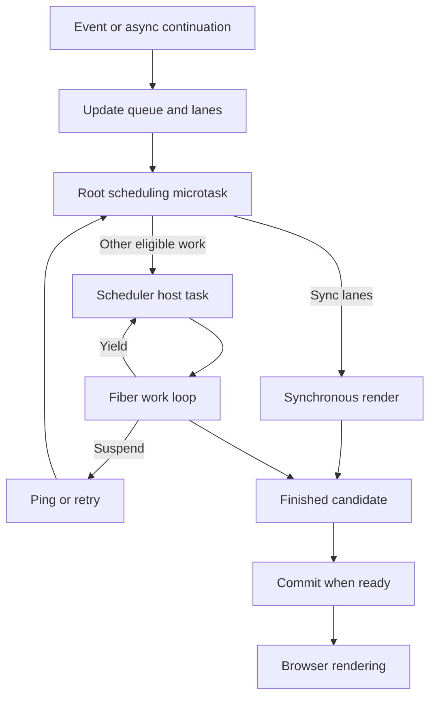
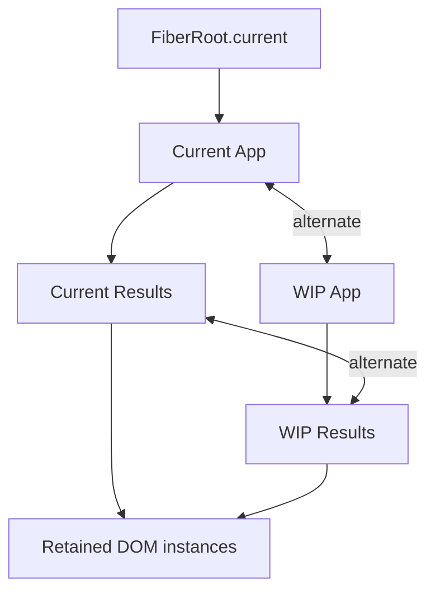
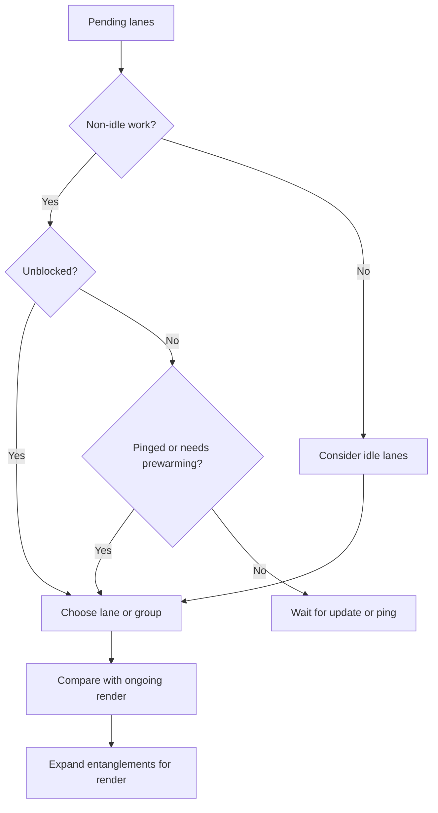
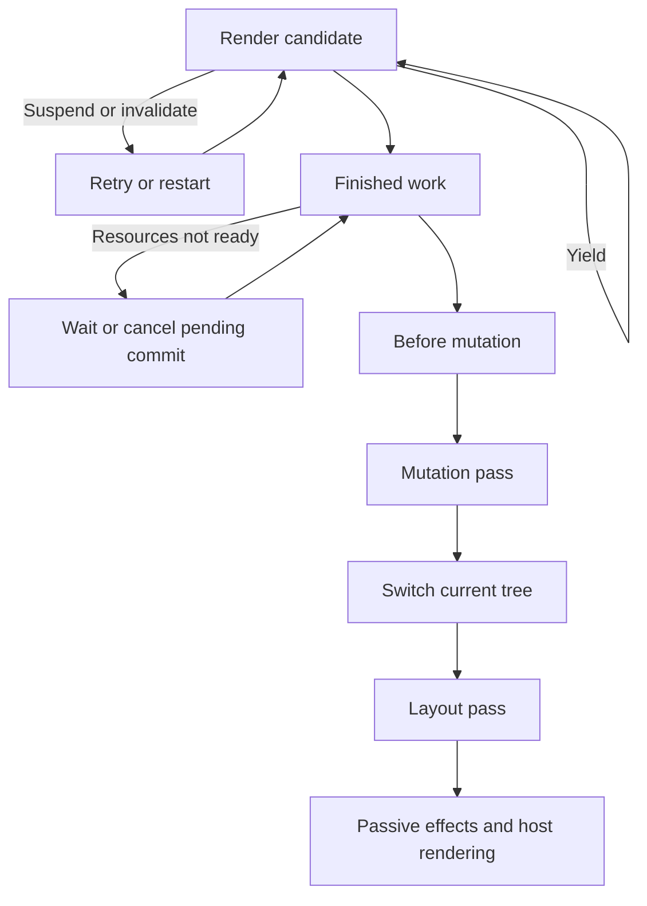
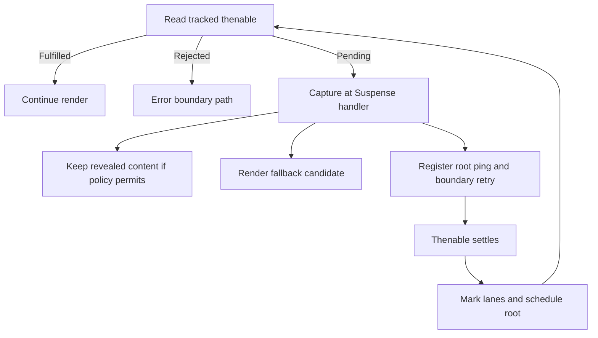
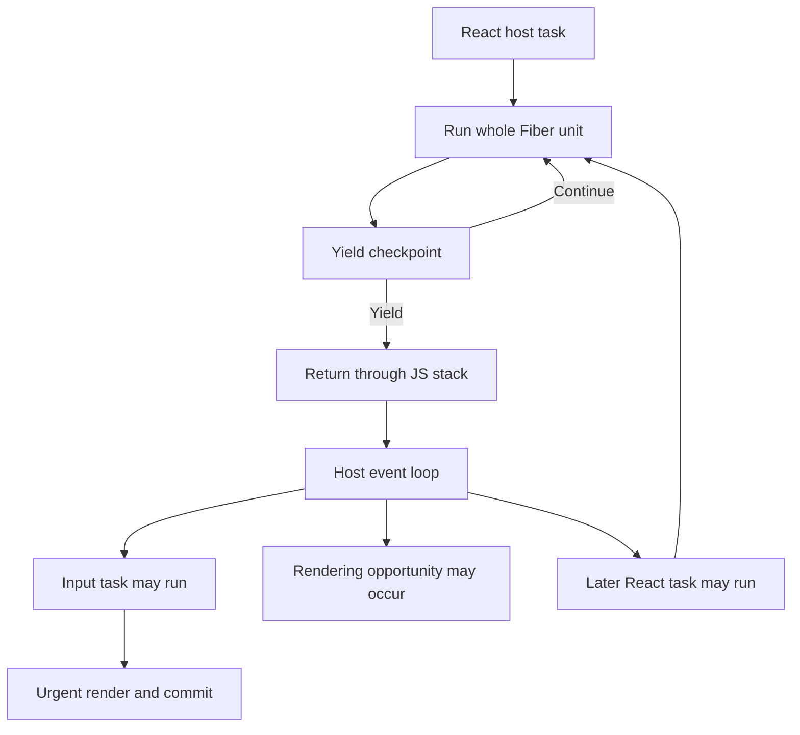

# Concurrent React Internals — Research Dossier

**Source-level study for a senior frontend engineering talk**  
**Research dates:** 18–19 September 2026 (source baseline verified 18 September)  
**Baseline:** React **19.3.0**, tag **`v19.3.0`**, commit **`1d34f91dfde6bba84d08b683aaba164c7194dacb`**  
**Primary scope:** the open-source stable React DOM client renderer. Native, server, development, profiling, experimental and alternate Scheduler builds are identified separately.

### Contents

- [0. Version, evidence, and how to use this dossier](#0-version-evidence-and-how-to-use-this-dossier)
- [1. The complete mental model](#1-the-complete-mental-model)
- [2. Fiber architecture and double buffering](#2-fiber-architecture-and-double-buffering)
- [3. Traversal, units of work, and the actual interruption boundary](#3-traversal-units-of-work-and-the-actual-interruption-boundary)
- [4. JavaScript call stack and browser event loop](#4-javascript-call-stack-and-browser-event-loop)
- [5. Scheduler internals: callbacks, heaps, continuations and host time](#5-scheduler-internals-callbacks-heaps-continuations-and-host-time)
- [6. Root scheduling: why both microtasks and Scheduler exist](#6-root-scheduling-why-both-microtasks-and-scheduler-exist)
- [7. Lanes: a priority and dependency system](#7-lanes-a-priority-and-dependency-system)
- [8. Browser priority, event priority, lanes and Scheduler priority](#8-browser-priority-event-priority-lanes-and-scheduler-priority)
- [9. Main worked example: urgent input and a transition](#9-main-worked-example-urgent-input-and-a-transition)
- [10. Render versus commit, including the 19.3 qualifications](#10-render-versus-commit-including-the-193-qualifications)
- [11. Reconciliation, bailouts and reuse](#11-reconciliation-bailouts-and-reuse)
- [12. Update queues and rebasing](#12-update-queues-and-rebasing)
- [13. Transition internals, Actions and ordering](#13-transition-internals-actions-and-ordering)
- [14. `useDeferredValue`: lane spawning rather than a timer](#14-usedeferredvalue-lane-spawning-rather-than-a-timer)
- [15. Suspense: capture, wakeables, pings and retries](#15-suspense-capture-wakeables-pings-and-retries)
- [16. Offscreen, Activity and View Transitions](#16-offscreen-activity-and-view-transitions)
- [17. Purity, abandoned work and Strict Mode](#17-purity-abandoned-work-and-strict-mode)
- [18. Effects under concurrency](#18-effects-under-concurrency)
- [19. External stores and tearing](#19-external-stores-and-tearing)
- [20. Streaming SSR and selective hydration](#20-streaming-ssr-and-selective-hydration)
- [21. What changed since React 18-era explanations?](#21-what-changed-since-react-18-era-explanations)
- [22. Performance implications: five distinct bottlenecks](#22-performance-implications-five-distinct-bottlenecks)
- [23. Profiling and presentation-ready demonstrations](#23-profiling-and-presentation-ready-demonstrations)
- [24. MiniConcurrentReact: mechanism map and runnable implementation](#24-miniconcurrentreact-mechanism-map-and-runnable-implementation)
- [25. Misconceptions: myth versus mechanism](#25-misconceptions-myth-versus-mechanism)
- [26. Historical evolution and stale vocabulary](#26-historical-evolution-and-stale-vocabulary)
- [27. Source-reading map](#27-source-reading-map)
- [28. Diagram index and slide usage](#28-diagram-index-and-slide-usage)
- [29. Professional talk insights and difficult questions](#29-professional-talk-insights-and-difficult-questions)
- [30. Deliverables, verification and evidence boundaries](#30-deliverables-verification-and-evidence-boundaries)

## 0. Version, evidence, and how to use this dossier

React 19.3.0 is the stable release identified by the [official versions page](https://react.dev/versions) and [release record](https://github.com/react/react/releases/tag/v19.3.0), published 9 September 2026. The tag resolves to the commit above; the downloaded `ReactVersion.js` declares `19.3.0`. The accompanying source manifest records SHA-256 hashes, sizes, line counts and immutable URLs for 68 inspected/downloaded repository files. This is a study of a released revision, not an extrapolation from `main`.

Labels used throughout:

- **PUBLIC CONTRACT** — behavior applications may use through documented stable APIs.
- **CURRENT IMPLEMENTATION** — behavior observed in the pinned source; names, flags, lane bits and heuristics may change.
- **HISTORICAL DETAIL** — useful origin or a superseded implementation.
- **EXPERIMENTAL / CANARY** — code or APIs outside this stable baseline.

Unlabelled teaching deductions explain consequences of the cited mechanisms. Every miniature implementation is an **educational reconstruction**, not copied React source and not a compatible renderer. A source-reading map and immutable reference links appear near the end. All file references in this document refer to the pinned commit unless explicitly marked otherwise.

Three corrections are essential before reading older material:

1. **Independent transitions:** 19.3 enables `enableParallelTransitions`; ordinary transition-update lanes are selected independently. Same-event lane reuse, queue entanglement and overlapping async-Action entanglement still exist. Some current API documentation retains an overbroad caveat that all ongoing transitions are batched. The released code and release record take precedence for this implementation question.
2. **Commit timing:** ordinary DOM commits still run synchronous mutation and layout passes. Stable View Transitions can orchestrate asynchronous waits before and between commit subphases. “Every commit is one uninterrupted JavaScript stack” is too broad for 19.3.
3. **Yield policy:** this stable build has `enableThrottledScheduling = false`. Its concurrent loop consults Scheduler. The separate 25 ms/5 ms loop exists in the source but is not the selected ordinary stable DOM path. Scheduler's default yield threshold is 5 ms; it is not a hard execution limit.

Evidence: [stable exports][exports], [feature flags][flags], [lane grouping][lane-groups], [work-loop selection][work-loops], [Scheduler feature flags][scheduler-flags], and [commit orchestration][commit-orchestration].

## 1. The complete mental model

**CURRENT IMPLEMENTATION.** React maintains a committed model of the UI and can compute a candidate model without immediately exposing it. Updates enter persistent queues. Lanes describe which updates belong to the next attempt. A root scheduler arranges when a root should run; a general-purpose Scheduler arranges host callbacks. The reconciler follows Fiber links to calculate a candidate tree. The renderer applies its effects at commit.

This is speculative calculation with controlled publication. A lower-priority attempt may finish, pause, suspend, restart, or become unnecessary. Its uncommitted component output is not progressively published to the document. The updates that led to it need not disappear when the attempt is abandoned.

| Responsibility | Owner | What it does not do |
| --- | --- | --- |
| Describe desired UI | Component functions and elements | Schedule browser execution by themselves |
| Retain work and tree identity | Fiber objects | Create threads or preempt functions |
| Choose compatible/prioritized updates | Lanes and root lane state | Tell the browser what a transition means |
| Coordinate pending roots | `ReactFiberRootScheduler` | Execute every update immediately |
| Order callbacks and offer yield checkpoints | `scheduler` package | Know components, DOM nodes, hooks or Suspense boundaries |
| Reconcile, traverse, suspend, retry | React reconciler | Own browser paint timing |
| Create/update host objects | DOM host configuration | Make a large layout cheap |
| Run tasks, checkpoints and rendering opportunities | Browser event loop | Promise a paint after every task |
| Calculate style, geometry and pixels | Browser rendering pipeline | Interpret React lane bits |

The ordinary route is: event dispatch → update priority/transition context → update object and lane → enqueue and mark the root → ensure root scheduling → root-scheduling microtask → synchronous flush or Scheduler callback → render work loop → `beginWork` and `completeWork` → completed candidate → commit eligibility → mutation → current-tree switch → layout work → browser rendering opportunities and passive effects.

That route has branches, not a universal fixed timeline. Controlled events may flush sync work before the scheduling microtask. Equal-state updates may bail out early. Suspense may prevent a completed candidate from committing. Passive effects may run before paint. View Transitions may delay a commit sequence.



Source entry points: [Hooks: `dispatchSetState`][dispatch], [ConcurrentUpdates: enqueue and staging][concurrent-queues], [RootScheduler][root-scheduler], [WorkLoop: render policy][work-gate], and [DOM host configuration][dom-host].

## 2. Fiber architecture and double buffering

**HISTORICAL DETAIL.** The stack reconciler expressed much of tree traversal through nested calls. Suspending that traversal while retaining the language call stack was not an available browser JavaScript mechanism. Fiber moved persistent traversal state into heap objects that React can revisit after returning to the host. Fiber shipped in React 16; interruptible public rendering features were not thereby enabled for every React 16 update. See the [React 16 release](https://legacy.reactjs.org/blog/2017/09/26/react-v16.0.html) and Andrew Clark's [architecture notes](https://github.com/acdlite/react-fiber-architecture), which are historical orientation rather than a specification of 19.3.

**CURRENT IMPLEMENTATION.** A Fiber is a record for a position/identity in the reconciled tree. It can represent a function, class, host element, text, root, Fragment, Suspense boundary, Activity, portal or another internal kind. It is not necessarily a component function or a DOM node. Elements are descriptions; Fibers are persistent work records.

| Field | Meaning in the current model |
| --- | --- |
| `tag` | Work category used by `beginWork`, completion and commit switches |
| `key` | Identity among siblings; affects reuse during reconciliation |
| `elementType` | Original element type used in identity matching |
| `type` | Resolved implementation type; may differ for wrappers or lazy types |
| `stateNode` | Tag-dependent instance: DOM node, class instance, root, internal instance |
| `return` | Parent/work-return link for the current traversal |
| `child` / `sibling` / `index` | First child, next sibling and sibling position |
| `ref` / `refCleanup` | Ref and, in current React, possible callback-ref cleanup |
| `pendingProps` | Inputs for this attempted version |
| `memoizedProps` | Inputs represented by the completed/current version |
| `memoizedState` | Tag-dependent state; function components use a hook chain here |
| `updateQueue` | Tag-dependent update/effect structure; not always a state queue |
| `dependencies` | Tracked context and related dependencies |
| `flags` | Work/effect markers on this Fiber |
| `subtreeFlags` | Aggregated descendant markers; enables skipping unaffected branches |
| `deletions` | Children to remove during commit |
| `lanes` | Pending work associated with this Fiber |
| `childLanes` | Pending descendant work aggregated up the tree |
| `alternate` | Other pooled version of the same Fiber identity |
| `mode` | Rendering/development/profiling mode bits |

The full type is [ReactInternalTypes: `Fiber`, L89–210][fiber-type]. The creation and reuse logic is [ReactFiber: `createWorkInProgress`, L323–436][fiber-copy].

The root's `current` points to the committed HostRoot Fiber. React lazily allocates a corresponding work-in-progress Fiber and links the pair with `alternate`. On later attempts it usually reuses that object. “Double buffering” does not mean cloning every DOM node or eagerly copying a complete tree. The current and candidate versions share host instances for retained elements, persistent queue structures, and sometimes child subtrees.

`createWorkInProgress` copies identity, state, queue and lane information from current. It resets per-attempt flags, subtree flags and deletions, preserves static flags, and clones the mutable dependency header. Children initially point to current children and are cloned/reconciled as needed. Profiling durations have their own reset rules. This is carefully controlled sharing, not a deep immutable copy.



The current/WIP names are roles. After commit, the finished tree becomes current; on a later render its former counterpart can be reused as WIP. An abandoned attempt does not become current. Allocation reuse alone says nothing about whether old computed output is still valid.

Educational Fiber:

```js
function createFiber(tag, pendingProps, key = null) {
  return {
    tag, key, elementType: tag, type: tag, stateNode: null,
    return: null, child: null, sibling: null, index: 0,
    ref: null, pendingProps, memoizedProps: null,
    memoizedState: null, updateQueue: null, dependencies: null,
    flags: 0, subtreeFlags: 0, deletions: null,
    lanes: 0, childLanes: 0, alternate: null,
  };
}
```

Production adds tag-specific invariants, hydration, profiling, debugging, refs and renderer behavior. The object is only the storage substrate. **Fiber itself does not schedule anything.**

## 3. Traversal, units of work, and the actual interruption boundary

**CURRENT IMPLEMENTATION.** `performUnitOfWork` calls `beginWork(current, workInProgress, entangledRenderLanes)`, stores the processed props, then either moves to the returned child or completes upward. `beginWork` dispatches by tag: it may execute a function via hooks, process a class/root queue, reconcile children, enter a boundary or bail out. `completeWork` prepares host work and aggregates flags/lanes. `completeUnitOfWork` walks siblings and parents iteratively.

For the requested abstract tree, excluding HostRoot, Fragment and host/text Fibers that real JSX would add, the order is:

| Step | Operation |
| --- | --- |
| 1 | begin App |
| 2 | begin Header |
| 3 | complete Header |
| 4 | begin Results |
| 5 | begin Row A |
| 6 | complete Row A |
| 7 | begin Row B |
| 8 | complete Row B |
| 9 | begin Row C |
| 10 | complete Row C |
| 11 | complete Results |
| 12 | complete App |

Educational traversal:

```js
function performUnitOfWork(unit) {
  const child = beginWork(unit.alternate, unit);
  unit.memoizedProps = unit.pendingProps;
  return child ?? completeUnitOfWork(unit);
}
function beginWork(current, work) {
  const children = runComponentOrProcessHost(work);
  reconcileChildren(current, work, children);
  return work.child;
}
function completeUnitOfWork(unit) {
  let work = unit;
  while (work !== null) {
    completeWork(work.alternate, work);
    if (work.sibling !== null) return work.sibling;
    work = work.return;
  }
  return null;
}
while (nextUnit !== null && !shouldYield()) {
  nextUnit = performUnitOfWork(nextUnit);
}
```

`runComponentOrProcessHost` and `reconcileChildren` above are conceptual placeholders. The runnable renderer later supplies concrete `beginWork` behavior for a fixed search tree.

The important detail is **where the yield check occurs**. In the selected concurrent work loop, it is between `performUnitOfWork` calls. One call can include `beginWork`, a whole function component, reconciliation of a large child array, and a run of ancestor completions. There is not necessarily a checkpoint between every begin and complete operation. Completion can itself spawn further work in production; unwinding a suspended/erroring branch is a separate path.

Sources: [WorkLoop: `workLoopConcurrentByScheduler`, `performUnitOfWork`][work-loops], [WorkLoop: `completeUnitOfWork`][complete-unit], [BeginWork][begin], and [CompleteWork][complete].

**Can React interrupt a component function in the middle? No, not by time slicing.** A call that spends 100 ms computing occupies that JavaScript stack for those 100 ms. React can check the clock only when control returns to it. If the component calls `use` on a pending thenable, an internal exception can unwind the call at that explicit API call. That is suspension through ordinary language control flow, not the scheduler pausing an arbitrary instruction and later restoring its local variables.

```js
function ExpensiveComponent() {
  doCpuWorkFor100ms(); // Occupies the main thread for the entire call.
  return result;
}
```

A parent `.map()` that performs all expensive computation inline has the same limitation. Returning many small `<Row>` elements helps only when expensive work actually happens in separate row component calls; constructing the array and reconciling it still have indivisible portions. Even with many Fibers, the worst individual work segment matters.

## 4. JavaScript call stack and browser event loop

**PUBLIC CONTRACT (platform).** JavaScript execution in a window agent follows run-to-completion semantics for the ordinary callbacks discussed here. Native browser systems may notice input while JavaScript is busy; that does not cause a keyboard handler to run in the middle of the current component's execution. React's answer to single-threaded responsiveness is to return control and arrange a future callback.

A yield proceeds through ordinary returns: the reconciler stops its loop, the root callback returns a continuation, Scheduler arranges another host callback, and the active JavaScript stack unwinds. The host can subsequently dispatch input or perform rendering work. Fiber pointers and other module state retain React's continuation data; the old language call stack does not remain suspended.

| Primitive | Role in this study |
| --- | --- |
| Task, often informally called macrotask | Host-dispatched work such as an input handler, timer or MessagePort delivery |
| Microtask | Promise reactions and `queueMicrotask`; used for root scheduling decisions and sync flushing |
| `MessageChannel` | Ordinary modern-browser Scheduler host-callback mechanism |
| `setImmediate` | Preferred by this Scheduler when available, notably Node; not an ordinary browser standard |
| `setTimeout` | Host fallback and delayed-task wakeups; subject to timer semantics/clamping |
| `scheduler.postTask` | Separate opt-in Scheduler implementation; not the default stable package entry |
| `requestAnimationFrame` | Work associated with rendering opportunities; not the normal reconciler work-loop driver |
| `requestIdleCallback` | Not the current default React Scheduler implementation |
| Web Worker | Separate agent useful for explicitly offloaded app computation; React transitions do not automatically use one |

The [HTML event-loop model](https://html.spec.whatwg.org/multipage/webappapis.html#event-loop-processing-model) describes task selection, microtask checkpoints and rendering opportunities. Multiple task sources exist; do not teach a single universal FIFO “macrotask queue.” A later MessageChannel callback is an opportunity for interleaving, not a guarantee that a waiting input or paint wins next. See also [MessageChannel](https://developer.mozilla.org/en-US/docs/Web/API/MessageChannel).

A possible timeline, with order constrained but durations illustrative:

| Execution turn | Stack activity | State visible to the application |
| --- | --- | --- |
| Input task A | React dispatch → handler → enqueue input and transition; controlled-event cleanup may sync-flush | Input `a`, prior results |
| Microtask checkpoint | Process root schedule; choose remaining transition lanes | Prior results |
| MessagePort task | Several Fiber units; deadline check; return continuation | Prior results |
| Between tasks | Host chooses another runnable task; rendering may be possible | No partial transition result |
| Input task B | Handle next input; enqueue `ab`; urgent render and commit | Input `ab`, prior results |
| Microtask checkpoint | Reschedule outstanding lower-priority work | Same |
| Later MessagePort tasks | Restart/rebase if necessary; continue slices | Same until commit |
| Final render callback | Finish candidate; ordinary commit may run immediately | Results `ab` published |
| Rendering opportunity | Style, layout, paint and compositing as required | New pixels can appear |

“Task ends → paint → next task” is not a promise. A long chain of microtasks can postpone both input tasks and rendering. Replacing every work slice with `queueMicrotask` or `await Promise.resolve()` would not provide the same responsiveness boundary as yielding to a host task.

This is **cooperative scheduling**: code voluntarily checks and returns. Preemptive scheduling would allow an execution authority to suspend arbitrary code without its cooperation. React does not implement that for your JavaScript component functions. Operating-system preemption of a browser thread is a different concept and does not let React dispatch another handler into the interrupted JavaScript stack.

## 5. Scheduler internals: callbacks, heaps, continuations and host time

**CURRENT IMPLEMENTATION.** The default `scheduler` entry exports `src/forks/Scheduler.js`. React's root scheduler submits a callback for work on a root, not one callback for every component. Scheduler has no Fiber or transition-state model.

Its task record contains an ID, callback, priority level, start time, expiration time and heap sort index. There are two min-heaps:

- **`timerQueue`:** delayed tasks, sorted by start time. A timer wakes Scheduler when delayed work becomes eligible.
- **`taskQueue`:** eligible work, sorted by expiration time, with task ID as a tie-breaker. `advanceTimers` moves ready delayed tasks into this queue.

The priority influences the initial timeout used to calculate expiration; the heap orders deadlines rather than simply sorting five enum labels. [Scheduler: `advanceTimers`, `flushWork`, `workLoop`][scheduler-work], [callback creation][scheduler-schedule], [heap implementation][scheduler-heap].

| Scheduler priority | Timeout used for a newly eligible callback |
| --- | --- |
| Immediate | −1 ms; already expired |
| UserBlocking | 250 ms |
| Normal | 5,000 ms |
| Low | 10,000 ms |
| Idle | Very large sentinel; conceptually non-expiring for normal interactions |

These are implementation deadlines, not prescribed callback delays, input-latency guarantees, or time-slice sizes. A Normal callback can run immediately when the host gives it time. The root's lane expiration mechanism is distinct from Scheduler callback expiration.

The main call path is `performWorkUntilDeadline` → `flushWork` → Scheduler `workLoop` → the submitted root callback. Before non-expired tasks, Scheduler can check `shouldYieldToHost`. The callback can return another function. That continuation is saved on the same task, and this implementation immediately returns to the host, even if time remains in the slice. Cancellation normally nulls the callback; it does not abort an executing JavaScript stack.

Host callback selection in the inspected build:

1. Use captured `setImmediate` if available.
2. Otherwise create a `MessageChannel` and invoke work through its receiving port.
3. Otherwise fall back to `setTimeout(..., 0)`.

MessagePort delivery supplies another host task without recursive JavaScript calls and avoids the nested-timer clamping that motivates the comment in Scheduler. It neither assigns lane priorities nor decides which UI to retain. Node's `setImmediate` preference also avoids keeping a process alive through MessageChannel ports. [Scheduler: host integration, L450–583][scheduler-host].

**The stable 5 ms threshold, precisely:** `frameYieldMs = 5`; a host callback records `startTime`; `shouldYieldToHost` returns true when enough time has elapsed, or earlier when the enabled paint-request flag requires a yield. The reconciler consults this predicate only at cooperative checkpoints. A 100 ms component, a long reconciliation loop, completion work, synchronous renders, expired work and commits can exceed 5 ms. A fast render can finish sooner; a continuation can yield sooner. The budget is not synchronized to display refresh.

**EXPERIMENTAL / CANARY.** `enableAlwaysYieldScheduler` is experimental; `enableThrottledScheduling` is false in this stable OSS reconciler. The latter selects an alternate loop with 25 ms for non-idle work and 5 ms for idle work. Finding that function in the repository is insufficient evidence that a stable app uses it. Similarly, `SchedulerPostTask.js` backs a separate `scheduler/unstable_post_task` entry. The normal package does not automatically switch to `postTask` merely because the browser has it. [Flags][flags], [Scheduler flags][scheduler-flags], [PostTask fork][scheduler-posttask], [default Scheduler entry][scheduler-entry].

This runnable teaching scheduler models the host boundary and continuation protocol. It deliberately uses a FIFO array and one budget instead of two heaps, five priorities and expiration:

```js
export function createScheduler({
  now = () => performance.now(),
  postTask, budgetMs = 5,
} = {}) {
  let close = () => {};
  if (!postTask) {
    const channel = new MessageChannel();
    const posted = [];
    channel.port1.onmessage = () => posted.shift()?.();
    postTask = callback => { posted.push(callback); channel.port2.postMessage(0); };
    close = () => { channel.port1.close(); channel.port2.close(); };
  }
  const queue = [];
  let posted = false, deadline = 0;
  const shouldYield = () => now() >= deadline;
  function request() {
    if (!posted && queue.length) { posted = true; postTask(workLoop); }
  }
  function workLoop() {
    posted = false;
    deadline = now() + budgetMs;
    try {
      while (queue.length) {
        const task = queue[0];
        if (!task.callback) { queue.shift(); continue; }
        if (shouldYield()) break;
        const callback = task.callback;
        task.callback = null;
        const continuation = callback();
        if (typeof continuation === 'function' && !task.cancelled) {
          task.callback = continuation;
          break; // A continuation always gets a fresh host task.
        }
        queue.shift();
      }
    } finally { request(); }
  }
  function schedule(callback) {
    const task = {callback, cancelled: false};
    queue.push(task); request(); return task;
  }
  function cancel(task) { if (task) { task.cancelled = true; task.callback = null; } }
  return {schedule, cancel, shouldYield, close};
}
```

The injected `postTask` here means “enqueue a host callback” for testing; it is not necessarily the browser `scheduler.postTask` API. In the browser default, it uses `MessageChannel`.

## 6. Root scheduling: why both microtasks and Scheduler exist

**CURRENT IMPLEMENTATION.** `ensureRootIsScheduled` inserts a root into a linked schedule if necessary and ensures a root-scheduling microtask is pending. The global schedule deduplicates roots; `root.next` links them. The microtask deduplication flag is independent from each root's `callbackNode` and `callbackPriority`.

`processRootScheduleInMicrotask` walks scheduled roots, marks starved lanes, obtains the next lanes and updates each root's callback. Roots with no schedulable work are removed. At the end it flushes eligible sync work across roots, unless a pending asynchronous commit sequence prevents doing so. It also resets the cached event transition lane. The comment about resetting when entering the concurrent loop is older than the actual reset location; read executable code, not that comment alone. [RootScheduler: microtask processing][root-microtask], [transition-lane allocation][transition-lane].

`root.callbackPriority` stores a representative **lane**, not a Scheduler priority enum. If the highest-priority lane is unchanged, an existing callback can be reused. If priority changes, React cancels/replaces the callback. When the callback eventually runs, lanes are selected again: the pending state may have changed since scheduling. The callback also flushes pending effects where needed and checks whether doing that replaced the callback.

Ordinary sync lanes require no extra Scheduler task; the microtask flush handles them. Other eligible lanes map to Scheduler priority and use `performWorkOnRootViaSchedulerTask`. After a partial render, that function checks whether the root still owns the same callback; if so it returns a continuation. [RootScheduler: `scheduleTaskForRootDuringMicrotask`][root-task], [root callback][root-callback].

A crucial distinction: **scheduled asynchronously does not mean rendered interruptibly**. `DefaultLane` or a continuous-input lane can enter through a Scheduler callback, yet `performWorkOnRoot` selects the synchronous Fiber loop because the lanes are classified as blocking. Explicit transition/retry/deferred work is what commonly selects time slicing. The decision also considers expiration, forced sync, and prerendering. [WorkLoop: `performWorkOnRoot`][work-gate], [Lane: blocking lanes][blocking-lanes].

Conceptual pseudocode:

```js
function ensureRootIsScheduled(root) {
  scheduledRoots.add(root);
  if (!microtaskPending) {
    microtaskPending = true;
    queueMicrotask(processRootSchedule);
  }
}
function processRootSchedule() {
  microtaskPending = false;
  for (const root of scheduledRoots) {
    markExpiredLanes(root);
    const lanes = getNextLanes(root);
    if (!lanes) removeOrUnschedule(root);
    else if (includesSyncLane(lanes)) cancelRootCallback(root);
    else scheduleOrReuseRootCallback(root, lanes);
  }
  flushEligibleSyncRoots();
}
```

This omits multi-root reentrancy guards, passive-effect handling, pending commits, hydration and eager `popstate` transition work. In development `act` uses a testing queue and can bypass normal yielding. Tests wrapped in `act` are therefore not measurements of actual host time slicing.

**Controlled-input exception:** `ReactDOMUpdateBatching.finishEventHandler` checks whether controlled state needs restoration. If so, it calls `flushSyncWork()` before restoring the DOM value. In the main example the urgent commit can happen during event cleanup, before the root-scheduling microtask. Do not draw all text-input commits exclusively inside that microtask. [Controlled-event batching][controlled-batching].

## 7. Lanes: a priority and dependency system

**CURRENT IMPLEMENTATION.** A lane is one bit; a lane set is a bitmask. The 31 usable bits allow inexpensive set operations in JavaScript's signed 32-bit bitwise arithmetic without using the sign bit. Lower set-bit positions generally represent higher priority, but selection applies grouping and state rules.

```js
const merged = lanes | lane;       // Union / add membership.
const overlap = lanes & lane;      // Intersection; nonzero means overlap.
const highest = lanes & -lanes;    // Isolate the least-significant set bit.
const remaining = lanes & ~lane;   // Remove membership.
const containsAll = (set & subset) === subset;
```

`NoLane = 0` has special queue-replay semantics because zero is a subset of every set. Testing inclusion with only `(lane & renderLanes) !== 0` would incorrectly skip those replay updates.

The exact 19.3.0 layout is below. It is **not a public API**, and toy snippets use smaller illustrative masks.

| Bit position, zero-based | Lane/group | Purpose |
| --- | --- | --- |
| 0 | SyncHydration | Urgent hydration |
| 1 | Sync | Discrete urgent updates |
| 2 | InputContinuousHydration | Continuous-priority hydration |
| 3 | InputContinuous | Continuous interaction updates |
| 4 | DefaultHydration | Default-priority hydration |
| 5 | Default | Ordinary update priority |
| 6 | Gesture | Reserved path for experimental gesture transitions |
| 7 | TransitionHydration | Hydration promoted relative to a transition |
| 8–17 | TransitionLane1–10 | Transition **update** lanes |
| 18–21 | TransitionLane11–14 | Transition **deferred** lanes |
| 22–25 | RetryLane1–4 | Suspense boundary retries |
| 26 | SelectiveHydration | Selective hydration work |
| 27 | IdleHydration | Idle hydration |
| 28 | Idle | Idle work |
| 29 | Offscreen | Hidden/prerender and certain hydration work |
| 30 | Deferred | Marker entangled with spawned deferred work |

This is 14 transition bits partitioned into 10 update lanes and 4 deferred lanes, not the familiar older diagrams with 16 interchangeable transition lanes. `DeferredLane` is not simply “the lane returned by every `useDeferredValue`.” That hook normally obtains a transition-deferred lane; the high Deferred bit marks its origin and prevents cascaded deferral waterfalls. [Lane constants and grouping, L41–240][lane-groups], [deferred marking][deferred-mark], [WorkLoop: `requestDeferredLane`][request-deferred].

Root state has several different masks:

| Root field | Question it answers |
| --- | --- |
| `pendingLanes` | Which lanes still have outstanding work? |
| `suspendedLanes` | Which attempted lanes could not complete/reveal yet? |
| `pingedLanes` | Which suspended lanes have been notified that they may proceed? |
| `warmLanes` | Which suspended lanes have already received speculative/prewarming attention? |
| `expiredLanes` | Which CPU-bound lanes have waited long enough to require stronger completion treatment? |
| `entangledLanes` and `entanglements` | Which lanes have relationships requiring additional updates in a render batch? |
| `expirationTimes` | Per-lane expiration timestamps, separate from Scheduler task deadlines |

A pending lane need not be runnable; a ping is not proof that every dependency is ready. It authorizes another attempt. Retry rendering can suspend again.

`getNextLanes` first examines non-idle pending work. It prefers unblocked work, then pinged work, then work needing prewarming if no completed candidate is waiting to commit. Idle work is considered when no non-idle work remains. It chooses a lane/group and compares it with ongoing work: a lower/equal-priority arrival generally does not discard a viable active attempt. There is a specific exception preserving a transition against an interrupting Default update. [Lane: `getNextLanes`, L249–360][next-lanes].

The selector is more than `pending & -pending`: `getHighestPriorityLanes` groups pending Sync/InputContinuous/Default update lanes; ordinary transition-update lanes are selected individually with the parallel-transitions flag on; deferred transition lanes and retry lanes have their own group selection. This does not remove later entanglement expansion. A synchronous root flush also has a separate `getNextLanesToFlushSync` selection path.

Expiration: Sync and continuous groups use 250 ms; Default and transition lanes use 5,000 ms. Retry expiration is disabled in this release; hydration/idle/offscreen/marker lanes have category-specific non-expiring cases. React starts clocks for work it can treat as CPU-bound and checks them during scheduling. Expiration is not a promise to finish by a wall-clock deadline or a timeout for unresolved data. Its key effect here is disabling time slicing when expired lanes are rendered; it does not simply rewrite every expired bit to `SyncLane`. [Lane: expiration][lane-expiration], [work-loop gate][work-gate].

Entanglement is dependency tracking. When multiple transition updates affect one hook queue, `entangleTransitionUpdate` combines its still-pending transition lanes and calls `markRootEntangled`. Transitive relationships are propagated. `prepareFreshStack` computes `entangledRenderLanes` separately from the root's scheduling lanes so that included updates need not determine the scheduling priority of the attempt. [Hooks: queue entanglement][hook-entanglement], [Lane: entanglement expansion][entangled-lanes], [fresh-stack setup][fresh-stack].

Transition allocation rotates through a finite pool; same-event updates reuse a cached lane. Overlapping async Actions can reuse their shared action lane. A lane is therefore neither a globally unique transition ID nor an immutable numeric “urgency score” for a user operation.



A useful miniature, intentionally without warm lanes, grouping, expiration or entanglement:

```js
const NoLane = 0, SyncLane = 1, TransitionLane = 2, IdleLane = 4;
const mergeLanes = (a, b) => a | b;
const getHighestPriorityLane = lanes => lanes & -lanes;
function getNextLanes(root) {
  const unblocked = root.pendingLanes & ~root.suspendedLanes;
  const pinged = root.pendingLanes & root.pingedLanes;
  return getHighestPriorityLane(unblocked || pinged);
}
```

## 8. Browser priority, event priority, lanes and Scheduler priority

**CURRENT IMPLEMENTATION.** These are separate abstractions. Browser task prioritization decides which host work runs. React classifies an event while dispatching it. Update-lane selection also checks transition context. The root later translates selected lane groups into a much coarser Scheduler priority.

| Origin / selected work | React priority or lane | Root scheduling route | Render loop, ordinary case |
| --- | --- | --- | --- |
| Click, keydown, input/change | Discrete → SyncLane | Sync flush; no ordinary Scheduler callback needed | Synchronous |
| Pointer movement, scroll, wheel | Continuous → InputContinuousLane | Scheduler UserBlocking | Blocking/synchronous Fiber render in this baseline |
| Ordinary update outside an explicit higher priority | DefaultLane | Scheduler Normal | Blocking/synchronous Fiber render in this baseline |
| `setState` inside transition context | Transition update lane | Scheduler Normal | Concurrent unless forced/expired or otherwise exceptional |
| Deferred follow-up | Transition-deferred lane, or Offscreen when appropriate | Usually Normal, or Idle for Offscreen | Usually concurrent |
| Suspense retry | Retry lane | Scheduler Normal | Usually concurrent; separate retry policies apply |
| Idle / Offscreen | Corresponding low lane | Scheduler Idle | Usually concurrent |
| Sync work intentionally prerendered | Sync-class lane | UserBlocking on the callback path | Concurrent prerender exception |

Sources: [DOM event classification][event-priority], [event-to-lane and lane-to-event conversion][event-lane], [requestUpdateLane][request-lane], [root mapping][root-task], [render-loop choice][work-gate]. Hydration lanes require their own classification; a blocked boundary can be promoted for the triggering event.

**`TransitionLane !== Scheduler LowPriority`.** Transition work normally reaches Scheduler as **NormalPriority**. Default work can also be NormalPriority yet use a synchronous reconciler loop. Scheduler priority alone cannot explain whether a UI update is interruptible, allowed to retain stale content, blocked by Suspense, or entangled with another update.

In the example, the browser dispatches an input event. React temporarily sets DiscreteEventPriority. `setInput(value)` selects SyncLane. `startTransition` installs a transition context, so `setQuery(value)` takes a transition lane despite the surrounding discrete event. React restores context after each scope. The urgent update flushes; remaining transition work is submitted at Scheduler NormalPriority. A single event has produced two update classes, without the browser learning either lane number.

## 9. Main worked example: urgent input and a transition

**PUBLIC CONTRACT / CURRENT IMPLEMENTATION.** Start with the requested program:

```jsx
function Search() {
  const [input, setInput] = useState('');
  const [query, setQuery] = useState('');
  function onChange(e) {
    const value = e.target.value;
    setInput(value);
    startTransition(() => setQuery(value));
  }
  return <>
    <input value={input} onChange={onChange} />
    <SlowResults query={query} />
  </>;
}
```

One qualification determines whether this is a good demo: **the unchanged results need a bailout during urgent renders**. A normal child function can run again when its parent renders even if its scalar prop is unchanged. Use `const SlowResults = memo(Results)` with stable props, a compiler-provided equivalent where applicable, or suitable state/tree organization. Otherwise the urgent update may synchronously traverse an expensive old-query subtree. A transition does not automatically memoize it. The expensive work must also be spread across row component calls, rather than performed entirely inside `Results` before returning its children. [Bailout logic][bailout]

For the trace below assume: a modern root; a memoized results subtree; pure rows; no suspension, expiration or View Transition; first transition unfinished when the second input event runs. Typing `a` then the character `b` means the second input value is **`ab`**, not `b`.

### A. React architecture

1. The browser changes the native input value and dispatches an input event. React's event system invokes the change handler under discrete priority. `setInput('a')` enqueues a Sync-lane update on the first hook queue.
2. `startTransition` runs its callback immediately with transition context installed. `setQuery('a')` receives transition lane T1 and is appended to the second hook queue. This does not compute results yet and does not schedule a separate browser task for that specific setter.
3. The root is marked pending with Sync and T1. Sync rendering processes the input update and skips the query update. The new candidate has input `a`, query `''`. With memoization, the expensive results subtree can bail out. The urgent commit reflects the controlled value without publishing speculative results.
4. Controlled-event completion may force that synchronous flush before returning from event dispatch; otherwise the root-scheduling machinery handles eligible sync work. The scheduling microtask arranges the remaining T1 callback at Scheduler Normal priority.
5. The transition attempt starts from committed current state. It processes the retained query update and computes a candidate with input `a`, query `a`. Each row's complete function call finishes before React can check whether to yield. Completion can walk several ancestors without another check.
6. A yield leaves `workInProgress` pointing to the next unit. No partial row output from that candidate has been inserted into the connected UI. The root callback returns its continuation and the host task ends.
7. A later browser input task dispatches the new value `ab`. It queues urgent input `ab` and transition query `ab`. A distinct event can allocate T2. These two query updates share a hook queue: `entangleTransitionUpdate` can couple its still-pending T1 and T2 lanes. The 19.3 parallel-transition feature does not make successive edits to one state queue independently publishable in all circumstances.
8. The urgent lane outranks the transition attempt. The root restarts from the committed tree for the urgent render. Speculative `a` results are not made current. The query queue preserves skipped updates; the urgent candidate is input `ab` with the last committed query/results.
9. After the urgent commit, the selected transition lane set is expanded by applicable entanglements. The query queue processes the pending `a` and `ab` replacements in insertion order. Its resulting value is `ab`. This new attempt can yield and resume repeatedly, then commit its completed results.
10. The browser may paint intermediate urgent commits and the final results at subsequent rendering opportunities. React does not promise a separate paint for every commit. If `a` had completed before the second event, showing `a` results briefly would have been valid; this trace deliberately assumes it had not.

Source chain: [event dispatch][event-priority] → [hook dispatch][dispatch] → [transition lane allocation][transition-lane] → [queue entanglement][hook-entanglement] → [lane selection][next-lanes] → [fresh stack][fresh-stack] → [work-loop continuation][root-callback] → [commit][commit-orchestration].

### B. JavaScript stack and event loop

```mermaid
sequenceDiagram
  participant Host as Browser
  participant React as React execution
  participant UI as Committed UI
  Host->>React: Input a task
  React->>UI: Urgent commit, input a
  React-->>Host: Return; root scheduling microtask
  Host->>React: Scheduler host task
  React->>React: Begin and complete several Fibers
  React-->>Host: Yield and return continuation
  Host->>React: Input ab task
  React->>UI: Urgent commit, input ab
  React-->>Host: Return; schedule transition
  Host->>React: Later host tasks
  React->>React: Restart, then resume slices
  React->>UI: Commit results ab
  React-->>Host: Return; paint may follow
```

The diagram shows one legal task selection, not a browser scheduling guarantee. An event cannot be processed while React is still inside an expensive row call. “Input interrupts rendering” describes the priority change between execution turns, not an input handler interrupting the active JavaScript stack.

### C. Current and work-in-progress

| Moment | Committed current | Candidate WIP | What can be retained |
| --- | --- | --- | --- |
| Before typing | input `''`, query `''` | None | Current Fibers and host instances |
| After urgent `a` | input `a`, query `''` | Transition `a` begins | Unchanged results can be reused during urgent work |
| At a yield | Same current | Some `a` Fibers computed; next pointer retained | Same-attempt progress, queues, allocated alternates |
| During urgent `ab` | Still previous current until commit | New urgent attempt based on current | Queue history and valid unchanged subtrees |
| After urgent `ab` | input `ab`, old query | Lower-priority attempt must reflect this current | Alternate storage; eligible bailouts, not arbitrary stale results |
| Final commit | input `ab`, query `ab` | Finished candidate becomes current | Previous current becomes the reusable alternate side |

The statement “Fiber 1 and 2 finished; Fiber 3 had not started; then the old transition is canceled” is a useful storyboard for abandoned **speculative output**. It is inaccurate if it implies a transaction object was canceled, update records were erased, all allocated objects were discarded, every completed subtree is always unusable, or the network request was aborted. React can cancel a Scheduler callback and abandon a particular render attempt while preserving its updates for rebasing. Another case with no higher-priority change simply resumes the same WIP at Fiber 3.

**Fiber 3 cannot be paused halfway through an ordinary component call.** If it runs for 100 ms, input waits until that work returns and React eventually yields. This remains true when the call belongs to a transition.

## 10. Render versus commit, including the 19.3 qualifications

**CURRENT IMPLEMENTATION.** Render executes components, reads state/context, processes queues, reconciles identities, constructs candidate Fibers and records work flags. Its host behavior depends on whether it is mounting, updating or hydrating.

| Work | Ordinary render behavior | Publication behavior |
| --- | --- | --- |
| Existing host element | Compare relevant inputs and mark update work | DOM property changes occur in commit |
| New host element | `completeWork` can create a detached DOM instance, append detached children and initialize it | Placement into the connected parent occurs in commit |
| Host text | Compute/prepare candidate text work | Retained text-node update occurs in commit |
| Hydration | Match and inspect existing server nodes; maintain hydration state | Required changes and attachment effects follow hydration/commit rules |
| Resources and hoistable/singleton host features | Renderer-specific preparation, preloading and specialized paths | Broader than the simple detached-element model |

Do not say “render never calls a DOM API.” A newly mounted detached element is a DOM object. Say **render does not progressively publish ordinary component results into the live UI**. In this tag, `updateHostComponent` in `completeWork` marks an update when old/new props differ; old tutorials about calculating a DOM `prepareUpdate` payload in render do not accurately describe this current DOM path. The host's `commitUpdate` calls its property update machinery. [Host completion][host-complete], [host update flag][host-update], [DOM host configuration][dom-host]

The ordinary commit sequence is:

| Phase | Representative work | Timing and yield behavior |
| --- | --- | --- |
| Before mutation | Class `getSnapshotBeforeUpdate`; host preparation and transition-related reads | Synchronous traversal; no Fiber time slicing |
| Mutation | Placements, updates, deletions, visibility; relevant effect cleanup and ref detachment | Synchronous traversal once entered |
| Current switch | `root.current = finishedWork` after mutation | The finished tree becomes the root's committed model |
| Layout | Layout-effect setup, class layout lifecycles, ref attachment and related work | Synchronous traversal; can schedule sync updates |
| After mutation / spawned work | Newer orchestration, View Transition callbacks, paint request and scheduling | Version- and feature-dependent orchestration |
| Passive effects | Passive cleanup and setup | Scheduled/flushed separately; not invariably after paint |

Ref work is distributed: an old ref may detach during mutation, and a new one attach during layout. Callback refs may return cleanup functions. The current switch occurs before layout effects observe the new tree. Insertion-effect handling participates in commit ordering and exists for style insertion before layout effects read layout; applications should not infer a universal all-components “DOM already updated” point for each insertion effect. [Mutation/current/layout][mutation-layout], [commit effects and refs][commit-effects]



The bottom of this diagram summarizes the ordinary path; it does not impose passive-effects-versus-paint ordering.

**19.3 exception to a common slogan.** `completeRootWhenReady` can wait for commit-blocking resources before entering commit. Stable View Transition integration additionally calls the browser's View Transition API and supplies mutation, layout, after-mutation, spawned-work and passive callbacks. The DOM implementation can wait for fonts/images between mutation and layout through promises. That is an actual asynchronous commit orchestration path, not time slicing of the mutation traversal. Pending-commit checks prevent conflicting React work from proceeding through an incompatible phase; some guards affect other roots too. Distinguish “this mutation pass cannot yield” from “every commit always occupies one uninterrupted task.” [Commit readiness][commit-ready], [commit orchestration][commit-orchestration], [DOM View Transition path][dom-view-transition], [pending-commit scheduling guard][root-callback]

A huge render can have a huge synchronous commit, but this is **possible, not inevitable**. Ten thousand expensive components may calculate output identical to the current DOM. Conversely a cheap render can request twenty thousand insertions. Render CPU, mutation volume and browser rendering cost are separate axes.

| Cost | Can ordinary concurrent rendering distribute it? | Typical intervention |
| --- | --- | --- |
| Many independent render units | Yes, between units | Transitions plus small units and urgent-path bailouts |
| One long component call or child reconciliation loop | No interruption inside the call | Better algorithm, less work, explicit chunking outside render, Worker |
| A large ordinary mutation pass | No Fiber time slicing inside it | Fewer mounted nodes, virtualization, pagination |
| Layout effects and synchronous reads/writes | No | Reduce effect work; avoid layout thrashing |
| Browser style, layout and paint | React does not schedule their internals | Smaller/contained DOM, appropriate CSS, simpler painting |
| Compositing and animation | Browser/GPU pipeline dependent | Appropriate animation properties and measurement |

React may trigger layout earlier than the browser's natural rendering phase if code reads geometry after writes. “The commit was short” therefore does not prove the frame or interaction was cheap. View Transitions can improve visual continuity, but snapshots, layout and animation still have costs.

## 11. Reconciliation, bailouts and reuse

**CURRENT IMPLEMENTATION.** Reconciliation matches new children to existing Fibers using parent position, keys and compatible types. A key is scoped to its siblings; it is not a global identity. Stable keys allow state and host identity to survive suitable reordering. A changed key/type generally requests a new identity. Array reconciliation first exploits an ordered matching prefix, then can map remaining children. It records placement/movement and deletions; it does not solve an arbitrary globally minimal DOM-edit problem. [Child reconciliation][child-reconcile]

`flags` describe work on a Fiber. `subtreeFlags` aggregate descendant work so commit traversals can skip unaffected branches. `lanes` and `childLanes` serve a different purpose: deciding whether render work exists locally or below. A parent that can bail out locally may still need to clone/traverse children whose `childLanes` intersect the selected work. Context propagation and hook dependencies also matter. A memoized prop comparison is not permission to ignore a descendant's own update. [BeginWork bailout][bailout], [completion aggregation][bubble]

Useful distinctions when answering “is work thrown away?”:

- **Yield without invalidation:** keep the WIP pointer and continue the same attempt on a later host callback.
- **Priority/root/selected-lane change requiring a fresh stack:** reconstruct the attempt from current, resetting render-stack state. Old speculative computations may run again.
- **Alternate-object reuse:** retain allocated Fiber objects while resetting their attempt-specific contents. This saves allocation; it does not certify computed output.
- **Bailout/subtree reuse:** skip work where props, dependencies and pending lanes permit it. Shared current children are real reuse, not an abandoned result being published accidentally.
- **Queue preservation:** retain updates and base history across skipped lanes and restarts. Losing a candidate is different from losing user intent.
- **Suspended-tree behavior:** retries, hidden trees and boundary state have additional reuse rules; an initial mount that never committed does not promise preservation of its component state across suspension.

A transition repeatedly interrupted by typing may therefore compute some rows several times. It may also skip large unchanged parts. Both “always starts exactly where it stopped” and “always throws every object and calculation away” are false. Use a trace of the particular root, render lanes, committed tree and boundary conditions to answer the question. [Fresh stack][fresh-stack], [concurrent render entry][concurrent-entry], [Fiber pooling][fiber-copy]

## 12. Update queues and rebasing

**CURRENT IMPLEMENTATION.** Hook state queues are not sorted by priority. Updates preserve enqueue order. Priority determines which updates are eligible in the current render, while a base queue retains enough history to later compute the result in the original order.

For state initially `1`, enqueue:

| Update | Lane | Action |
| --- | --- | --- |
| A | Transition | `s => s + 10` |
| B | Sync | `s => s * 2` |
| C | Transition | `s => s + 1` |

A Sync-only render skips A, remembers base state `1`, applies B to obtain visible state `2`, and skips C. The retained queue is **A(T), B(NoLane), C(T)**. B is retained even though its effect is now committed: after replaying A later, B must run again to preserve order. `NoLane` makes that clone eligible in later rebasing passes; it does not represent new urgent work.

The transition render starts from base state `1`: A produces `11`, replayed B produces `22`, C produces `23`. Simply applying A and C to the already visible `2` would produce `13`, which is wrong. This noncommutative example exposes the mechanism better than three increments.

`updateReducerImpl` merges the hook's circular pending queue with its base queue, preserves it on current as needed for interrupted work, then walks it. The first skipped update fixes the new base state. Skipped updates keep their lane; subsequently included updates receive replay clones with `NoLane`. The new state and base queue become part of the WIP hook. Optimistic updates introduce an additional `revertLane` case, and hidden updates use an Offscreen marker. [Hooks queue algorithm, L1316–1588][hook-queue]

Class/root queues use a related persistent base-list design, with a circular shared pending queue and explicit callback handling. A callback for an already committed update is cleared in the replay clone so it is not fired twice. Do not copy a hook queue diagram and label it the exact data structure for every Fiber tag. [Class/root queue algorithm][class-queue]

Runnable educational algorithm, also used by the supplied renderer:

```js
export function processQueue(baseState, updates, renderLanes) {
  let state = baseState, nextBaseState = baseState, skipped = false;
  const baseQueue = [];
  for (const update of updates) {
    const include = update.lane === NoLane ||
      (update.lane & renderLanes) === update.lane;
    if (!include) {
      if (!skipped) nextBaseState = state;
      skipped = true;
      baseQueue.push({...update});
    } else {
      state = update.action(state);
      if (skipped) baseQueue.push({...update, lane: NoLane});
    }
  }
  return {state, baseState: skipped ? nextBaseState : state, baseQueue};
}
```

The miniature uses arrays and immutable queue processing. Production stages concurrent updates, uses linked/circular structures, tracks eager state and reducers, supports render-phase updates, entangles transitions and handles hidden/optimistic updates. In the toy, the draft snapshots pending length and consumes that prefix only when committed. An update arriving after the snapshot remains pending. That protects against a common broken teaching implementation that deletes all pending updates after an interrupted render.

A subtle purity consequence: eligible state updaters may execute more than once, and `dispatchSetStateInternal` can eagerly calculate state during dispatch when queue conditions permit. Therefore “updater functions only run in the render phase” is also too absolute. They must remain pure regardless of this optimization. [Dispatch/eager state][dispatch]

## 13. Transition internals, Actions and ordering

**PUBLIC CONTRACT.** `startTransition` marks updates performed in its synchronous scope as transition updates. Its callback is invoked immediately. Wrapping a 100 ms `expensiveFunction()` directly in that callback runs the function immediately and blocks for 100 ms. The wrapper changes React update treatment, not arbitrary JavaScript execution.

**CURRENT IMPLEMENTATION.** The public implementation saves `ReactSharedInternals.T`, installs a transition object, calls the scope, invokes renderer completion hooks and restores the previous value in `finally`. `requestUpdateLane` checks this context and uses `requestTransitionLane`. Nested scopes are not a fresh thread, a browser task or an automatic new independent transaction. Lane selection may reuse the current event's transition lane, reuse an entangled Action lane or rotate through available update lanes. [Public implementation][start-transition], [update-lane selection][request-lane], [transition lane caching][transition-lane]

`useTransition` adds a hook-owned pending state and stable starter. Its implementation dispatches an optimistic pending value with urgent treatment and schedules completion with the transition. If the callback returns a thenable, the completion state is chained to that thenable; the hook can suspend on the completion result. The public standalone `startTransition` itself does not return a pending handle. [Hook implementation][hook-transition]

**React 19 Actions.** Async callbacks are recognized and pending state can remain active across their asynchronous work. This is not automatic propagation of synchronous transition context across every `await`. The original `T` scope is restored when the async function initially returns its promise. Updates after an `await` still need an appropriate `startTransition` wrapper under the documented current limitation:

```js
startTransition(async () => {
  const result = await saveSomething();
  startTransition(() => setResult(result));
});
```

Overlapping async Actions can share a pending counter, lane and completion thenable in `ReactFiberAsyncAction`, because this implementation cannot reliably distinguish every async context. Rendering an update entangled with that pending Action may suspend until the scope completes. This is one reason 19.3's independent transition lanes do not mean universal independent async transaction semantics. [Async-Action entanglement][async-actions], [renderer transition completion hook][transition-finish]

Important distinctions:

| Question | Current answer |
| --- | --- |
| Are two calls in the same event necessarily separate lanes? | No; event-level caching can assign one lane. |
| Can 19.3 transitions on independent state advance separately? | Yes; eligible transition-update lanes are selected individually, subject to dependencies and other rules. |
| Can multiple pending transitions updating one queue become coupled? | Yes; queue entanglement remains. |
| Does a new transition cancel an old network request? | No; application/request-layer cancellation is separate. |
| Does async completion always respect request initiation order? | No; raw overlapping requests can resolve out of order. Use ordering/cancellation or the suitable Action abstraction. |
| Can a transition drive the controlled text input value itself? | Keep the controlled value urgent; defer the dependent expensive UI. |
| Is a transition guaranteed never to block? | No; large units, expiration, commit, effects and browser work can block. |
| Do errors have identical handling in every starter? | No; standalone `startTransition` reports caught errors, while the hook's rejected completion can surface through render/error-boundary handling. |

`useOptimistic` helps explain the queue's extra `revertLane`: ordinary optimistic updates commit with SyncLane but retain the associated transition lane describing when that optimistic overlay should revert. This is not an ordinary low-priority update moved earlier without bookkeeping. Gesture-specific behavior in this source is experimental. [Optimistic dispatch][optimistic]

The runnable miniature implements only a synchronous transition-depth scope and one transition lane. It deliberately excludes async Actions, pending state, event caching, lane rotation, entanglement, errors and optimistic reversion.

## 14. `useDeferredValue`: lane spawning rather than a timer

**PUBLIC CONTRACT / CURRENT IMPLEMENTATION.** A deferred value allows an urgent render to keep a previous dependent value while scheduling a follow-up render. In `updateDeferredValueImpl`, changed values are treated according to whether the render is urgent and whether React is already rendering deferred work. Urgent work can retain the previous value and request a deferred lane; nonurgent work can accept the new value directly. The optional initial value can also arrange a follow-up on mount. [Deferred hook implementation][deferred-hook]

`requestDeferredLane` allocates a transition-deferred lane, or OffscreenLane for suitable prerendering. It marks the nearest relevant Suspense handler with `DidDefer`. Root bookkeeping links the spawned work with the high DeferredLane marker and necessary parent update lanes. These relationships prevent repeated deferral waterfalls and ensure the follow-up receives the right base updates. The highest Deferred bit is therefore not simply another independently runnable user priority. [Deferred request][request-deferred], [spawned-deferred bookkeeping][deferred-mark]

Suspending background work can leave the old value/content committed. Effects for an abandoned background attempt do not run. Memoization is still needed if keeping the old prop is supposed to let an expensive child skip urgent work.

This is not debounce: there is no fixed quiet-period timer and no guarantee that only one background attempt occurs. Work can start as soon as scheduling allows and be interrupted repeatedly. Network request frequency is not automatically reduced. Debounce, caching, request cancellation and concurrency solve different problems.

## 15. Suspense: capture, wakeables, pings and retries

**PUBLIC CONTRACT.** A Suspense boundary coordinates the availability and reveal of a subtree. Supported suspending reads include `use` with a suitable promise, lazy-loaded component code, and framework-integrated data sources. Fetching in an effect does not automatically activate the nearest boundary. Suspense is more than a spinner because it controls whether React can publish a candidate, preserve previously revealed content, hydrate a boundary, or reveal nested content independently. [Suspense reference](https://react.dev/reference/react/Suspense), [use reference](https://react.dev/reference/react/use)

### The production suspension path

**CURRENT IMPLEMENTATION.** The useful “throw a promise” story is incomplete in 19.3:

1. `trackUsedThenable` inspects a tracked thenable's status. Fulfilled values can return synchronously; rejection becomes an error. For a pending read, React stores the relevant thenable internally and throws its opaque `SuspenseException` sentinel.
2. `handleThrow` recognizes internal sentinels, retrieves the actual suspended thenable with `getSuspendedThenable`, and records the appropriate suspended reason. Legacy raw-thenable throws and selective-hydration exceptions have distinct handling.
3. `throwException` marks the source Fiber incomplete, identifies the nearest eligible handler and marks capture work. Unwinding restores context stacks and turns the capture into a boundary render path. This is not a component-level JavaScript `try/catch` wrapped around the entire descendant tree.
4. React records wakeables for retry and attaches root ping listeners for the relevant render-lane set. A ping means a previously blocked attempt may be runnable; it does not mean that a particular DOM update should execute immediately in the promise reaction.
5. The boundary/root policy decides whether to finish a fallback candidate, keep the existing shell, delay, retry, or prerender other work. After a fallback commits, boundary retry listeners also participate in future retries.

Sources: [thenable instrumentation and sentinel][thenables], [handleThrow][handle-throw], [capture and listener registration][throw], [unwind logic][unwind], [root ping cache and scheduling][ping].

A stable promise identity or framework cache matters. Manufacturing a fresh pending promise on every render can create repeated suspension and warnings. React's thenable tracking is not a general memoization layer that makes arbitrary request creation safe. A rejection retries into error handling; a Suspense fallback is not an error boundary. Never swallow React's internal suspension exception with a userland `try/catch` around `use` and expect normal Suspense behavior.

### Root ping versus boundary retry

| Mechanism | When attached / stored | Purpose |
| --- | --- | --- |
| Root ping listener | During suspended rendering, cached by wakeable and lane set | Mark suspended lanes pinged and reconsider root work; may restart a relevant attempt |
| Boundary retry listener | Associated with captured wakeables and committed boundary state | Retry a fallback/hidden boundary when its dependency settles |
| Retry lane | Selected/allocated for boundary retry work | Describe retry work independently of the original event's update lane |
| Suspended lanes | Root pending work that cannot currently finish | Avoid spending every scheduling turn repeating blocked work |
| Warm lanes / prerender state | Track work already explored despite suspension | Discover dependencies without indefinitely redoing the same blocked work |

A promise callback normally performs bookkeeping and scheduling. It does not directly resume a saved component call stack at the `use` expression. On retry React calls component logic again using retained React state where applicable; JavaScript locals from the failed invocation are reconstructed.



### Fallback policy and nesting

An already revealed boundary that suspends during a transition can keep showing its current content while the replacement is prepared. A newly introduced boundary may show its own fallback: “transitions never show fallbacks” is false. An urgent update may hide already revealed content if it suspends. Boundary placement therefore defines reveal granularity, not just spinner placement. Nested boundaries can reveal independently when their surrounding content is allowed to commit.

When already visible Suspense content is hidden, React disconnects relevant layout effects and reconnects them when content is shown again. A first mount that suspends before committing does not have the same state-retention guarantees as previously committed hidden content. The boundary's primary child is represented using Offscreen machinery; this is part of how hidden/retained content participates in work.

**CURRENT IMPLEMENTATION / HISTORY.** React 19 changed the initial handling of suspended siblings: prioritize getting the nearest fallback ready, then schedule a prewarming pass to discover additional sibling work/dependencies. The current `warmLanes`, prerendering decisions and work-loop suspension state should be read together. “React always renders every sibling before showing the fallback” describes neither this policy nor every historical configuration accurately. The [React 19 release](https://react.dev/blog/2024/12/05/react-19) explains the user-visible change; the [lane selector][next-lanes] and [work loop][concurrent-entry] supply implementation detail.

`SuspenseList` code exists, but `unstable_SuspenseList` is absent from `react/index.stable.js` in this baseline. Treat it as **EXPERIMENTAL / CANARY**, not a stable 19.3 API just because its reconciler tag is present. [Stable exports][exports], [experimental exports][experimental-exports]

### Educational version and its limitations

The companion `mechanisms.mjs` includes a cached resource and this boundary:

```js
export function createBoundary(scheduleRetry) {
  const listening = new WeakSet();
  let committed, hasContent = false, showingFallback = false;
  return function renderBoundary(render, fallback, {transition = false} = {}) {
    try {
      const content = render();
      committed = content; hasContent = true; showingFallback = false;
      return {status: 'content', content};
    } catch (value) {
      if (value === null || (typeof value !== 'object' && typeof value !== 'function') ||
          typeof value.then !== 'function') throw value;
      if (!listening.has(value)) {
        listening.add(value);
        const retry = () => { listening.delete(value); scheduleRetry(); };
        value.then(retry, retry);
      }
      // A transition may preserve currently revealed content. It must not bring
      // back content after this simplified boundary has already shown fallback.
      const keepRevealedContent = transition && hasContent && !showingFallback;
      showingFallback = !keepRevealedContent;
      return {status: 'suspended', content: keepRevealedContent ? committed : fallback};
    }
  };
}
```

The helper immediately treats a successful render result as committed. Its
`transition` option keeps that previous result only while this simplified
boundary is currently showing content; after it has shown fallback, another
pending transition does not resurrect old content. This one boolean is a
teaching substitute for React's Fiber/Suspense state, not a reproduction of it.
The helper is useful for demonstrating promise identity, listener deduplication,
rejection and a scheduled retry, but it does **not** model a Fiber handler stack,
lane sets, nested boundaries, internal sentinels, primary/Offscreen trees,
commit-time listeners, fallback throttling, render unwinding, hydration, sibling
prewarming or async Actions. It must not be presented as an implementation
recipe for a production Suspense data source. The combined search renderer
demonstrates CPU interruption; this separate helper isolates dependency
suspension so the two mechanisms are not confused.

## 16. Offscreen, Activity and View Transitions

| Concept | Status in this baseline | Concurrency relevance |
| --- | --- | --- |
| Internal Offscreen Fiber | **CURRENT IMPLEMENTATION** | Retained hidden trees, deferred background work and Suspense primary content |
| `<Activity>` | **PUBLIC CONTRACT**, stable since 19.2 | Hide/restore children while retaining state; effect lifecycle follows visibility |
| Public `<Offscreen>` API | Not a stable export | Do not infer a supported public component from the internal tag |
| `<ViewTransition>` and `addTransitionType` | **PUBLIC CONTRACT**, stable in 19.3 | Coordinate eligible React changes with browser View Transitions |
| Gesture transitions and related lanes | **EXPERIMENTAL / CANARY** | Code exists but its flag is experimental in stable builds |
| `SuspenseList` | **EXPERIMENTAL / CANARY** | Internal implementation does not imply a stable export |

**CURRENT IMPLEMENTATION.** Activity has its own Fiber tag and constructs an internal Offscreen child. Hidden mode retains component state and host content, hides the content, disconnects effects, and permits background updates at lower priority. Restoring visibility reconnects effects. “Hidden” therefore differs from unmounting, from leaving everything live behind ordinary CSS, and from a frozen screenshot that can never receive work. [Activity/Offscreen begin work][activity], [Offscreen processing][offscreen], [Activity contract](https://react.dev/reference/react/Activity)

Retained state can avoid expensive reconstruction, but retained memory and background work still cost resources. DOM/native behavior such as media playback should be managed through the relevant lifecycle rather than assuming visual hiding stops it. Hidden external-store subscriptions have special consistency/reconnection handling in `updateSyncExternalStore`. [Store hook][external-store]

**CURRENT IMPLEMENTATION.** View Transition integration identifies eligible transition/retry/idle work, collects host information, and coordinates snapshots, mutations, layout and animation callbacks. The browser API is a visual transition mechanism; it does not execute components on another thread. The stable source has `enableViewTransition = true`, while gesture and several more specialized features remain gated. The ordinary `enableSuspenseyImages` flag is false, yet the View Transition path has its own image/font readiness behavior. Do not extrapolate that every image in every React render globally suspends commit. [Flags][flags], [View Transition lane eligibility][view-lanes], [DOM integration][dom-view-transition]

## 17. Purity, abandoned work and Strict Mode

**PUBLIC CONTRACT.** Rendering must be pure with respect to observable external state. Consider:

```js
function Component() {
  externalArray.push('rendered'); // Observable mutation during an attempt.
  return <div />;
}
```

If the attempt is abandoned, the array mutation remains even though its UI never committed. If the render restarts, the push repeats. If React bails out, the push does not occur. Consequently the array records implementation attempts rather than user-visible lifecycle. Similar problems affect analytics, subscriptions, imperative widgets and uncached requests started merely because a component function ran.

Local mutation of newly created objects is compatible with purity when it cannot affect shared observable state. Side effects belong in the appropriate event/Action or effect lifecycle according to their purpose; they should not simply be moved indiscriminately into an effect.

**PUBLIC CONTRACT / DEVELOPMENT BEHAVIOR.** Strict Mode deliberately exercises extra rendering and effect/ref setup-cleanup behavior in development to expose impure logic and incomplete cleanup. Exact checks depend on placement and build. It does not enable a production “double render mode,” reproduce every scheduler interleaving, or prove code is concurrency-safe when no warning appears. Production interruption and abandoned work are possible without development Strict Mode checks. [Strict Mode reference](https://react.dev/reference/react/StrictMode), [hook purity/replay mechanism][hook-queue], [commit effect handling][commit-effects]

## 18. Effects under concurrency

**PUBLIC CONTRACT / CURRENT IMPLEMENTATION.** Effects belong to committed work. Rendering an uncommitted candidate may allocate effect records but does not run that candidate's effect setup. Abandoning the candidate therefore does not require cleaning up an effect that never ran. The currently committed effect can remain active while replacement work is in progress.

| Hook | Relevant behavior | Timing pitfall |
| --- | --- | --- |
| `useLayoutEffect` | Cleanup/setup associated with commit; measures or adjusts layout before the usual next paint | Its work and synchronous updates can delay paint |
| `useEffect` | Passive cleanup/setup for committed work; dependencies determine reruns | “Always after paint” is false |
| `useInsertionEffect` | Specialized style insertion ordered before layout-effect reads | Not a general place for state updates or assumptions about refs/DOM phase completeness |

For a changed passive effect, cleanup of the previous committed effect precedes setup of the next relevant effect. Unmounting disconnects committed effects. Hiding and revealing certain retained trees adds disconnect/reconnect paths without ordinary state destruction. Avoid relying on an undocumented total ordering across every sibling/component and phase.

The root schedules passive work, but can flush pending effects before proceeding with other work; `flushSpawnedWork` has a path that synchronously flushes passive effects for Sync-lane commits. Layout effects that schedule more work also affect the observed ordering. Browser paint is controlled by host rendering opportunities, not by the name “passive.” [Spawned work and sync passive flush][spawned], [passive traversal][passive], [effect list mount/unmount][commit-effects]

A useful measurement logs render, layout, passive, rAF and event timestamps, then inspects the browser trace. Console order alone does not establish that a paint occurred. rAF runs in rendering-related scheduling before paint; even it is not a “paint finished” callback. Public references: [useEffect](https://react.dev/reference/react/useEffect), [useLayoutEffect](https://react.dev/reference/react/useLayoutEffect), [useInsertionEffect](https://react.dev/reference/react/useInsertionEffect).

## 19. External stores and tearing

The tearing scenario is a consistency problem, not a visual animation artifact. A reads external snapshot X, React yields, the store changes to Y, then B reads Y. If React published those reads together, one committed UI could describe incompatible store versions.

**PUBLIC CONTRACT.** `useSyncExternalStore(subscribe, getSnapshot, getServerSnapshot?)` provides React with both observation and consistency hooks. `getSnapshot` must return a cached/immutable representation with stable identity when the underlying store has not changed. A mutable object whose identity never changes defeats the `Object.is` contract. [API reference](https://react.dev/reference/react/useSyncExternalStore), [design RFC](https://github.com/reactjs/rfcs/blob/main/text/0214-use-sync-external-store.md)

**CURRENT IMPLEMENTATION.** The hook reads a snapshot during render and, on appropriate nonblocking paths, records a StoreConsistency check containing `getSnapshot` and the rendered value. Before committing a concurrent candidate, `isRenderConsistentWithExternalStores` walks flagged Fibers and checks snapshots again. If inconsistent, React re-renders synchronously so another host event cannot interleave between those component reads. Subscription changes and post-render checks can schedule a Sync-lane store rerender. [Hook and subscription implementation][external-store], [precommit verification][store-check], [blocking retry on inconsistency][work-gate]

This is a validate-and-retry mechanism, not universal multiversion storage. Mutating an external store inside `startTransition` does not give the store an old version that React can keep reading indefinitely. Store-triggered changes use synchronous consistency treatment, and they can force a transition attempt onto a blocking path. The component/store contract must also avoid pathological mutation during reads.

Educational checkpoint:

```js
function snapshotsAreConsistent(reads) {
  return reads.every(({getSnapshot, value}) => {
    try { return Object.is(getSnapshot(), value); }
    catch { return false; }
  });
}
```

Production tracks checks on Fibers and has subscription, hydration, hidden-tree and lifecycle details; merely comparing once without a subscription or retry protocol is insufficient.

## 20. Streaming SSR and selective hydration

**PUBLIC CONTRACT.** Streaming SSR can send the shell and Suspense fallbacks before every boundary's content is ready. Later server output carries completed boundary content and the instructions/markers needed to integrate it. Hydration attaches React behavior to server-rendered content and must initially agree with the server output. This is separate from a client transition progressively committing rows. [Streaming API](https://react.dev/reference/react-dom/server/renderToPipeableStream), [hydrateRoot](https://react.dev/reference/react-dom/client/hydrateRoot)

**CURRENT IMPLEMENTATION.** Server rendering uses Fizz's request/task/segment/boundary machinery. `renderSuspenseBoundary` separates fallback and content segments. Suspended tasks register retry work; `retryTask`/`retryRenderTask` restore relevant task context and retry. `startWork` schedules server work and `startFlowing` connects completed output to a destination, with backpressure and error paths. Do not transplant the browser's MessageChannel/Fiber time-slicing diagram onto Fizz and call it the server implementation. [Fizz boundaries][fizz-boundary], [Fizz retries][fizz-retry], [Fizz scheduling/flow][fizz-flow]

On the client, hydration state maps server nodes and Suspense markers to dehydrated Fibers. Boundaries provide units that can hydrate according to available code/data and priority. A relevant event can prompt hydration work for its blocked target. `ReactDOMEventListener` distinguishes event categories: some continuous events can be queued/coalesced for replay; certain discrete events try synchronous hydration during capture and stop propagation if still blocked. Therefore the popular blanket claim “React queues every event until hydration and replays it later” is inaccurate for this tag. [Hydration context][hydration], [dehydrated Suspense work][dehydrated], [event-triggered hydration][event-hydration]

**HISTORICAL DETAIL.** React 18 introduced the widely taught streaming/selective-hydration architecture for modern roots. Later releases refined scheduling, boundary reveal batching and partial prerender/resume APIs. “Concurrent Mode” is usually obsolete terminology for an opt-in experimental mode; discuss concurrent features and their eligible updates in a modern root. [React 18 working-group architecture discussion](https://github.com/reactwg/react-18/discussions/37)

**19.3 relevance.** The stable `browser()` API from `react-dom`, consumed through `use(browser())`, gives a supported way to defer a subtree to client rendering under Suspense. It is relevant to server/client boundary behavior, not a general browser scheduling primitive. Calling `browser()` without consuming its result does not express the same suspension. Check the [browser reference](https://react.dev/reference/react-dom/browser) and [19.3 release](https://react.dev/blog/2026/09/09/react-19-3). Hydration remains a distinct mode with specialized lanes and recovery; these changes do not make mismatched markup a supported optimization.

## 21. What changed since React 18-era explanations?

| Period | Material change | What an older explanation can get wrong |
| --- | --- | --- |
| React 18 | Modern-root concurrent features, transitions, deferred values, streaming SSR/selective hydration, broader batching | Fiber's existence alone does not mean every update time-slices |
| React 19 | Async Actions, `use`, optimistic/action-related queues, Suspense sibling prewarming | A transition is more than a synchronous priority marker; production suspension is not always a raw promise throw |
| React 19.1 | Hydration and Suspense scheduling/retry refinements | A React 18 event-replay or fallback trace is not necessarily current |
| React 19.2 | Stable Activity, Effect Events, cache lifetime signal, Performance Tracks; partial prerender/resume APIs and server reveal batching | Hidden trees and browser profiling have public capabilities absent from early concurrency tutorials |
| React 19.3 | Stable View Transitions, independent transition scheduling, browser-only subtree support; Fragment refs also stabilize | All transitions need not form one global batch; commit orchestration is more nuanced |
| Current source structure | Dedicated root scheduler, lane subsets for update/deferred work, `completeRootWhenReady`, multiple pending commit phases | Old function names, transition counts, effect-list descriptions or timing heuristics may be stale |

Release evidence: [18](https://react.dev/blog/2022/03/29/react-v18), [19](https://react.dev/blog/2024/12/05/react-19), [19.2](https://react.dev/blog/2025/10/01/react-19-2), [19.3](https://react.dev/blog/2026/09/09/react-19-3), [19.3 release record](https://github.com/react/react/releases/tag/v19.3.0). The downloaded `CHANGELOG.md` has older release sections and is not the sole authority for 19.3's release contents.

The independent-transition change is supported by [PR #37290](https://github.com/react/react/pull/37290), the enabled flag and `getHighestPriorityLanes`. “Parallel” here means independently progressing eligible transition work, not simultaneous JavaScript execution on multiple CPU cores. Same-event reuse, same-queue entanglement and async-Action entanglement remain visible in source.

Scheduler did not become a default `requestIdleCallback`, rAF or `scheduler.postTask` implementation in this baseline. Its host selection still prefers setImmediate, then MessageChannel, then a timer. Changes in reconciler policy must not be misreported as a wholesale replacement of the Scheduler host driver. Internal Meta/native forks can differ; a feature flag or test gated for an experimental/legacy-cache build is not evidence that the corresponding behavior ships in the stable DOM build.

## 22. Performance implications: five distinct bottlenecks

| Scenario | Where concurrency helps | Where it cannot help | What to change and measure |
| --- | --- | --- | --- |
| A. One component spends 100 ms on synchronous CPU | Can defer when the call begins relative to urgent work | Cannot interrupt that call once entered | Improve the algorithm, cache valid results, move suitable pure computation to a Worker; measure the longest indivisible segment |
| B. 10,000 Fibers do small amounts of work | Can distribute render units across tasks so input can run between slices | Parent element construction, array reconciliation and completion can still be long; total CPU remains | Memoize useful boundaries, localize state, virtualize/window, avoid creating work unnecessarily; inspect slice and unit duration |
| C. Cheap render inserts 20,000 DOM nodes | Can defer candidate calculation and presentation policy | Ordinary mutation pass still runs synchronously; node creation/initialization also costs | Reduce the published node count through windowing/pagination; measure mutation and retained memory |
| D. Moderate mutations trigger huge layout/paint | Can decide when eligible UI changes become ready | Does not break up browser layout/paint algorithms or layout-effect work | Inspect CSS/layout invalidation, geometry reads, paint regions and layer costs; use containment where appropriate |
| E. Typing repeatedly interrupts transitions | Can prioritize the input and avoid publishing obsolete candidates | May repeat render work, postpone results and increase CPU | Keep urgent path small, cache reusable calculations, reduce result workload, consider request cancellation/debounce independently |

**Responsiveness** asks whether urgent interaction can get service promptly. **Latency** asks when the desired result becomes visible. **CPU cost** asks how much calculation occurs. **Throughput** asks how much useful work completes over time. A transition can improve responsiveness while worsening completion latency and CPU due to retries. It is a scheduling tradeoff, not a general speed multiplier.

Memoization helps when it avoids work under valid dependency/identity assumptions; it does not preempt a cache miss. State localization can prevent an urgent change from touching a large parent subtree. Batching reduces repeated render/commit opportunities but can still leave a large batch. Virtualization and pagination reduce both render and publication volume. A Worker can execute explicitly transferred computation on another agent, with serialization, synchronization and stale-result handling costs; DOM rendering still happens on the appropriate host thread.

`flushSync` is an integration escape hatch to force relevant DOM updates before the call completes. It can flush additional pending work/effects and cause fallbacks, and it reduces scheduling flexibility. Do not use it as a general response to a slow transition. [flushSync reference](https://react.dev/reference/react-dom/flushSync), [flushSync source][flush-sync]

The source mechanisms supporting this table are the [yield checkpoint][work-loops], [blocking/expiration gate][work-gate], [completion behavior][host-complete] and [commit traversals][mutation-layout]. Actual millisecond results require measurement of the application's build, device and browser.

## 23. Profiling and presentation-ready demonstrations

**CURRENT TOOLING.** Use complementary tools rather than one duration number:

| Tool | Useful evidence | Limitation |
| --- | --- | --- |
| React DevTools Profiler | Committed component renders, component cost and update attribution | A commit-focused view alone can miss CPU spent on abandoned attempts |
| `<Profiler>` callback | Commit-associated `actualDuration`, `baseDuration`, timestamps and phase | It is not a callback for every yielded slice or abandoned root attempt |
| React Performance Tracks | Scheduler/component activity aligned with browser timelines, including transitions and Suspense | Availability/detail depend on development/profiling build and instrumentation |
| Browser Performance panel | Input dispatch, JS tasks, User Timing, style/layout/paint and long tasks | React intent requires React tracks or app marks to interpret precisely |
| Long Tasks / interaction timing | Main-thread blocking and input-to-presentation evidence | A 50 ms threshold is a diagnostic convention, not a responsiveness guarantee |

Performance Tracks are available in development and profiling configurations, not ordinary optimized production builds by default. Profiling builds have different default component visibility; `<Profiler>` and the DevTools extension affect coverage. Consult the [current tracks reference](https://react.dev/reference/dev-tools/react-performance-tracks), [Profiler reference](https://react.dev/reference/react/Profiler), [Chrome Performance documentation](https://developer.chrome.com/docs/devtools/performance) and [long-task guidance](https://web.dev/articles/optimize-long-tasks). The supplied mini-renderer emits custom `mini-react:` User Timing marks; those are **not** React Performance Tracks.

A disciplined trace-reading sequence:

1. Identify the input event and delay before its handler executes. A late handler can indicate a previous indivisible task, not slow input state itself.
2. Find the urgent update/render/commit. Verify the input commits while results remain on the old query.
3. Follow Transition render activity across task boundaries. Look for an interruption/restart and distinguish it from suspension while waiting for data.
4. Identify the final commit separately from render duration. Then inspect layout effects, style/layout, paint and subsequent passive effects.
5. Compare total render CPU and time-to-final-results, not only the fastest input commit. Repeat on a consistent build/device and distinguish development overhead from production behavior.

Reproducible demonstrations:

| Demo | Procedure | Expected teaching observation |
| --- | --- | --- |
| Runnable miniature | Open the supplied HTML, press **Run a → ab** | First transition yields; later injected update causes urgent commit, abandonment/rebase and final `ab` results |
| Indivisible call | Select **First row blocks 100 ms** | One row overshoots the 5 ms checkpoint budget; the frame counter stalls |
| Many small real React rows | In React 19.3, memoize `SlowResults`, put CPU work in individual `Row` functions, type quickly | Eligible transition render yields while urgent input skips unchanged results |
| Missing bailout | Remove that memoization in a controlled version | The urgent parent update can re-enter expensive old-query work synchronously |
| Suspense rather than CPU | Use a cached promise with `use`, compare urgent replacement with transition replacement | Boundary policy changes whether already revealed content remains visible |
| Commit bottleneck | Use cheap rows but publish many DOM nodes | Render time slicing does not eliminate mutation/layout/paint cost |
| Rebasing | Run the A(+10), B(×2), C(+1) queue example | Urgent state is 2; eventual state is 23, not 13 |
| Independent transitions | Separate events and separate state queues; suspend one transition | 19.3 can advance independent work; same-event/shared-queue variants demonstrate coupling |

The first two and queue demonstrations are supplied runnable artifacts. The real React variants are experiment designs, not claimed recorded benchmarks. Use a framework/environment that actually pins `react` and `react-dom` to 19.3.0; display the version. Avoid `act` for performance observations, because its testing queue changes scheduling. Console logging every Fiber can dominate the cost; the miniature keeps its visible trace to scheduling events and batches diagnostic display updates through rAF.

Browser delivery order remains nondeterministic. The miniature's scripted second input is scheduled in a later host task after the first yield; this controls the intended interruption opportunity without claiming native keyboard event timing. Manual typing exercises real browser input events.

## 24. MiniConcurrentReact: mechanism map and runnable implementation

The bundle contains `examples/mini-concurrent-react.mjs`, `examples/mechanisms.mjs`, `examples/verify.mjs`, and a standalone `mini-concurrent-react-demo.html`. No package installation is needed for the browser demo. Run the checks with:

```sh
node examples/verify.mjs
```

| Concept | Real source / function | Educational implementation | Deliberate difference |
| --- | --- | --- | --- |
| Fiber record | `ReactFiber.js`, creation and `createWorkInProgress` | `createFiber`, `createWorkInProgress` | Fixed tags, fewer fields/invariants |
| Traversal | WorkLoop `performUnitOfWork`, `completeUnitOfWork`; Begin/CompleteWork | Same conceptual function names | Search/Input/Results/Row only; no JSX or generic reconciliation |
| Concurrent loop | `workLoopConcurrentByScheduler` | `perform` loop | Two toy lanes; no expiration, prerendering or errors |
| Host scheduling | Scheduler `workLoop`, `shouldYieldToHost` | `createScheduler` | FIFO array, one budget, MessageChannel only by default |
| Lanes | Lane `getNextLanes`, bit operations | `mergeLanes`, `getHighestPriorityLane`, `getNextLanes` | No real lane layout, ping selection, warm lanes or entanglement |
| Root scheduling | RootScheduler `ensureRootIsScheduled` and microtask processing | Root-local microtask and callback | One root; no pending-commit/effect guards |
| Transition context | `ReactStartTransition.startTransition`, `requestUpdateLane` | `transitionDepth`, synchronous scope | No async Action or `isPending` semantics |
| Rebase queue | Hooks `updateReducerImpl` | `processQueue` | One root state queue rather than separate hook queues |
| Suspense | Thenable/Throw/WorkLoop modules | `createResource`, `createBoundary` in `mechanisms.mjs` | Raw thenable demonstration separate from Fiber renderer |
| Commit | WorkLoop/CommitWork/DOM host config | Synchronous snapshot adapter; `commitDraft` example | No DOM diff, lifecycle tree or View Transition orchestration |
| Store consistency | Hooks/WorkLoop store checks | `snapshotsAreConsistent` | Demonstrates validation only; no subscriptions or retry integration |

The renderer intentionally snapshots its root queue when starting a draft. Same-lane updates arriving after that snapshot remain pending and can require another render after the existing draft commits. This is a teaching simplification, not a complete model of React's concurrent-update staging. The Search example's two real hook queues are represented by one object-state queue so the rebase algorithm is inspectable in a small file.

Its Results bailout is explicit. The fixed child matcher reuses by position/tag/key but does not implement React's key-map reconciliation, moves or deletions. Flags demonstrate recording work; the host adapter commits a completed snapshot instead of traversing a production effect tree. The host adapter is synchronous and excludes React 19.3's asynchronous commit orchestration.

Complete integrated implementation:

```js
// Educational reconstruction, not React source or a compatible renderer.
// Fixed Search/Input/Results/Row tree; one root update queue; one transition lane.
// See README.md for deliberate differences from React 19.3.0.
export const NoLane = 0, SyncLane = 1, TransitionLane = 2;
export const mergeLanes = (a, b) => a | b;
export const getHighestPriorityLane = lanes => lanes & -lanes;
export function getNextLanes(root) {
  return getHighestPriorityLane(root.pendingLanes & ~root.suspendedLanes);
}
let transitionDepth = 0;
export function startTransition(action) {
  transitionDepth++;
  try { action(); } finally { transitionDepth--; }
}

// Pure queue processing. Calling this never consumes committed updates.
export function processQueue(baseState, updates, renderLanes) {
  let state = baseState, nextBaseState = baseState, skipped = false;
  const baseQueue = [];
  for (const update of updates) {
    const include = update.lane === NoLane ||
      (update.lane & renderLanes) === update.lane;
    if (!include) {
      if (!skipped) nextBaseState = state;
      skipped = true;
      baseQueue.push({...update});
    } else {
      state = update.action(state);
      if (skipped) baseQueue.push({...update, lane: NoLane});
    }
  }
  return {state, baseState: skipped ? nextBaseState : state, baseQueue};
}

// 43 lines: FIFO host scheduler with cancellation and continuations.
// Deliberately omits React Scheduler's heaps, deadlines and five priorities.
export function createScheduler({
  now = () => performance.now(),
  postTask, budgetMs = 5,
} = {}) {
  let close = () => {};
  if (!postTask) {
    const channel = new MessageChannel();
    const posted = [];
    channel.port1.onmessage = () => posted.shift()?.();
    postTask = callback => { posted.push(callback); channel.port2.postMessage(0); };
    close = () => { channel.port1.close(); channel.port2.close(); };
  }
  const queue = [];
  let posted = false, deadline = 0;
  const shouldYield = () => now() >= deadline;
  function request() {
    if (!posted && queue.length) { posted = true; postTask(workLoop); }
  }
  function workLoop() {
    posted = false;
    deadline = now() + budgetMs;
    try {
      while (queue.length) {
        const task = queue[0];
        if (!task.callback) { queue.shift(); continue; }
        if (shouldYield()) break;
        const callback = task.callback;
        task.callback = null;
        const continuation = callback();
        if (typeof continuation === 'function' && !task.cancelled) {
          task.callback = continuation;
          break; // A continuation always gets a fresh host task.
        }
        queue.shift();
      }
    } finally { request(); }
  }
  function schedule(callback) {
    const task = {callback, cancelled: false};
    queue.push(task); request(); return task;
  }
  function cancel(task) { if (task) { task.cancelled = true; task.callback = null; } }
  return {schedule, cancel, shouldYield, close};
}

export function createFiber(tag, pendingProps, key = null) {
  return {
    tag, key, elementType: tag, type: tag, stateNode: null,
    return: null, child: null, sibling: null, index: 0, ref: null,
    pendingProps, memoizedProps: null, memoizedState: null,
    updateQueue: null, dependencies: null, flags: 0, subtreeFlags: 0,
    deletions: null, lanes: 0, childLanes: 0, alternate: null,
    output: null, bailedOut: false,
  };
}
export function createWorkInProgress(current, props) {
  let work = current.alternate;
  if (!work) {
    work = createFiber(current.tag, props, current.key);
    work.alternate = current; current.alternate = work;
  }
  Object.assign(work, {
    pendingProps: props, memoizedProps: current.memoizedProps,
    memoizedState: current.memoizedState, output: current.output,
    stateNode: current.stateNode, updateQueue: current.updateQueue,
    child: current.child, lanes: current.lanes, childLanes: current.childLanes,
    flags: 0, subtreeFlags: 0, deletions: null, bailedOut: false,
    return: null, sibling: null,
  });
  return work;
}
function linkChildren(parent, descriptions) {
  let old = parent.alternate?.child ?? null, previous = null;
  parent.child = null;
  for (let i = 0; i < descriptions.length; i++) {
    const [tag, props, key = null] = descriptions[i];
    const same = old && old.tag === tag && old.key === key;
    const child = same ? createWorkInProgress(old, props) : createFiber(tag, props, key);
    child.return = parent; child.index = i;
    if (previous) previous.sibling = child; else parent.child = child;
    previous = child;
    old = old?.sibling ?? null;
  }
}
export function beginWork(fiber, root) {
  const props = fiber.pendingProps;
  root.emit('begin', {fiber: fiber.tag, key: fiber.key});
  switch (fiber.tag) {
    case 'Search':
      linkChildren(fiber, [['Input', {value: props.input}], ['Results', {query: props.query}]]);
      return fiber.child;
    case 'Input': fiber.output = props.value; return null;
    case 'Results': {
      // Explicit query-only memoization, analogous to memo(SlowResults).
      const old = fiber.alternate;
      if (old && old.memoizedProps.query === props.query && root.memoResults) {
        fiber.bailedOut = true;
        fiber.child = old.child; fiber.output = old.output;
        root.emit('bailout', {fiber: 'Results', query: props.query});
        return null;
      }
      // Like React reconciliation, this loop itself cannot yield.
      linkChildren(fiber, Array.from({length: root.rowCount}, (_, i) =>
        ['Row', {query: props.query, index: i}, String(i)]));
      return fiber.child;
    }
    case 'Row':
      // One whole call is indivisible from the scheduler's perspective.
      fiber.output = root.renderRow(props);
      return null;
    default: throw new Error('Unknown educational Fiber tag');
  }
}
export function completeWork(fiber, root) {
  if (fiber.tag === 'Results' && !fiber.bailedOut) {
    const rows = [];
    for (let child = fiber.child; child; child = child.sibling) rows.push(child.output);
    fiber.output = rows;
  }
  if (fiber.tag === 'Search') fiber.output = {
    input: fiber.child.output,
    query: fiber.pendingProps.query,
    rows: fiber.child.sibling.output,
  };
  // Model an effect marker; the host adapter applies the final snapshot at commit.
  fiber.flags = fiber.output !== fiber.alternate?.output ? 1 : 0;
  if (!fiber.bailedOut) {
    for (let child = fiber.child; child; child = child.sibling)
      fiber.subtreeFlags |= child.flags | child.subtreeFlags;
  }
  fiber.memoizedProps = fiber.pendingProps;
  root.emit('complete', {fiber: fiber.tag, key: fiber.key});
}
export function completeUnitOfWork(unit, root) {
  let fiber = unit;
  while (fiber) {
    completeWork(fiber, root);
    if (fiber.sibling) return fiber.sibling;
    fiber = fiber.return;
  }
  return null;
}
export function performUnitOfWork(unit, root) {
  return beginWork(unit, root) || completeUnitOfWork(unit, root);
}

export function createMiniConcurrentRoot({
  scheduler = createScheduler(), queueMicrotask: enqueueMicrotask = globalThis.queueMicrotask,
  now = () => performance.now(), rowCount = 120,
  renderRow = ({query, index}) => `${query || 'empty'} · row ${index + 1}`,
  commit = () => {}, onEvent = () => {}, memoResults = true,
} = {}) {
  const initial = {input: '', query: ''};
  const root = {
    current: createFiber('Search', initial), baseState: initial, baseQueue: [], pending: [],
    pendingLanes: 0, suspendedLanes: 0, draft: null, nextUnit: null,
    callback: null, microtaskScheduled: false, rowCount, renderRow, memoResults,
    generation: 0, committedGeneration: 0, lastSnapshot: null,
    emit(type, detail = {}) { onEvent({type, time: now(), generation: root.generation, ...detail}); },
  };
  function refreshLanes() {
    root.pendingLanes = [...root.baseQueue, ...root.pending].reduce((n, u) => n | u.lane, 0);
  }
  function prepare(lanes) {
    if (root.draft) root.emit('abandon', {lanes: root.draft.lanes});
    const pendingCount = root.pending.length;
    const queueResult = processQueue(root.baseState,
      [...root.baseQueue, ...root.pending.slice(0, pendingCount)], lanes);
    root.generation++;
    const work = createWorkInProgress(root.current, queueResult.state);
    root.draft = {work, lanes, queueResult, pendingCount};
    root.nextUnit = work;
    root.emit('render-start', {lanes, state: queueResult.state});
  }
  function commitRoot() {
    const draft = root.draft;
    // No yields or awaits within this synchronous mutation adapter.
    root.emit('commit-start', {lanes: draft.lanes});
    commit(draft.work.output);
    root.current = draft.work;
    root.baseState = draft.queueResult.baseState;
    root.baseQueue = draft.queueResult.baseQueue;
    root.pending.splice(0, draft.pendingCount); // Keep updates received after render began.
    root.lastSnapshot = draft.work.output;
    root.committedGeneration = root.generation;
    root.draft = null; root.nextUnit = null;
    refreshLanes();
    root.emit('commit-end', {lanes: draft.lanes, state: root.current.pendingProps});
  }
  function perform(lanes, sync) {
    if (!root.draft || root.draft.lanes !== lanes) prepare(lanes);
    while (root.nextUnit && (sync || !scheduler.shouldYield()))
      root.nextUnit = performUnitOfWork(root.nextUnit, root);
    if (!root.nextUnit) commitRoot();
    else root.emit('yield', {lanes, next: root.nextUnit.tag});
  }
  function concurrentCallback() {
    const lanes = getNextLanes(root);
    if (!lanes) { root.callback = null; return null; }
    perform(lanes, lanes === SyncLane);
    if (root.draft) return concurrentCallback;
    root.callback = null;
    ensureRootIsScheduled();
    return null;
  }
  function processRootScheduleInMicrotask() {
    root.microtaskScheduled = false;
    if (getNextLanes(root) === SyncLane) {
      scheduler.cancel(root.callback); root.callback = null;
      perform(SyncLane, true);
    }
    if (getNextLanes(root) && !root.callback)
      root.callback = scheduler.schedule(concurrentCallback);
  }
  function ensureRootIsScheduled() {
    if (!root.microtaskScheduled) {
      root.microtaskScheduled = true;
      enqueueMicrotask(processRootScheduleInMicrotask);
    }
  }
  function setState(action, lane = transitionDepth ? TransitionLane : SyncLane) {
    root.pending.push({action, lane}); refreshLanes();
    root.emit('update', {lane}); ensureRootIsScheduled();
  }
  function input(value) {
    root.emit('input', {value});
    setState(s => ({...s, input: value}));
    startTransition(() => setState(s => ({...s, query: value})));
  }
  function mount() { setState(s => s, SyncLane); }
  return {root, input, setState, mount, ensureRootIsScheduled, scheduler};
}
```

A minimal non-DOM use of the engine can pass `commit: snapshot => console.log(snapshot)` and call `mount()` followed by `input('a')`. The supplied HTML provides the DOM adapter, trace, CPU controls and scripted interruption. When embedding the scheduler in Node, close its MessageChannel when finished; the deterministic checks instead inject host-task and clock functions.

## 25. Misconceptions: myth versus mechanism

| Myth | Accurate version |
| --- | --- |
| Concurrent React means multithreaded React | The DOM renderer cooperatively interleaves eligible work on the main thread. |
| Transitions use Web Workers | A transition does not offload JavaScript; Workers require explicit app architecture. |
| React interrupts a component halfway through | Scheduler checks happen after React regains control; explicit suspension unwinds rather than freezes locals. |
| Each Fiber is an event-loop task | Many Fiber units can execute in one host callback. |
| Every component is scheduled separately | A root callback drives traversal through many components. |
| `startTransition` makes its callback asynchronous | The callback runs immediately; eligible updates receive transition treatment. |
| `startTransition` reduces computation | It may repeat work and increase CPU while improving urgent responsiveness. |
| Suspense catches any promise anywhere | Supported rendering reads use React's suspension machinery; effect/event promises do not automatically activate it. |
| Suspense is just a spinner | It is also a reveal, retention, retry and hydration boundary. |
| Fiber updates the live DOM as each component renders | Ordinary candidate output is published at commit; detached host instances may be prepared during render. |
| React progressively commits finished Fibers | A time-sliced attempt does not expose its completed prefix as partial UI. |
| React always resumes exactly where it stopped | Unchanged attempts may resume; changed priority/dependencies can require restart. |
| Interrupted work is always fully discarded | Queues, pooled objects, current subtrees and eligible bailouts can survive; speculative calculations may be repeated. |
| Transition means Scheduler LowPriority | Transition lanes normally map to Scheduler NormalPriority. |
| MessageChannel is the React scheduler | It is a host-callback mechanism without knowledge of lanes or UI. |
| React renders exactly 5 ms at a time | 5 ms is this build's default cooperative threshold; indivisible work can overrun it. |
| Every modern-root update is time-sliced | Sync, continuous and default work have blocking paths; eligibility matters. |
| A Scheduler callback necessarily implies concurrent rendering | The callback can call the synchronous Fiber loop. |
| Concurrent rendering makes giant commits cheap | Mutation, layout effects and browser rendering remain distinct costs. |
| `useDeferredValue` is debounce | It spawns eligible follow-up work without a fixed delay or request suppression. |
| `useEffect` always runs after paint | Passive effects can flush before paint, including sync-related paths. |
| There are two complete DOM trees | Fiber alternates share retained host instances; WIP is not a cloned live document. |
| Higher priority means reorder the update queue | React skips by lanes and later rebases in enqueue order. |
| A skipped update can be erased | It must remain available unless legitimately superseded by queue semantics. |
| A second transition automatically aborts a fetch | Request cancellation is independent. |
| All transitions are one batch in 19.3 | Independent transition lanes can progress; event/queue/Action coupling remains. |
| Independent transitions execute simultaneously | “Parallel” describes scheduling independence, not main-thread parallel execution. |
| Every commit is exactly one uninterrupted task | Ordinary passes are synchronous; View Transition orchestration can await between subphases. |
| A hidden Activity is unmounted | State/host content can remain while effects disconnect and background work proceeds. |
| Strict Mode proves all interleavings safe | It is a development stress check, not exhaustive scheduler verification. |
| Wrapping an external-store mutation creates a transition snapshot | The store needs its own versioning; React validates snapshots and may retry synchronously. |
| All blocked hydration events are queued and replayed | Current handling differs for discrete and continuous event categories. |
| A source function existing means stable React uses it | Exports, build forks and feature flags determine reachability. |
| A long render guarantees a long commit | Computation may produce few or no host changes. |

Each correction follows the mechanism and immutable source references in sections 2–21. These rows are teaching summaries, not additional API promises.

## 26. Historical evolution and stale vocabulary

| Stage | Architectural development | What to retain today |
| --- | --- | --- |
| Stack reconciler | Tree work expressed through recursive execution | Why stopping ordinary recursion without returning was difficult |
| React 16 Fiber | Heap-resident units, parent/sibling links, current/alternate work | Fiber is the substrate, not itself a scheduling policy |
| Expiration-time scheduling | Scalar deadlines represented urgency and batching in older reconciler designs | Historical fields/algorithms are not the current lane model |
| Scheduler package | Cooperative host callback scheduling and priorities | Separate it from reconciler update selection |
| Lanes | Bitsets represent work classes, sets and dependencies | A lane is more expressive than one scalar deadline |
| React 18 concurrent features | Transitions/deferred UI, modern-root concurrency and streaming hydration | Eligibility, consistency and commit boundaries matter |
| React 19 family | Actions, `use`, richer boundaries/hidden trees and observability | Async dependencies and visibility complicate simple CPU-only diagrams |
| React 19.3 | Independent transitions and stable View Transition integration | Recheck global-batching and one-stack-commit slogans |

Stale article markers include reconciler `expirationTime` as the primary update model; `nextEffect` linked lists presented as the current ordinary effect traversal; `scheduleWork` as a universal modern entry point; a public experimental “Concurrent Mode” opt-in described as current stable setup; `requestIdleCallback` as the host driver; a fixed 16-transition-lane layout; `commitRootWhenReady` used as this tag's function name; and DOM `prepareUpdate` payload descriptions transplanted from older hosts. Some concepts survive in other renderers or old branches, so classify the statement rather than declaring every old identifier universally nonexistent.

Historical orientation: [React 16 announcement](https://legacy.reactjs.org/blog/2017/09/26/react-v16.0.html), [Fiber architecture notes](https://github.com/acdlite/react-fiber-architecture), [React 18 announcement](https://react.dev/blog/2022/03/29/react-v18). For implementation claims, follow the pinned source map below.

## 27. Source-reading map

All links resolve to **`1d34f91dfde6bba84d08b683aaba164c7194dacb`**. `R/` means `packages/react-reconciler/src/`, `D/` means `packages/react-dom-bindings/src/`, and `S/` means `packages/scheduler/src/`. The full filenames and line anchors are in the linked URLs and source manifest.

| Order / file | Read first | Purpose | Initially skim/skip |
| --- | --- | --- | --- |
| 1. [stable exports][exports], [feature flags][flags] | Export list; `enableParallelTransitions`, `enableViewTransition`, `enableThrottledScheduling` | Establish the build actually studied | Unrelated experiments and renderer forks |
| 2. [R/ReactInternalTypes.js][fiber-type] | `Fiber` fields | Storage vocabulary | Debug/profiling fields initially |
| 3. [R/ReactFiber.js][fiber-copy] | `createWorkInProgress`, `resetWorkInProgress` | Current/alternate pooling and reset | Every constructor-by-element variant |
| 4. [R/ReactFiberLane.js][lane-groups] | Constants; `getHighestPriorityLanes`, `getNextLanes` | Work selection and grouping | Hydration/hidden/entanglement branches on first pass, then revisit |
| 5. [R/ReactEventPriorities.js][event-lane] | `lanesToEventPriority`, `eventPriorityToLane` | Coarse priority conversion | Nothing large |
| 6. [R/ReactFiberHooks.js][dispatch] | `dispatchSetState`, `dispatchSetStateInternal` | Update object, lane and eager state | Other hook implementations initially |
| 7. [R/ReactFiberConcurrentUpdates.js][concurrent-queues] | `enqueueConcurrentHookUpdate`, `finishQueueingConcurrentUpdates` | Staging and ancestor lane marking | Hidden-update details initially |
| 8. [R/ReactFiberRootScheduler.js][root-scheduler] | `ensureRootIsScheduled`, `processRootScheduleInMicrotask`, `scheduleTaskForRootDuringMicrotask`, `performWorkOnRootViaSchedulerTask` | Root coordination and callbacks | `act`, legacy and special event cases first pass |
| 9. [S/forks/Scheduler.js][scheduler-work] | `unstable_scheduleCallback`, `workLoop`, `performWorkUntilDeadline`, `shouldYieldToHost` | Callback deadlines and host execution | Profiling hooks initially |
| 10. [S/SchedulerMinHeap.js][scheduler-heap] | `push`, `peek`, `pop`, comparator | Concrete task/timer ordering | Standard heap implementation after understanding invariants |
| 11. [R/ReactFiberWorkLoop.js][work-gate] | `performWorkOnRoot`, `prepareFreshStack`, concurrent loop, `performUnitOfWork`, `completeUnitOfWork` | Render attempt lifecycle | Commit and suspension branches until traversal is clear |
| 12. [R/ReactFiberBeginWork.js][begin] | Function component path; `bailoutOnAlreadyFinishedWork` | Execute/reconcile/skip | Specialized tags on first pass |
| 13. [R/ReactChildFiber.js][child-reconcile] | `reconcileChildrenArray`, `placeChild`, deletion handling | Identity and changes | Uncommon iterable/lazy diagnostics initially |
| 14. [R/ReactFiberCompleteWork.js][complete] | HostComponent branch, `updateHostComponent`, `bubbleProperties` | Host preparation and aggregated flags | Resource/hydration paths after ordinary DOM |
| 15. [R/ReactFiberHooks.js][hook-queue] | `updateReducerImpl`; then transition/deferred/store implementations | Persistence, rebasing and hooks | Optimistic/revert handling only after basic queue trace |
| 16. [R/ReactFiberClassUpdateQueue.js][class-queue] | `processUpdateQueue` | Related class/root queue with callbacks | Class-specific payload variants initially |
| 17. [R/ReactFiberThenable.js][thenables], [ReactFiberThrow.js][throw], [ReactFiberUnwindWork.js][unwind] | `trackUsedThenable`, `throwException`, unwind handlers | Pending read → capture → recovery | Development diagnostics initially |
| 18. [R/ReactFiberSuspenseComponent.js][suspense-component], [ReactFiberSuspenseContext.js][suspense-context] | Boundary state and handler/shell context | Retention and fallback policy | SuspenseList experiments initially |
| 19. [R/ReactFiberWorkLoop.js][commit-ready] | `completeRootWhenReady`, `commitRoot`, phase flushes, ping/retry functions | Finished work, commit readiness and orchestration | Instrumentation until ordinary sequence is understood |
| 20. [R/ReactFiberCommitWork.js][commit-work], [ReactFiberCommitEffects.js][commit-effects] | Mutation/layout traversals, effect lists, refs, retry listeners | Apply tree effects | Host persistence/native branches initially |
| 21. [D/client/ReactFiberConfigDOM.js][dom-host] | Host creation/commit, microtasks, View Transition and resource readiness | Actual browser operations | Server-specific host details initially |
| 22. [D/events/ReactDOMEventListener.js][event-priority], [ReactDOMUpdateBatching.js][controlled-batching] | Priority wrappers; event cleanup; hydration branch | Event-to-lane route and controlled input | Event replay details until main input trace is clear |
| 23. [R/ReactFiberHydrationContext.js][hydration], [BeginWork dehydrated boundaries][dehydrated] | Claiming nodes, boundary reentry | Selective hydration | Mismatch diagnostic formatting initially |
| 24. [ReactFizzServer.js][fizz-boundary] | `renderSuspenseBoundary`, `retryTask`, `startWork`, `startFlowing` | Server task/segment pipeline | Serialization details until architecture is clear |

Reading method: trace one concrete update end to end, annotate which variables live on the root versus a Fiber versus a hook queue versus the Scheduler task, then introduce one complication at a time. Read test gates and build flags before treating a test as evidence about stable behavior. This research inspected source and ran the educational checks; it did not execute React's complete upstream test suites.

## 28. Diagram index and slide usage

The dossier includes seven slide-sized diagrams: overall architecture (section 1), current/WIP sharing (2), event-loop constraints (4, table), lane selection (7), input interruption (9), render/commit (10), and Suspense retry (15). Add this compact event-loop decision diagram when explaining why yielding is only an opportunity:



The event-loop diagram intentionally branches. A linear animation that always places a paint between two tasks teaches a guarantee the platform does not make. When drawing current and WIP, show their shared host instances; when drawing lanes, show blocked/pinged/entangled state as well as bit priority; when drawing commits, label the ordinary path and the View Transition qualification.

## 29. Professional talk insights and difficult questions

| Senior-engineer question / claim | Precise answer or useful demonstration |
| --- | --- |
| What object is actually scheduled? | Usually a callback to work on a root; the callback traverses many Fibers. |
| Why both microtasks and tasks? | A microtask coordinates roots and eligible sync work; later host tasks provide opportunities for input/paint interleaving. |
| Why not yield through `await Promise.resolve()`? | Promise continuations stay in microtask processing; chaining them can postpone the very host work you wanted to admit. |
| Is Fiber a coroutine? | It stores resumable React work state, but does not preserve an arbitrary paused JavaScript stack frame. |
| Why does a 5 ms scheduler produce a 105 ms task? | A checkpoint cannot preempt the 100 ms unit entered just before the threshold. |
| Can completion itself be the bottleneck? | Yes; ancestor completion and child aggregation can run inside one unit. |
| Why can NormalPriority render synchronously? | Scheduler priority selects callback urgency; lane policy independently selects the Fiber loop. |
| Why replay an already committed update? | It must be reapplied after earlier skipped updates to preserve queue order. |
| Why can an urgent input still lag with a transition? | The urgent parent may re-render expensive unchanged children, or previous indivisible/commit/browser work may block it. |
| Is an abandoned transition a canceled operation? | Only that attempt's output may be abandoned; queued intent, network work and other effects have separate lifecycles. |
| Can newer content appear before older independent work? | 19.3 permits independent transition progress; shared queues and dependencies constrain it. |
| Why is a hidden tree still expensive? | Retained memory, background rendering and reconnection work remain. |
| Why can external stores force blocking? | Snapshot consistency is validated; unversioned mutation cannot supply an old snapshot on demand. |
| Can a commit wait after DOM mutation? | The View Transition host path can defer later subphases; mutation itself is not sliced. |
| Why can a short commit still miss the frame? | Style/layout/paint and layout-effect-induced reads can dominate outside the apparent mutation measurement. |
| Does `isPending` measure “a background thread is busy”? | No; it represents the hook's transition/Action pending lifecycle, including asynchronous dependencies. |
| Why can a component's updater run before rendering begins? | Eager state calculation during dispatch is an optimization; purity still applies. |
| Can React retry something that rejected? | The retry reads the rejection and proceeds through error handling rather than treating rejection as successful content. |
| Why are stable exports as important as source files? | Experimental APIs and inactive loops remain present in the repository. |
| What is the strongest overall “aha”? | Scheduling, consistency and publication are separate problems coordinated by different layers. |

A strong talk sequence is: show the event-loop constraint; expose a Fiber unit; demonstrate a 100 ms overrun; add lanes; prove rebasing numerically; run the interrupted search; add Suspense; finally expose the synchronous commit/browser bottleneck. This sequence explains why each mechanism exists without treating concurrency as a magical performance switch.

## 30. Deliverables, verification and evidence boundaries

**Output A** is this dossier, including source analysis, diagrams, runnable code and the source-reading map. **Output B** is the standalone context pack reproduced at the end and supplied separately. The complete bundle includes the standalone HTML demonstration, modular teaching code, checks, README, source manifest and 68 pinned source files with React's MIT license.

Verification performed:

- Tag/version/release metadata and the stable export/flag configuration were checked against primary sources.
- The source manifest records immutable URLs and SHA-256 hashes for the downloaded source snapshot.
- Ten deterministic behavioral checks cover noncommutative rebasing, urgent versus speculative publication, interrupted draft abandonment with update preservation, same-attempt continuation, updates arriving after a snapshot, an indivisible 100 ms unit, store snapshot validation, retained Suspense content/listener deduplication, fallback-state preservation, and a settled-promise retry.
- JavaScript syntax and artifact/reference integrity are checked separately during packaging.

Limits: this is a source study and educational implementation, not a formal
proof or a production performance benchmark. React's upstream tests were not
run. The standalone page's behavior and DOM results were exercised in headless
Edge, but its visual layout was not reviewed. Millisecond values in narrative
timelines are illustrative unless explicitly identified as source constants.

### Immutable source references

- [packages/react-reconciler/src/ReactFiberBeginWork.js · mountActivityChildren; updateActivityComponent · L898–1255](https://github.com/react/react/blob/1d34f91dfde6bba84d08b683aaba164c7194dacb/packages/react-reconciler/src/ReactFiberBeginWork.js#L898-L1255)
- [packages/react-reconciler/src/ReactFiberAsyncAction.js · entangleAsyncAction and scope completion · L37–139](https://github.com/react/react/blob/1d34f91dfde6bba84d08b683aaba164c7194dacb/packages/react-reconciler/src/ReactFiberAsyncAction.js#L37-L139)
- [packages/react-reconciler/src/ReactFiberBeginWork.js · bailoutOnAlreadyFinishedWork · L3826–3865](https://github.com/react/react/blob/1d34f91dfde6bba84d08b683aaba164c7194dacb/packages/react-reconciler/src/ReactFiberBeginWork.js#L3826-L3865)
- [packages/react-reconciler/src/ReactFiberBeginWork.js · beginWork dispatch · L3870–4310](https://github.com/react/react/blob/1d34f91dfde6bba84d08b683aaba164c7194dacb/packages/react-reconciler/src/ReactFiberBeginWork.js#L3870-L4310)
- [packages/react-reconciler/src/ReactFiberLane.js · blocking and expired lane predicates · L684–711](https://github.com/react/react/blob/1d34f91dfde6bba84d08b683aaba164c7194dacb/packages/react-reconciler/src/ReactFiberLane.js#L684-L711)
- [packages/react-reconciler/src/ReactFiberCompleteWork.js · bubbleProperties · L793–920](https://github.com/react/react/blob/1d34f91dfde6bba84d08b683aaba164c7194dacb/packages/react-reconciler/src/ReactFiberCompleteWork.js#L793-L920)
- [packages/react-reconciler/src/ReactChildFiber.js · reconcileChildrenArray and related matching · L1177–1535](https://github.com/react/react/blob/1d34f91dfde6bba84d08b683aaba164c7194dacb/packages/react-reconciler/src/ReactChildFiber.js#L1177-L1535)
- [packages/react-reconciler/src/ReactFiberClassUpdateQueue.js · processUpdateQueue · L487–680](https://github.com/react/react/blob/1d34f91dfde6bba84d08b683aaba164c7194dacb/packages/react-reconciler/src/ReactFiberClassUpdateQueue.js#L487-L680)
- [packages/react-reconciler/src/ReactFiberCommitEffects.js · effect setup/cleanup; class lifecycles and refs · L97–921](https://github.com/react/react/blob/1d34f91dfde6bba84d08b683aaba164c7194dacb/packages/react-reconciler/src/ReactFiberCommitEffects.js#L97-L921)
- [packages/react-reconciler/src/ReactFiberWorkLoop.js · commitRoot and phase orchestration · L3725–3921](https://github.com/react/react/blob/1d34f91dfde6bba84d08b683aaba164c7194dacb/packages/react-reconciler/src/ReactFiberWorkLoop.js#L3725-L3921)
- [packages/react-reconciler/src/ReactFiberWorkLoop.js · completeRootWhenReady · L1578–1700](https://github.com/react/react/blob/1d34f91dfde6bba84d08b683aaba164c7194dacb/packages/react-reconciler/src/ReactFiberWorkLoop.js#L1578-L1700)
- [packages/react-reconciler/src/ReactFiberCommitWork.js · attachSuspenseRetryListeners; mutation and layout traversals · L1978–3115](https://github.com/react/react/blob/1d34f91dfde6bba84d08b683aaba164c7194dacb/packages/react-reconciler/src/ReactFiberCommitWork.js#L1978-L3115)
- [packages/react-reconciler/src/ReactFiberCompleteWork.js · completeWork and host branches · L1100–1490](https://github.com/react/react/blob/1d34f91dfde6bba84d08b683aaba164c7194dacb/packages/react-reconciler/src/ReactFiberCompleteWork.js#L1100-L1490)
- [packages/react-reconciler/src/ReactFiberWorkLoop.js · completeUnitOfWork · L3368–3431](https://github.com/react/react/blob/1d34f91dfde6bba84d08b683aaba164c7194dacb/packages/react-reconciler/src/ReactFiberWorkLoop.js#L3368-L3431)
- [packages/react-reconciler/src/ReactFiberWorkLoop.js · renderRootConcurrent · L2779–3053](https://github.com/react/react/blob/1d34f91dfde6bba84d08b683aaba164c7194dacb/packages/react-reconciler/src/ReactFiberWorkLoop.js#L2779-L3053)
- [packages/react-reconciler/src/ReactFiberConcurrentUpdates.js · finishQueueingConcurrentUpdates; enqueueConcurrentHookUpdate; ancestor marking · L39–264](https://github.com/react/react/blob/1d34f91dfde6bba84d08b683aaba164c7194dacb/packages/react-reconciler/src/ReactFiberConcurrentUpdates.js#L39-L264)
- [packages/react-dom-bindings/src/events/ReactDOMUpdateBatching.js · finishEventHandler; controlled restoration · L28–59](https://github.com/react/react/blob/1d34f91dfde6bba84d08b683aaba164c7194dacb/packages/react-dom-bindings/src/events/ReactDOMUpdateBatching.js#L28-L59)
- [packages/react-reconciler/src/ReactFiberHooks.js · mount/updateDeferredValueImpl · L3028–3109](https://github.com/react/react/blob/1d34f91dfde6bba84d08b683aaba164c7194dacb/packages/react-reconciler/src/ReactFiberHooks.js#L3028-L3109)
- [packages/react-reconciler/src/ReactFiberLane.js · markSpawnedDeferredLane; markRootEntangled · L997–1057](https://github.com/react/react/blob/1d34f91dfde6bba84d08b683aaba164c7194dacb/packages/react-reconciler/src/ReactFiberLane.js#L997-L1057)
- [packages/react-reconciler/src/ReactFiberBeginWork.js · updateDehydratedSuspenseComponent · L2972–3240](https://github.com/react/react/blob/1d34f91dfde6bba84d08b683aaba164c7194dacb/packages/react-reconciler/src/ReactFiberBeginWork.js#L2972-L3240)
- [packages/react-reconciler/src/ReactFiberHooks.js · dispatchSetState; dispatchSetStateInternal · L3626–3726](https://github.com/react/react/blob/1d34f91dfde6bba84d08b683aaba164c7194dacb/packages/react-reconciler/src/ReactFiberHooks.js#L3626-L3726)
- [packages/react-dom-bindings/src/client/ReactFiberConfigDOM.js · DOM host creation, scheduling and commitUpdate · L440–1020](https://github.com/react/react/blob/1d34f91dfde6bba84d08b683aaba164c7194dacb/packages/react-dom-bindings/src/client/ReactFiberConfigDOM.js#L440-L1020)
- [packages/react-dom-bindings/src/client/ReactFiberConfigDOM.js · startViewTransition callbacks and readiness waits · L2167–2421](https://github.com/react/react/blob/1d34f91dfde6bba84d08b683aaba164c7194dacb/packages/react-dom-bindings/src/client/ReactFiberConfigDOM.js#L2167-L2421)
- [packages/react-reconciler/src/ReactFiberLane.js · getEntangledLanes · L427–475](https://github.com/react/react/blob/1d34f91dfde6bba84d08b683aaba164c7194dacb/packages/react-reconciler/src/ReactFiberLane.js#L427-L475)
- [packages/react-dom-bindings/src/events/ReactDOMEventListener.js · blocked event and synchronous hydration handling · L170–237](https://github.com/react/react/blob/1d34f91dfde6bba84d08b683aaba164c7194dacb/packages/react-dom-bindings/src/events/ReactDOMEventListener.js#L170-L237)
- [packages/react-reconciler/src/ReactEventPriorities.js · event/lane priority conversion · L22–67](https://github.com/react/react/blob/1d34f91dfde6bba84d08b683aaba164c7194dacb/packages/react-reconciler/src/ReactEventPriorities.js#L22-L67)
- [packages/react-dom-bindings/src/events/ReactDOMEventListener.js · priority wrappers and getEventPriority · L98–414](https://github.com/react/react/blob/1d34f91dfde6bba84d08b683aaba164c7194dacb/packages/react-dom-bindings/src/events/ReactDOMEventListener.js#L98-L414)
- [packages/react/index.experimental.js · experimental exports · L10–75](https://github.com/react/react/blob/1d34f91dfde6bba84d08b683aaba164c7194dacb/packages/react/index.experimental.js#L10-L75)
- [packages/react/index.stable.js · stable exports · L10–55](https://github.com/react/react/blob/1d34f91dfde6bba84d08b683aaba164c7194dacb/packages/react/index.stable.js#L10-L55)
- [packages/react-reconciler/src/ReactFiberHooks.js · mount/updateSyncExternalStore; consistency and subscription · L1648–1918](https://github.com/react/react/blob/1d34f91dfde6bba84d08b683aaba164c7194dacb/packages/react-reconciler/src/ReactFiberHooks.js#L1648-L1918)
- [packages/react-reconciler/src/ReactFiber.js · createWorkInProgress; resetWorkInProgress · L323–522](https://github.com/react/react/blob/1d34f91dfde6bba84d08b683aaba164c7194dacb/packages/react-reconciler/src/ReactFiber.js#L323-L522)
- [packages/react-reconciler/src/ReactInternalTypes.js · Fiber type · L89–210](https://github.com/react/react/blob/1d34f91dfde6bba84d08b683aaba164c7194dacb/packages/react-reconciler/src/ReactInternalTypes.js#L89-L210)
- [packages/react-server/src/ReactFizzServer.js · renderSuspenseBoundary · L1474–1665](https://github.com/react/react/blob/1d34f91dfde6bba84d08b683aaba164c7194dacb/packages/react-server/src/ReactFizzServer.js#L1474-L1665)
- [packages/react-server/src/ReactFizzServer.js · startWork; startFlowing; stopFlowing · L6370–6496](https://github.com/react/react/blob/1d34f91dfde6bba84d08b683aaba164c7194dacb/packages/react-server/src/ReactFizzServer.js#L6370-L6496)
- [packages/react-server/src/ReactFizzServer.js · retryTask; retryRenderTask · L5327–5460](https://github.com/react/react/blob/1d34f91dfde6bba84d08b683aaba164c7194dacb/packages/react-server/src/ReactFizzServer.js#L5327-L5460)
- [packages/shared/ReactFeatureFlags.js · stable OSS feature flags · L24–282](https://github.com/react/react/blob/1d34f91dfde6bba84d08b683aaba164c7194dacb/packages/shared/ReactFeatureFlags.js#L24-L282)
- [packages/react-dom/src/shared/ReactDOMFlushSync.js · flushSyncImpl · L10–63](https://github.com/react/react/blob/1d34f91dfde6bba84d08b683aaba164c7194dacb/packages/react-dom/src/shared/ReactDOMFlushSync.js#L10-L63)
- [packages/react-reconciler/src/ReactFiberWorkLoop.js · prepareFreshStack · L2023–2293](https://github.com/react/react/blob/1d34f91dfde6bba84d08b683aaba164c7194dacb/packages/react-reconciler/src/ReactFiberWorkLoop.js#L2023-L2293)
- [packages/react-reconciler/src/ReactFiberWorkLoop.js · handleThrow · L2302–2435](https://github.com/react/react/blob/1d34f91dfde6bba84d08b683aaba164c7194dacb/packages/react-reconciler/src/ReactFiberWorkLoop.js#L2302-L2435)
- [packages/react-reconciler/src/ReactFiberHooks.js · entangleTransitionUpdate · L3867–3889](https://github.com/react/react/blob/1d34f91dfde6bba84d08b683aaba164c7194dacb/packages/react-reconciler/src/ReactFiberHooks.js#L3867-L3889)
- [packages/react-reconciler/src/ReactFiberHooks.js · updateReducerImpl · L1316–1588](https://github.com/react/react/blob/1d34f91dfde6bba84d08b683aaba164c7194dacb/packages/react-reconciler/src/ReactFiberHooks.js#L1316-L1588)
- [packages/react-reconciler/src/ReactFiberHooks.js · startTransition; mountTransition; updateTransition · L3117–3455](https://github.com/react/react/blob/1d34f91dfde6bba84d08b683aaba164c7194dacb/packages/react-reconciler/src/ReactFiberHooks.js#L3117-L3455)
- [packages/react-reconciler/src/ReactFiberCompleteWork.js · HostComponent mount/update completion · L1374–1454](https://github.com/react/react/blob/1d34f91dfde6bba84d08b683aaba164c7194dacb/packages/react-reconciler/src/ReactFiberCompleteWork.js#L1374-L1454)
- [packages/react-reconciler/src/ReactFiberCompleteWork.js · updateHostComponent marks work · L463–481](https://github.com/react/react/blob/1d34f91dfde6bba84d08b683aaba164c7194dacb/packages/react-reconciler/src/ReactFiberCompleteWork.js#L463-L481)
- [packages/react-reconciler/src/ReactFiberHydrationContext.js · hydration entry/reentry and node claiming · L156–573](https://github.com/react/react/blob/1d34f91dfde6bba84d08b683aaba164c7194dacb/packages/react-reconciler/src/ReactFiberHydrationContext.js#L156-L573)
- [packages/react-reconciler/src/ReactFiberLane.js · computeExpirationTime; markStarvedLanesAsExpired · L477–588](https://github.com/react/react/blob/1d34f91dfde6bba84d08b683aaba164c7194dacb/packages/react-reconciler/src/ReactFiberLane.js#L477-L588)
- [packages/react-reconciler/src/ReactFiberLane.js · lane constants; getHighestPriorityLanes · L41–240](https://github.com/react/react/blob/1d34f91dfde6bba84d08b683aaba164c7194dacb/packages/react-reconciler/src/ReactFiberLane.js#L41-L240)
- [packages/react-reconciler/src/ReactFiberWorkLoop.js · flushMutationEffects; root.current; flushLayoutEffects · L4009–4151](https://github.com/react/react/blob/1d34f91dfde6bba84d08b683aaba164c7194dacb/packages/react-reconciler/src/ReactFiberWorkLoop.js#L4009-L4151)
- [packages/react-reconciler/src/ReactFiberLane.js · getNextLanes · L249–360](https://github.com/react/react/blob/1d34f91dfde6bba84d08b683aaba164c7194dacb/packages/react-reconciler/src/ReactFiberLane.js#L249-L360)
- [packages/react-reconciler/src/ReactFiberBeginWork.js · updateOffscreenComponent · L620–896](https://github.com/react/react/blob/1d34f91dfde6bba84d08b683aaba164c7194dacb/packages/react-reconciler/src/ReactFiberBeginWork.js#L620-L896)
- [packages/react-reconciler/src/ReactFiberHooks.js · dispatchOptimisticSetState and revertLane · L3728–3832](https://github.com/react/react/blob/1d34f91dfde6bba84d08b683aaba164c7194dacb/packages/react-reconciler/src/ReactFiberHooks.js#L3728-L3832)
- [packages/react-reconciler/src/ReactFiberWorkLoop.js · flushPassiveEffects; flushPassiveEffectsImpl · L4691–4830](https://github.com/react/react/blob/1d34f91dfde6bba84d08b683aaba164c7194dacb/packages/react-reconciler/src/ReactFiberWorkLoop.js#L4691-L4830)
- [packages/react-reconciler/src/ReactFiberWorkLoop.js · attachPingListener; pingSuspendedRoot · L4970–5096](https://github.com/react/react/blob/1d34f91dfde6bba84d08b683aaba164c7194dacb/packages/react-reconciler/src/ReactFiberWorkLoop.js#L4970-L5096)
- [packages/react-reconciler/src/ReactFiberWorkLoop.js · requestDeferredLane · L884–921](https://github.com/react/react/blob/1d34f91dfde6bba84d08b683aaba164c7194dacb/packages/react-reconciler/src/ReactFiberWorkLoop.js#L884-L921)
- [packages/react-reconciler/src/ReactFiberWorkLoop.js · requestUpdateLane · L812–868](https://github.com/react/react/blob/1d34f91dfde6bba84d08b683aaba164c7194dacb/packages/react-reconciler/src/ReactFiberWorkLoop.js#L812-L868)
- [packages/react-reconciler/src/ReactFiberRootScheduler.js · performWorkOnRootViaSchedulerTask · L513–605](https://github.com/react/react/blob/1d34f91dfde6bba84d08b683aaba164c7194dacb/packages/react-reconciler/src/ReactFiberRootScheduler.js#L513-L605)
- [packages/react-reconciler/src/ReactFiberRootScheduler.js · processRootScheduleInMicrotask · L259–348](https://github.com/react/react/blob/1d34f91dfde6bba84d08b683aaba164c7194dacb/packages/react-reconciler/src/ReactFiberRootScheduler.js#L259-L348)
- [packages/react-reconciler/src/ReactFiberRootScheduler.js · root scheduling entry points · L116–738](https://github.com/react/react/blob/1d34f91dfde6bba84d08b683aaba164c7194dacb/packages/react-reconciler/src/ReactFiberRootScheduler.js#L116-L738)
- [packages/react-reconciler/src/ReactFiberRootScheduler.js · scheduleTaskForRootDuringMicrotask · L384–508](https://github.com/react/react/blob/1d34f91dfde6bba84d08b683aaba164c7194dacb/packages/react-reconciler/src/ReactFiberRootScheduler.js#L384-L508)
- [packages/scheduler/index.js · default package export · L1–10](https://github.com/react/react/blob/1d34f91dfde6bba84d08b683aaba164c7194dacb/packages/scheduler/index.js#L1-L10)
- [packages/scheduler/src/SchedulerFeatureFlags.js · yield interval and priority timeout constants · L10–18](https://github.com/react/react/blob/1d34f91dfde6bba84d08b683aaba164c7194dacb/packages/scheduler/src/SchedulerFeatureFlags.js#L10-L18)
- [packages/scheduler/src/SchedulerMinHeap.js · push; peek; pop; comparator · L10–95](https://github.com/react/react/blob/1d34f91dfde6bba84d08b683aaba164c7194dacb/packages/scheduler/src/SchedulerMinHeap.js#L10-L95)
- [packages/scheduler/src/forks/Scheduler.js · shouldYieldToHost; performWorkUntilDeadline; host scheduling · L450–583](https://github.com/react/react/blob/1d34f91dfde6bba84d08b683aaba164c7194dacb/packages/scheduler/src/forks/Scheduler.js#L450-L583)
- [packages/scheduler/src/forks/SchedulerPostTask.js · optional postTask Scheduler implementation · L1–239](https://github.com/react/react/blob/1d34f91dfde6bba84d08b683aaba164c7194dacb/packages/scheduler/src/forks/SchedulerPostTask.js#L1-L239)
- [packages/scheduler/src/forks/Scheduler.js · unstable_scheduleCallback · L335–427](https://github.com/react/react/blob/1d34f91dfde6bba84d08b683aaba164c7194dacb/packages/scheduler/src/forks/Scheduler.js#L335-L427)
- [packages/scheduler/src/forks/Scheduler.js · advanceTimers; flushWork; workLoop · L103–260](https://github.com/react/react/blob/1d34f91dfde6bba84d08b683aaba164c7194dacb/packages/scheduler/src/forks/Scheduler.js#L103-L260)
- [packages/react-reconciler/src/ReactFiberWorkLoop.js · flushSpawnedWork; sync passive flushing · L4154–4335](https://github.com/react/react/blob/1d34f91dfde6bba84d08b683aaba164c7194dacb/packages/react-reconciler/src/ReactFiberWorkLoop.js#L4154-L4335)
- [packages/react/src/ReactStartTransition.js · public startTransition · L45–117](https://github.com/react/react/blob/1d34f91dfde6bba84d08b683aaba164c7194dacb/packages/react/src/ReactStartTransition.js#L45-L117)
- [packages/react-reconciler/src/ReactFiberWorkLoop.js · isRenderConsistentWithExternalStores · L1703–1759](https://github.com/react/react/blob/1d34f91dfde6bba84d08b683aaba164c7194dacb/packages/react-reconciler/src/ReactFiberWorkLoop.js#L1703-L1759)
- [packages/react-reconciler/src/ReactFiberSuspenseComponent.js · Suspense state and helpers · L10–107](https://github.com/react/react/blob/1d34f91dfde6bba84d08b683aaba164c7194dacb/packages/react-reconciler/src/ReactFiberSuspenseComponent.js#L10-L107)
- [packages/react-reconciler/src/ReactFiberSuspenseContext.js · handler and shell boundary context · L22–234](https://github.com/react/react/blob/1d34f91dfde6bba84d08b683aaba164c7194dacb/packages/react-reconciler/src/ReactFiberSuspenseContext.js#L22-L234)
- [packages/react-reconciler/src/ReactFiberThenable.js · SuspenseException; trackUsedThenable; getSuspendedThenable · L55–395](https://github.com/react/react/blob/1d34f91dfde6bba84d08b683aaba164c7194dacb/packages/react-reconciler/src/ReactFiberThenable.js#L55-L395)
- [packages/react-reconciler/src/ReactFiberThrow.js · throwException capture and wakeable handling · L364–548](https://github.com/react/react/blob/1d34f91dfde6bba84d08b683aaba164c7194dacb/packages/react-reconciler/src/ReactFiberThrow.js#L364-L548)
- [packages/react-reconciler/src/ReactFiberTransition.js · renderer transition completion hook · L78–98](https://github.com/react/react/blob/1d34f91dfde6bba84d08b683aaba164c7194dacb/packages/react-reconciler/src/ReactFiberTransition.js#L78-L98)
- [packages/react-reconciler/src/ReactFiberRootScheduler.js · requestTransitionLane · L698–724](https://github.com/react/react/blob/1d34f91dfde6bba84d08b683aaba164c7194dacb/packages/react-reconciler/src/ReactFiberRootScheduler.js#L698-L724)
- [packages/react-reconciler/src/ReactFiberUnwindWork.js · unwindWork and boundary capture · L62–224](https://github.com/react/react/blob/1d34f91dfde6bba84d08b683aaba164c7194dacb/packages/react-reconciler/src/ReactFiberUnwindWork.js#L62-L224)
- [packages/react-reconciler/src/ReactFiberLane.js · Suspensey/View Transition lane eligibility · L650–682](https://github.com/react/react/blob/1d34f91dfde6bba84d08b683aaba164c7194dacb/packages/react-reconciler/src/ReactFiberLane.js#L650-L682)
- [packages/react-reconciler/src/ReactFiberWorkLoop.js · performWorkOnRoot; sync/concurrent policy and store retry · L1137–1243](https://github.com/react/react/blob/1d34f91dfde6bba84d08b683aaba164c7194dacb/packages/react-reconciler/src/ReactFiberWorkLoop.js#L1137-L1243)
- [packages/react-reconciler/src/ReactFiberWorkLoop.js · work-loop selection; workLoopConcurrentByScheduler; performUnitOfWork · L3007–3123](https://github.com/react/react/blob/1d34f91dfde6bba84d08b683aaba164c7194dacb/packages/react-reconciler/src/ReactFiberWorkLoop.js#L3007-L3123)

[activity]: https://github.com/react/react/blob/1d34f91dfde6bba84d08b683aaba164c7194dacb/packages/react-reconciler/src/ReactFiberBeginWork.js#L898-L1255
[async-actions]: https://github.com/react/react/blob/1d34f91dfde6bba84d08b683aaba164c7194dacb/packages/react-reconciler/src/ReactFiberAsyncAction.js#L37-L139
[bailout]: https://github.com/react/react/blob/1d34f91dfde6bba84d08b683aaba164c7194dacb/packages/react-reconciler/src/ReactFiberBeginWork.js#L3826-L3865
[begin]: https://github.com/react/react/blob/1d34f91dfde6bba84d08b683aaba164c7194dacb/packages/react-reconciler/src/ReactFiberBeginWork.js#L3870-L4310
[blocking-lanes]: https://github.com/react/react/blob/1d34f91dfde6bba84d08b683aaba164c7194dacb/packages/react-reconciler/src/ReactFiberLane.js#L684-L711
[bubble]: https://github.com/react/react/blob/1d34f91dfde6bba84d08b683aaba164c7194dacb/packages/react-reconciler/src/ReactFiberCompleteWork.js#L793-L920
[child-reconcile]: https://github.com/react/react/blob/1d34f91dfde6bba84d08b683aaba164c7194dacb/packages/react-reconciler/src/ReactChildFiber.js#L1177-L1535
[class-queue]: https://github.com/react/react/blob/1d34f91dfde6bba84d08b683aaba164c7194dacb/packages/react-reconciler/src/ReactFiberClassUpdateQueue.js#L487-L680
[commit-effects]: https://github.com/react/react/blob/1d34f91dfde6bba84d08b683aaba164c7194dacb/packages/react-reconciler/src/ReactFiberCommitEffects.js#L97-L921
[commit-orchestration]: https://github.com/react/react/blob/1d34f91dfde6bba84d08b683aaba164c7194dacb/packages/react-reconciler/src/ReactFiberWorkLoop.js#L3725-L3921
[commit-ready]: https://github.com/react/react/blob/1d34f91dfde6bba84d08b683aaba164c7194dacb/packages/react-reconciler/src/ReactFiberWorkLoop.js#L1578-L1700
[commit-work]: https://github.com/react/react/blob/1d34f91dfde6bba84d08b683aaba164c7194dacb/packages/react-reconciler/src/ReactFiberCommitWork.js#L1978-L3115
[complete]: https://github.com/react/react/blob/1d34f91dfde6bba84d08b683aaba164c7194dacb/packages/react-reconciler/src/ReactFiberCompleteWork.js#L1100-L1490
[complete-unit]: https://github.com/react/react/blob/1d34f91dfde6bba84d08b683aaba164c7194dacb/packages/react-reconciler/src/ReactFiberWorkLoop.js#L3368-L3431
[concurrent-entry]: https://github.com/react/react/blob/1d34f91dfde6bba84d08b683aaba164c7194dacb/packages/react-reconciler/src/ReactFiberWorkLoop.js#L2779-L3053
[concurrent-queues]: https://github.com/react/react/blob/1d34f91dfde6bba84d08b683aaba164c7194dacb/packages/react-reconciler/src/ReactFiberConcurrentUpdates.js#L39-L264
[controlled-batching]: https://github.com/react/react/blob/1d34f91dfde6bba84d08b683aaba164c7194dacb/packages/react-dom-bindings/src/events/ReactDOMUpdateBatching.js#L28-L59
[deferred-hook]: https://github.com/react/react/blob/1d34f91dfde6bba84d08b683aaba164c7194dacb/packages/react-reconciler/src/ReactFiberHooks.js#L3028-L3109
[deferred-mark]: https://github.com/react/react/blob/1d34f91dfde6bba84d08b683aaba164c7194dacb/packages/react-reconciler/src/ReactFiberLane.js#L997-L1057
[dehydrated]: https://github.com/react/react/blob/1d34f91dfde6bba84d08b683aaba164c7194dacb/packages/react-reconciler/src/ReactFiberBeginWork.js#L2972-L3240
[dispatch]: https://github.com/react/react/blob/1d34f91dfde6bba84d08b683aaba164c7194dacb/packages/react-reconciler/src/ReactFiberHooks.js#L3626-L3726
[dom-host]: https://github.com/react/react/blob/1d34f91dfde6bba84d08b683aaba164c7194dacb/packages/react-dom-bindings/src/client/ReactFiberConfigDOM.js#L440-L1020
[dom-view-transition]: https://github.com/react/react/blob/1d34f91dfde6bba84d08b683aaba164c7194dacb/packages/react-dom-bindings/src/client/ReactFiberConfigDOM.js#L2167-L2421
[entangled-lanes]: https://github.com/react/react/blob/1d34f91dfde6bba84d08b683aaba164c7194dacb/packages/react-reconciler/src/ReactFiberLane.js#L427-L475
[event-hydration]: https://github.com/react/react/blob/1d34f91dfde6bba84d08b683aaba164c7194dacb/packages/react-dom-bindings/src/events/ReactDOMEventListener.js#L170-L237
[event-lane]: https://github.com/react/react/blob/1d34f91dfde6bba84d08b683aaba164c7194dacb/packages/react-reconciler/src/ReactEventPriorities.js#L22-L67
[event-priority]: https://github.com/react/react/blob/1d34f91dfde6bba84d08b683aaba164c7194dacb/packages/react-dom-bindings/src/events/ReactDOMEventListener.js#L98-L414
[experimental-exports]: https://github.com/react/react/blob/1d34f91dfde6bba84d08b683aaba164c7194dacb/packages/react/index.experimental.js#L10-L75
[exports]: https://github.com/react/react/blob/1d34f91dfde6bba84d08b683aaba164c7194dacb/packages/react/index.stable.js#L10-L55
[external-store]: https://github.com/react/react/blob/1d34f91dfde6bba84d08b683aaba164c7194dacb/packages/react-reconciler/src/ReactFiberHooks.js#L1648-L1918
[fiber-copy]: https://github.com/react/react/blob/1d34f91dfde6bba84d08b683aaba164c7194dacb/packages/react-reconciler/src/ReactFiber.js#L323-L522
[fiber-type]: https://github.com/react/react/blob/1d34f91dfde6bba84d08b683aaba164c7194dacb/packages/react-reconciler/src/ReactInternalTypes.js#L89-L210
[fizz-boundary]: https://github.com/react/react/blob/1d34f91dfde6bba84d08b683aaba164c7194dacb/packages/react-server/src/ReactFizzServer.js#L1474-L1665
[fizz-flow]: https://github.com/react/react/blob/1d34f91dfde6bba84d08b683aaba164c7194dacb/packages/react-server/src/ReactFizzServer.js#L6370-L6496
[fizz-retry]: https://github.com/react/react/blob/1d34f91dfde6bba84d08b683aaba164c7194dacb/packages/react-server/src/ReactFizzServer.js#L5327-L5460
[flags]: https://github.com/react/react/blob/1d34f91dfde6bba84d08b683aaba164c7194dacb/packages/shared/ReactFeatureFlags.js#L24-L282
[flush-sync]: https://github.com/react/react/blob/1d34f91dfde6bba84d08b683aaba164c7194dacb/packages/react-dom/src/shared/ReactDOMFlushSync.js#L10-L63
[fresh-stack]: https://github.com/react/react/blob/1d34f91dfde6bba84d08b683aaba164c7194dacb/packages/react-reconciler/src/ReactFiberWorkLoop.js#L2023-L2293
[handle-throw]: https://github.com/react/react/blob/1d34f91dfde6bba84d08b683aaba164c7194dacb/packages/react-reconciler/src/ReactFiberWorkLoop.js#L2302-L2435
[hook-entanglement]: https://github.com/react/react/blob/1d34f91dfde6bba84d08b683aaba164c7194dacb/packages/react-reconciler/src/ReactFiberHooks.js#L3867-L3889
[hook-queue]: https://github.com/react/react/blob/1d34f91dfde6bba84d08b683aaba164c7194dacb/packages/react-reconciler/src/ReactFiberHooks.js#L1316-L1588
[hook-transition]: https://github.com/react/react/blob/1d34f91dfde6bba84d08b683aaba164c7194dacb/packages/react-reconciler/src/ReactFiberHooks.js#L3117-L3455
[host-complete]: https://github.com/react/react/blob/1d34f91dfde6bba84d08b683aaba164c7194dacb/packages/react-reconciler/src/ReactFiberCompleteWork.js#L1374-L1454
[host-update]: https://github.com/react/react/blob/1d34f91dfde6bba84d08b683aaba164c7194dacb/packages/react-reconciler/src/ReactFiberCompleteWork.js#L463-L481
[hydration]: https://github.com/react/react/blob/1d34f91dfde6bba84d08b683aaba164c7194dacb/packages/react-reconciler/src/ReactFiberHydrationContext.js#L156-L573
[lane-expiration]: https://github.com/react/react/blob/1d34f91dfde6bba84d08b683aaba164c7194dacb/packages/react-reconciler/src/ReactFiberLane.js#L477-L588
[lane-groups]: https://github.com/react/react/blob/1d34f91dfde6bba84d08b683aaba164c7194dacb/packages/react-reconciler/src/ReactFiberLane.js#L41-L240
[mutation-layout]: https://github.com/react/react/blob/1d34f91dfde6bba84d08b683aaba164c7194dacb/packages/react-reconciler/src/ReactFiberWorkLoop.js#L4009-L4151
[next-lanes]: https://github.com/react/react/blob/1d34f91dfde6bba84d08b683aaba164c7194dacb/packages/react-reconciler/src/ReactFiberLane.js#L249-L360
[offscreen]: https://github.com/react/react/blob/1d34f91dfde6bba84d08b683aaba164c7194dacb/packages/react-reconciler/src/ReactFiberBeginWork.js#L620-L896
[optimistic]: https://github.com/react/react/blob/1d34f91dfde6bba84d08b683aaba164c7194dacb/packages/react-reconciler/src/ReactFiberHooks.js#L3728-L3832
[passive]: https://github.com/react/react/blob/1d34f91dfde6bba84d08b683aaba164c7194dacb/packages/react-reconciler/src/ReactFiberWorkLoop.js#L4691-L4830
[ping]: https://github.com/react/react/blob/1d34f91dfde6bba84d08b683aaba164c7194dacb/packages/react-reconciler/src/ReactFiberWorkLoop.js#L4970-L5096
[request-deferred]: https://github.com/react/react/blob/1d34f91dfde6bba84d08b683aaba164c7194dacb/packages/react-reconciler/src/ReactFiberWorkLoop.js#L884-L921
[request-lane]: https://github.com/react/react/blob/1d34f91dfde6bba84d08b683aaba164c7194dacb/packages/react-reconciler/src/ReactFiberWorkLoop.js#L812-L868
[root-callback]: https://github.com/react/react/blob/1d34f91dfde6bba84d08b683aaba164c7194dacb/packages/react-reconciler/src/ReactFiberRootScheduler.js#L513-L605
[root-microtask]: https://github.com/react/react/blob/1d34f91dfde6bba84d08b683aaba164c7194dacb/packages/react-reconciler/src/ReactFiberRootScheduler.js#L259-L348
[root-scheduler]: https://github.com/react/react/blob/1d34f91dfde6bba84d08b683aaba164c7194dacb/packages/react-reconciler/src/ReactFiberRootScheduler.js#L116-L738
[root-task]: https://github.com/react/react/blob/1d34f91dfde6bba84d08b683aaba164c7194dacb/packages/react-reconciler/src/ReactFiberRootScheduler.js#L384-L508
[scheduler-entry]: https://github.com/react/react/blob/1d34f91dfde6bba84d08b683aaba164c7194dacb/packages/scheduler/index.js#L1-L10
[scheduler-flags]: https://github.com/react/react/blob/1d34f91dfde6bba84d08b683aaba164c7194dacb/packages/scheduler/src/SchedulerFeatureFlags.js#L10-L18
[scheduler-heap]: https://github.com/react/react/blob/1d34f91dfde6bba84d08b683aaba164c7194dacb/packages/scheduler/src/SchedulerMinHeap.js#L10-L95
[scheduler-host]: https://github.com/react/react/blob/1d34f91dfde6bba84d08b683aaba164c7194dacb/packages/scheduler/src/forks/Scheduler.js#L450-L583
[scheduler-posttask]: https://github.com/react/react/blob/1d34f91dfde6bba84d08b683aaba164c7194dacb/packages/scheduler/src/forks/SchedulerPostTask.js#L1-L239
[scheduler-schedule]: https://github.com/react/react/blob/1d34f91dfde6bba84d08b683aaba164c7194dacb/packages/scheduler/src/forks/Scheduler.js#L335-L427
[scheduler-work]: https://github.com/react/react/blob/1d34f91dfde6bba84d08b683aaba164c7194dacb/packages/scheduler/src/forks/Scheduler.js#L103-L260
[spawned]: https://github.com/react/react/blob/1d34f91dfde6bba84d08b683aaba164c7194dacb/packages/react-reconciler/src/ReactFiberWorkLoop.js#L4154-L4335
[start-transition]: https://github.com/react/react/blob/1d34f91dfde6bba84d08b683aaba164c7194dacb/packages/react/src/ReactStartTransition.js#L45-L117
[store-check]: https://github.com/react/react/blob/1d34f91dfde6bba84d08b683aaba164c7194dacb/packages/react-reconciler/src/ReactFiberWorkLoop.js#L1703-L1759
[suspense-component]: https://github.com/react/react/blob/1d34f91dfde6bba84d08b683aaba164c7194dacb/packages/react-reconciler/src/ReactFiberSuspenseComponent.js#L10-L107
[suspense-context]: https://github.com/react/react/blob/1d34f91dfde6bba84d08b683aaba164c7194dacb/packages/react-reconciler/src/ReactFiberSuspenseContext.js#L22-L234
[thenables]: https://github.com/react/react/blob/1d34f91dfde6bba84d08b683aaba164c7194dacb/packages/react-reconciler/src/ReactFiberThenable.js#L55-L395
[throw]: https://github.com/react/react/blob/1d34f91dfde6bba84d08b683aaba164c7194dacb/packages/react-reconciler/src/ReactFiberThrow.js#L364-L548
[transition-finish]: https://github.com/react/react/blob/1d34f91dfde6bba84d08b683aaba164c7194dacb/packages/react-reconciler/src/ReactFiberTransition.js#L78-L98
[transition-lane]: https://github.com/react/react/blob/1d34f91dfde6bba84d08b683aaba164c7194dacb/packages/react-reconciler/src/ReactFiberRootScheduler.js#L698-L724
[unwind]: https://github.com/react/react/blob/1d34f91dfde6bba84d08b683aaba164c7194dacb/packages/react-reconciler/src/ReactFiberUnwindWork.js#L62-L224
[view-lanes]: https://github.com/react/react/blob/1d34f91dfde6bba84d08b683aaba164c7194dacb/packages/react-reconciler/src/ReactFiberLane.js#L650-L682
[work-gate]: https://github.com/react/react/blob/1d34f91dfde6bba84d08b683aaba164c7194dacb/packages/react-reconciler/src/ReactFiberWorkLoop.js#L1137-L1243
[work-loops]: https://github.com/react/react/blob/1d34f91dfde6bba84d08b683aaba164c7194dacb/packages/react-reconciler/src/ReactFiberWorkLoop.js#L3007-L3123

---

=== CONCURRENT REACT CONTEXT PACK ===

# Concurrent React — Standalone Context Pack

**Purpose:** dense source-grounded context for advanced analysis, teaching and follow-up research.  
**Baseline:** React **19.3.0**, tag **`v19.3.0`**, commit **`1d34f91dfde6bba84d08b683aaba164c7194dacb`**.  
**Evidence checked:** 18 September 2026; dossier finalized 19 September 2026.  
**Scope:** open-source stable React DOM client. Server, native, profiling, development and experimental forks are distinct. Implementation details below refer to this revision, not a permanent API contract.

**Labels:** PUBLIC CONTRACT = documented stable behavior; CURRENT IMPLEMENTATION = inspected code; HISTORICAL DETAIL = superseded/origin material; EXPERIMENTAL / CANARY = outside the stable baseline. Educational code is original simplification, not React-compatible source.

## 1. Baseline and critical corrections

[Release](https://github.com/react/react/releases/tag/v19.3.0), [versions](https://react.dev/versions), [release article](https://react.dev/blog/2026/09/09/react-19-3). Stable exports and feature flags are essential evidence: [exports][exports], [flags][flags].

- **CURRENT IMPLEMENTATION:** `enableParallelTransitions = true`; transition-update lanes can be selected independently. This does not remove same-event lane reuse, shared-state-queue entanglement or overlapping async-Action coupling. It does not add threads.
- **CURRENT IMPLEMENTATION:** `enableViewTransition = true`; eligible commits can have asynchronous orchestration, including waits between mutation and layout. Ordinary mutation/layout traversals themselves remain synchronous.
- **CURRENT IMPLEMENTATION:** `enableThrottledScheduling = false`; the ordinary concurrent loop uses Scheduler's predicate. A separate 25 ms non-idle / 5 ms idle loop exists but is not the selected stable path.
- **CURRENT IMPLEMENTATION:** Scheduler default `frameYieldMs = 5`; a cooperative threshold, not a task-duration cap.
- **PUBLIC CONTRACT:** Activity is stable; ViewTransition and `addTransitionType` are stable in 19.3. A public Offscreen component and `unstable_SuspenseList` are not stable exports. Gesture transitions remain experimental.

## 2. Layer ownership and end-to-end update route

| Layer | Responsibility |
| --- | --- |
| Browser event loop | Choose runnable tasks, run microtask checkpoints, allow rendering opportunities |
| DOM event system | Dispatch handlers under React event/update priority |
| Hook/class queue | Preserve ordered updates and base history |
| Lanes | Encode eligible work sets, urgency, suspension and dependencies |
| Root scheduler | Coordinate roots, sync flushing and callback reuse/replacement |
| Scheduler package | General callbacks, deadlines, host tasks and cooperative yield predicate |
| Fiber/reconciler | Persistent work records, traversal, reconciliation, suspension and retry |
| DOM renderer/commit | Prepare host instances and publish completed changes |
| Browser rendering | Style, layout, paint and compositing |

Ordinary path: event → context/priority → `setState` update+lane → queue/staged concurrent update → mark Fiber/ancestor/root lanes → `ensureRootIsScheduled` → root microtask → sync flush or Scheduler callback → `performWorkOnRoot` → render loop → `beginWork`/reconcile/`completeWork` → completed candidate → commit readiness → mutation/current switch/layout → host rendering and passive effects, whose relative order is conditional. [Dispatch][dispatch], [staging][concurrent-queues], [root scheduler][root-scheduler], [work gate][work-gate]

Exceptions include eager equal-state bailout, controlled-input cleanup flushing before the microtask, suspension, resource-blocked commit and View Transition orchestration. Render output is speculative until published; queue intent can survive an abandoned attempt.

## 3. Fiber and traversal

**CURRENT IMPLEMENTATION.** Fiber is a work/identity record, not a thread, DOM node or scheduled task. Important fields: `tag`, `key`, `elementType`, resolved `type`, tag-specific `stateNode`; `return`, `child`, `sibling`, `index`; `ref`, `refCleanup`; `pendingProps`, `memoizedProps`, `memoizedState`, `updateQueue`, `dependencies`; `flags`, `subtreeFlags`, `deletions`; `lanes`, `childLanes`, `alternate`, `mode`. Function hooks form a chain in `memoizedState`; `updateQueue` has different meanings by tag. [Fiber type][fiber-type]

`root.current` is committed. `createWorkInProgress` lazily creates/reuses its alternate, copies identity/state/queue/lane information, resets per-attempt effects/deletions, preserves static flags and clones the dependency header. Current and WIP share retained host instances and may share child subtrees. Roles swap after commit; no full second live DOM exists. Storage reuse does not guarantee stale computed output is reusable. [Creation/copy][fiber-copy]

Traversal stores return points in links rather than one giant recursive JS stack. Abstract requested tree order: begin App; begin Header; complete Header; begin Results; begin/complete Row A; begin/complete Row B; begin/complete Row C; complete Results; complete App. Real JSX adds host/text/root/wrapper Fibers.

```js
function performUnitOfWork(unit) {
  const child = beginWork(unit.alternate, unit);
  return child ?? completeUnitOfWork(unit);
}
function completeUnitOfWork(unit) {
  while (unit) {
    completeWork(unit.alternate, unit);
    if (unit.sibling) return unit.sibling;
    unit = unit.return;
  }
  return null;
}
while (nextUnit && !shouldYield())
  nextUnit = performUnitOfWork(nextUnit);
```

Pseudocode omits real props bookkeeping, exceptions, profiling and completion paths that return further work. One unit can include a full component function, reconciliation loop and multiple ancestor completions. React cannot pause an arbitrary component instruction. A 100 ms call blocks for 100 ms. Suspension at `use` throws/unwinds; it does not preserve a paused language stack. [Unit loop][work-loops], [completion][complete-unit]

## 4. Event loop and Scheduler

A yield means ordinary returns through the reconciler/root/Scheduler stack, retaining heap/module work state and posting a later callback. Only after control returns can a later input task run. Multiple browser task sources exist; there is no universal FIFO macrotask queue and no guaranteed paint/input task between slices. Microtask-only continuations can keep the host from reaching the desired rendering/input opportunity. [Platform model](https://html.spec.whatwg.org/multipage/webappapis.html#event-loop-processing-model)

**CURRENT IMPLEMENTATION:** default host preference is `setImmediate` → `MessageChannel` → `setTimeout`. setImmediate is relevant especially in Node; ordinary browsers use MessageChannel. MessageChannel supplies host tasks and avoids nested-timer clamping, but has no lanes/components. rAF and requestIdleCallback are not the normal Fiber work-loop driver. `scheduler/unstable_post_task` is a separate entry/fork, not an automatic replacement when a browser exposes postTask. [Scheduler host][scheduler-host], [entry][scheduler-entry], [PostTask fork][scheduler-posttask]

Scheduler keeps `timerQueue` ordered by delayed start time and `taskQueue` by expiration, with IDs breaking ties. `advanceTimers` moves eligible delayed tasks. `unstable_scheduleCallback` builds a record with callback/priority/start/expiration/sort index. Timeout constants: Immediate −1 ms; UserBlocking 250 ms; Normal 5000 ms; Low 10000 ms; Idle a large sentinel. These are deadlines, not intentional delays or slice sizes. [Scheduling][scheduler-schedule], [heap][scheduler-heap]

Call path: `performWorkUntilDeadline` → `flushWork` → `workLoop` → root callback. `shouldYieldToHost` observes elapsed time and enabled paint requests. Returned continuation is stored on the same task and causes a host yield even if budget remains. Cancellation nulls a callback; it cannot abort executing JS. Expired tasks can bypass normal yielding. [Scheduler loop][scheduler-work], [flags][scheduler-flags]

## 5. Root scheduler and priority mapping

`ensureRootIsScheduled` deduplicates roots in a linked list and requests one scheduling microtask. `processRootScheduleInMicrotask` iterates roots, marks starved lanes, schedules/cancels/reuses callbacks, removes inactive roots, flushes eligible sync work and resets the event transition lane. Pending async commit phases can prevent a flush. [Microtask processing][root-microtask]

`root.callbackPriority` is a representative **lane**, not a Scheduler enum. `scheduleTaskForRootDuringMicrotask` maps eligible work to a callback. At execution, `performWorkOnRootViaSchedulerTask` checks pending commits, flushes pending effects, reselects lanes and returns a continuation only if the root still owns the same callback node. [Scheduling][root-task], [callback][root-callback]

| Work | Typical root route | Ordinary render policy |
| --- | --- | --- |
| Discrete input/Sync | Sync flush, often without Scheduler callback | Blocking |
| Continuous input | Scheduler UserBlocking | Blocking lane classification |
| Default | Scheduler Normal | Blocking lane classification |
| Transition update/deferred | Usually Scheduler Normal | Concurrent unless forced, expired or exceptional |
| Retry | Scheduler Normal | Usually concurrent; retry policy matters |
| Idle/Offscreen | Scheduler Idle | Usually concurrent |

**TransitionLane is not Scheduler LowPriority. Asynchronous callback scheduling is not proof of interruptible rendering.** `performWorkOnRoot` uses `!forceSync && !includesBlockingLane && !includesExpiredLane`, with a prerender exception. Scheduler timeout can force sync in this build. [Event conversion][event-lane], [blocking mask][blocking-lanes], [gate][work-gate]

Controlled event cleanup checks restoration needs, calls `flushSyncWork`, then restores the controlled state; input commits can occur before the scheduling microtask. `act` can use its own testing queue, so it is unsuitable for measuring host yielding. [Controlled batching][controlled-batching]

## 6. Lanes and dependencies

31 usable bits; lower bits generally indicate higher priority, with grouping/policy exceptions. Exact zero-based bit layout in this tag:

| Bits | Meaning |
| --- | --- |
| 0 / 1 | SyncHydration / Sync |
| 2 / 3 | InputContinuousHydration / InputContinuous |
| 4 / 5 | DefaultHydration / Default |
| 6 / 7 | Experimental Gesture / TransitionHydration |
| 8–17 | Ten transition-update lanes |
| 18–21 | Four transition-deferred lanes |
| 22–25 | Four retry lanes |
| 26 / 27 | SelectiveHydration / IdleHydration |
| 28 / 29 / 30 | Idle / Offscreen / Deferred marker |

`a | b`: union; `a & b`: overlap; `lanes & -lanes`: lowest set bit; `a & ~b`: removal; `(set & subset) === subset`: containment, including NoLane=0. [Lane layout/grouping][lane-groups]

Root masks: `pendingLanes` outstanding work; `suspendedLanes` blocked work; `pingedLanes` blocked work whose dependency signaled; `warmLanes` explored suspended work; `expiredLanes` ready work past policy deadlines; `entangledLanes` plus per-lane relationships for coupled rendering. Fiber `lanes` are local and `childLanes` summarize descendants.

`getNextLanes`: prefer nonidle pending work; within it unblocked, then pinged, then eligible un-warmed prerender work. Idle is considered only when no nonidle work remains. Keep an existing attempt when new work is not sufficiently higher priority; Default specifically does not interrupt an ongoing transition. Selected lanes can expand via entanglement. [Selection][next-lanes], [entanglement][entangled-lanes]

Stable grouping: urgent update lanes can group; transition-update selection chooses an individual highest lane with parallel transitions enabled; deferred and retry groups have separate grouping. Allocation rotates finite sets and can wrap. Same-event transition lane caching and shared-queue entanglement prevent interpreting every `startTransition` call as a unique transaction. [Transition allocation][transition-lane], [queue entanglement][hook-entanglement]

Lane expiration: sync/continuous class 250 ms; default/transition class 5000 ms; retry expiration flag disabled; selective/idle/offscreen/deferred marker do not get ordinary expiration. Ready/pinged eligibility matters. Expiration affects render policy; it does not rewrite every update to Sync. Scheduler task expiration is a separate mechanism. [Expiration][lane-expiration]

## 7. Update queues, rebasing and interruption

Hook pending/base queues preserve enqueue order. In `updateReducerImpl`, merge circular pending/base lists; first skipped update records new base state; skipped updates keep their lanes; subsequently included updates are also retained as NoLane replay clones. The current queue retains necessary history across abandoned WIP. Class/root queues use related persistent lists and suppress repeated callbacks on replay. [Hook queue][hook-queue], [class queue][class-queue]

Proof example: initial 1; A transition `+10`; B Sync `×2`; C transition `+1`. Urgent render shows 2; base stays 1; retained queue A(T), B(0), C(T). Eventual replay gives 23. Applying skipped work to the visible 2 gives incorrect 13.

```js
function rebase(base, updates, lanes) {
  let state = base, saved = base, skipped = false;
  const rest = [];
  for (const u of updates) {
    const include = u.lane === 0 || (u.lane & lanes) === u.lane;
    if (!include) {
      if (!skipped) saved = state;
      skipped = true; rest.push({...u});
    } else {
      state = u.action(state);
      if (skipped) rest.push({...u, lane: 0});
    }
  }
  return {state, base: skipped ? saved : state, updates: rest};
}
```

Toy arrays omit eager reducers, render-phase updates, optimistic revert lanes, hidden markers, staging and entanglement. Updaters must be pure: replay can repeat them and eager dispatch can execute them before render. [Dispatch][dispatch]

Interruption categories: same root/lanes can resume the current WIP pointer; changed lanes/root or invalidation can prepare a fresh stack from current; alternate objects can be reused after reset; valid bailouts can retain current subtrees; updates remain available for rebasing. Do not claim either universal exact resumption or universal total discard. [Fresh stack][fresh-stack], [concurrent entry][concurrent-entry], [bailout][bailout]

## 8. Search example: type a, then b → input value ab

Assume memoized SlowResults, expensive work in individual rows, first transition unfinished at second event, no suspension/expiration/View Transition.

1. Input task under discrete priority queues input `a` on Sync and query `a` on T1 through transition context.
2. Urgent render skips query update; memoized unchanged Results can bail out. Commit input `a` with previous results. Controlled-event cleanup may flush immediately.
3. Root microtask schedules transition at NormalPriority. Several row units execute; a checkpoint yields; no partial speculative results are published.
4. Later input task queues input `ab` and query `ab`, possibly on T2. Shared query queue can entangle T1/T2.
5. Urgent work replaces the low-priority attempt, renders from current, preserves skipped updates and commits input `ab` with old results.
6. Transition render processes/rebases query replacements in order, calculates `ab`, yields/resumes, then commits finished results. The browser may paint intermediate commits, but no paint-per-commit guarantee exists.

Without a bailout, urgent parent rendering can still execute costly old-query children. A transition is not automatic memoization. If `a` finished before the second event, its results may legitimately have committed. “Old transition canceled” should mean an obsolete attempt/callback/output, not erased queued intent or automatically aborted I/O. A running Row cannot be preempted halfway. [Event priorities][event-priority], [root scheduling][root-scheduler], [queue coupling][hook-entanglement]

## 9. Transitions, Actions and deferred values

`startTransition` saves/restores `ReactSharedInternals.T` around immediate callback invocation. `requestUpdateLane` checks transition context before ordinary event priority. Nested transitions do not create threads/tasks. `useTransition` adds optimistic urgent pending state and a transition completion update; an async return can chain the completion to a thenable. [Public start][start-transition], [request lane][request-lane], [hook transition][hook-transition]

React 19 Actions support async pending lifecycles, but synchronous transition context does not automatically survive `await`; wrap post-await setters as appropriate. Overlapping async Actions can share a pending scope, lane and thenable in `ReactFiberAsyncAction`. Raw requests can resolve out of order; concurrency does not automatically enforce latest-request-wins. Standalone start reports errors differently from the hook's rejected completion path. [Async Actions][async-actions]

```js
// Only a teaching scope: no async Actions or production lane allocation.
let inTransition = false;
function startTransitionToy(fn) {
  const previous = inTransition;
  inTransition = true;
  try { fn(); } finally { inTransition = previous; }
}
```

CPU inside `fn` blocks immediately. Keep controlled input state urgent. `useOptimistic` updates carry a normal Sync lane plus a `revertLane` linked to the transition; this is richer than one low-priority queue. [Optimistic update][optimistic]

`useDeferredValue`: urgent render can retain the prior value and spawn a deferred lane; nonurgent work can adopt the new value; initialValue can cause mount deferral. `requestDeferredLane` chooses deferred transition/Offscreen work and marks DidDefer; Deferred marker/entanglements prevent waterfalls. No fixed timer, debounce guarantee or automatic request deduplication. Suspended follow-up can retain existing content. [Hook][deferred-hook], [deferred request][request-deferred], [root marker][deferred-mark]

## 10. Render, reconciliation and commit

Render executes components, processes queues/context, reconciles identity and records flags. Mount completion can create detached DOM nodes and assemble detached children. Existing host updates mark work; current DOM property updates occur in commit. Hydration, resources and singleton/hoistable features require specialized caveats. “No DOM APIs during render” is false; “no progressive ordinary UI publication during candidate rendering” is the useful rule. [Host completion][host-complete], [host update marking][host-update]

Keys/types/parent position guide reuse. Array matching records placements, moves and deletions without guaranteeing a globally minimal edit script. `subtreeFlags` summarizes effect work; `childLanes` summarizes pending descendant render work. Parent bailout may still traverse an updated descendant. [Reconciliation][child-reconcile], [bailout][bailout], [aggregation][bubble]

Ordinary commit: before-mutation snapshots → synchronous mutation/cleanup/ref detachment → `root.current = finishedWork` → layout effects/lifecycles/ref attachment → spawned/passive scheduling. Each ordinary mutation/layout traversal is unsliced. `completeRootWhenReady` can delay entry for resources. View Transition DOM integration can await fonts/images between mutation and layout; pending-commit guards constrain conflicting root work. This is asynchronous orchestration, not progressive Fiber commits. [Commit readiness][commit-ready], [phase orchestration][commit-orchestration], [current/layout][mutation-layout], [View Transition host][dom-view-transition]

A long render does not imply large DOM changes. A cheap render can demand a huge commit. React CPU, DOM mutation, layout effects, style recalculation, layout, paint and compositing are distinct costs. Concurrency cannot make 20,000 insertions or a huge layout intrinsically cheap.

## 11. Suspense and hidden trees

Supported render reads suspend; arbitrary effect fetches do not. `use(promise)` uses `trackUsedThenable`: fulfilled returns, rejected errors, pending stores the thenable and throws internal `SuspenseException`. WorkLoop retrieves it, classifies the suspension, captures at the nearest eligible handler and unwinds. Legacy raw thenable throws are a separate path. [Thenables][thenables], [throw handling][handle-throw], [capture][throw]

Root ping listeners are deduplicated by wakeable/lane set. Settlement marks lanes pinged and schedules work; committed fallback boundaries also have retry listeners/lane handling. Retrying re-executes React work, not a saved component call stack. Stable promise identity/cache matters. Rejection eventually enters error handling, not perpetual loading. [Ping][ping], [boundary effects][commit-work]

Already revealed content may remain during a suspending transition; new nested boundaries may still show fallback. Urgent suspension may hide prior content. Initial never-committed mounts differ from retained committed trees. React 19 prioritizes fallback readiness and then prewarms sibling work; warm lanes help track exploration. Suspense primary content uses Offscreen machinery. SuspenseList remains outside stable exports.

```js
// Concept only: production uses Fiber handlers, internal sentinels and lanes.
try { return render(); }
catch (x) {
  if (!x || typeof x.then !== 'function') throw x;
  x.then(scheduleRetry, scheduleRetry);
  return transition && hasCommittedContent ? previousContent : fallback;
}
```

A real teaching helper should deduplicate listeners and cache the promise. This snippet lacks nested capture, unwinding, root/commit listener distinctions, retry policies, hidden trees, prewarming and hydration.

Activity is stable, with its own Fiber plus internal Offscreen child. Hidden mode retains state/host content, disconnects effects and allows lower-priority background work. Reveal reconnects effects. Hidden is not unmounted or cost-free. ViewTransition is stable; gesture features and public SuspenseList are not. [Activity processing][activity], [Offscreen][offscreen], [exports][exports]

## 12. Purity, effects and external stores

Render-side external mutation survives even if UI is abandoned, and repeats on restart. Pure local construction is fine; externally observable writes need the appropriate event/Action/effect lifecycle. Strict Mode's development replay/setup-cleanup checks expose mistakes but do not exhaustively simulate scheduling or imply production always renders twice.

Effects run for committed work. Aborted candidates do not execute their effect setups. Layout effects participate in synchronous commit and can delay paint. Insertion effects support style insertion before layout reads. Passive cleanup/setup can be scheduled later or flushed before paint, including Sync-lane paths; “useEffect always after paint” is false. Hiding/revealing retained trees adds reconnect behavior. [Commit effects][commit-effects], [spawned/sync passive handling][spawned], [passive traversal][passive]

Tearing: A reads X; yield; store becomes Y; B reads Y; publishing both would be inconsistent. `useSyncExternalStore` reads stable cached snapshots, records consistency checks on applicable nonblocking paths, validates before commit, and triggers blocking rerender when values differ. Subscriptions/post-render checks can force Sync updates. Object.is identity must accurately represent changes. Transition-wrapping an external mutation does not add multiversion snapshots. [Store hook][external-store], [precommit verification][store-check], [retry gate][work-gate], [design RFC](https://github.com/reactjs/rfcs/blob/main/text/0214-use-sync-external-store.md)

## 13. SSR/hydration and version evolution

Fizz server work uses requests/tasks/segments and Suspense boundaries, not the browser Fiber/MessageChannel loop. It can stream a shell/fallback and later boundary content/instructions. `renderSuspenseBoundary`, `retryTask`, `startWork`, `startFlowing` are key entry points. [Boundary][fizz-boundary], [retry][fizz-retry], [flow][fizz-flow]

Client hydration matches server nodes/markers and treats dehydrated boundaries as schedulable units. Event priority can trigger hydration. Current discrete capture paths attempt synchronous hydration and may stop propagation; continuous events have queue/coalescing paths. Do not say every blocked event is universally replayed. 19.3 `use(browser())` supports intentionally browser-rendered subtrees under Suspense. [Hydration][hydration], [dehydrated boundary][dehydrated], [event path][event-hydration], [browser API](https://react.dev/reference/react-dom/browser)

History: stack reconciler → Fiber (React 16) → expiration-time models/Scheduler → lanes → React 18 concurrent features/streaming hydration → React 19 Actions/use/prewarming → 19.2 Activity/Performance Tracks/partial prerender-resume → 19.3 independent transitions/View Transitions/browser API/Fragment refs. Treat older `expirationTime`, `nextEffect`, default requestIdleCallback, all-transitions-batched and one-stack-commit explanations as version-sensitive. Native/internal forks and gated tests are separate evidence.

## 14. Performance, profiling and teaching constraints

| Bottleneck | Concurrency outcome |
| --- | --- |
| One 100 ms component | Cannot slice the call; optimize/offload computation |
| Many small Fibers | Can yield between units; parent/reconciliation/completion still indivisible |
| 20,000 DOM insertions | Commit/browser cost remains; reduce node count |
| Large layout/paint | Browser work dominates; inspect CSS, invalidation and reads |
| Repeatedly interrupted typing | Better urgent responsiveness can cost more CPU and slower final completion |

Use memoization, state localization, virtualization, pagination, algorithmic improvement, caching or Workers according to the bottleneck. `flushSync` forces relevant work and reduces flexibility; it is not a general optimization. Responsiveness, final-result latency, CPU and throughput must be measured separately.

DevTools Profiler/Profiler callbacks primarily describe committed component work; browser traces capture abandoned CPU and host timing. React Performance Tracks in development/profiling builds align Blocking/Transition/Suspense/Idle and component activity with the browser timeline; ordinary production builds do not expose them by default. Identify input delay, urgent render/commit, interrupted transition, final commit, passive work and browser layout/paint separately. Long-task thresholds are diagnostics, not guarantees. [Tracks](https://react.dev/reference/dev-tools/react-performance-tracks), [Chrome Performance](https://developer.chrome.com/docs/devtools/performance)

The companion mini-renderer has Fiber traversal, current/alternate storage, two toy lanes, MessageChannel scheduler, microtask root coordination, persistent rebase queue, query memoization and synchronous final-snapshot commit. Separate helpers demonstrate Suspense and store consistency. It excludes production hooks, lane groups/entanglement, hydration, multi-root policy and View Transitions. Ten deterministic behavioral checks pass; headless browser behavior was exercised, but visual layout and upstream React suites were not checked. The teaching demo is not a production React benchmark.

## 15. Essential teaching statements

Fiber stores work; it does not schedule by itself. MessageChannel knows nothing about transitions. Input handlers never splice into an occupied component call stack. A yield is an opportunity, not a promised paint. Lane priority and Scheduler priority are distinct. Update ordering survives skipped work through rebasing. Abandoned output is not erased intent. Independent transitions are not threads. Memoization is needed to protect the urgent path in the usual search demo. Suspense controls availability/reveal, not just spinners. Rendering is speculative; ordinary publication is coordinated. Async commit orchestration does not make mutation loops preemptible. External stores require consistency validation. A transition can improve responsiveness while increasing total CPU.

## Primary source URLs

All source links below are immutable and include the repository file and relevant line range. They are sufficient to reconstruct the implementation claims without the full dossier.

- [packages/react-reconciler/src/ReactFiberBeginWork.js · mountActivityChildren; updateActivityComponent · L898–1255](https://github.com/react/react/blob/1d34f91dfde6bba84d08b683aaba164c7194dacb/packages/react-reconciler/src/ReactFiberBeginWork.js#L898-L1255)
- [packages/react-reconciler/src/ReactFiberAsyncAction.js · entangleAsyncAction and scope completion · L37–139](https://github.com/react/react/blob/1d34f91dfde6bba84d08b683aaba164c7194dacb/packages/react-reconciler/src/ReactFiberAsyncAction.js#L37-L139)
- [packages/react-reconciler/src/ReactFiberBeginWork.js · bailoutOnAlreadyFinishedWork · L3826–3865](https://github.com/react/react/blob/1d34f91dfde6bba84d08b683aaba164c7194dacb/packages/react-reconciler/src/ReactFiberBeginWork.js#L3826-L3865)
- [packages/react-reconciler/src/ReactFiberLane.js · blocking and expired lane predicates · L684–711](https://github.com/react/react/blob/1d34f91dfde6bba84d08b683aaba164c7194dacb/packages/react-reconciler/src/ReactFiberLane.js#L684-L711)
- [packages/react-reconciler/src/ReactFiberCompleteWork.js · bubbleProperties · L793–920](https://github.com/react/react/blob/1d34f91dfde6bba84d08b683aaba164c7194dacb/packages/react-reconciler/src/ReactFiberCompleteWork.js#L793-L920)
- [packages/react-reconciler/src/ReactChildFiber.js · reconcileChildrenArray and related matching · L1177–1535](https://github.com/react/react/blob/1d34f91dfde6bba84d08b683aaba164c7194dacb/packages/react-reconciler/src/ReactChildFiber.js#L1177-L1535)
- [packages/react-reconciler/src/ReactFiberClassUpdateQueue.js · processUpdateQueue · L487–680](https://github.com/react/react/blob/1d34f91dfde6bba84d08b683aaba164c7194dacb/packages/react-reconciler/src/ReactFiberClassUpdateQueue.js#L487-L680)
- [packages/react-reconciler/src/ReactFiberCommitEffects.js · effect setup/cleanup; class lifecycles and refs · L97–921](https://github.com/react/react/blob/1d34f91dfde6bba84d08b683aaba164c7194dacb/packages/react-reconciler/src/ReactFiberCommitEffects.js#L97-L921)
- [packages/react-reconciler/src/ReactFiberWorkLoop.js · commitRoot and phase orchestration · L3725–3921](https://github.com/react/react/blob/1d34f91dfde6bba84d08b683aaba164c7194dacb/packages/react-reconciler/src/ReactFiberWorkLoop.js#L3725-L3921)
- [packages/react-reconciler/src/ReactFiberWorkLoop.js · completeRootWhenReady · L1578–1700](https://github.com/react/react/blob/1d34f91dfde6bba84d08b683aaba164c7194dacb/packages/react-reconciler/src/ReactFiberWorkLoop.js#L1578-L1700)
- [packages/react-reconciler/src/ReactFiberCommitWork.js · attachSuspenseRetryListeners; mutation and layout traversals · L1978–3115](https://github.com/react/react/blob/1d34f91dfde6bba84d08b683aaba164c7194dacb/packages/react-reconciler/src/ReactFiberCommitWork.js#L1978-L3115)
- [packages/react-reconciler/src/ReactFiberWorkLoop.js · completeUnitOfWork · L3368–3431](https://github.com/react/react/blob/1d34f91dfde6bba84d08b683aaba164c7194dacb/packages/react-reconciler/src/ReactFiberWorkLoop.js#L3368-L3431)
- [packages/react-reconciler/src/ReactFiberWorkLoop.js · renderRootConcurrent · L2779–3053](https://github.com/react/react/blob/1d34f91dfde6bba84d08b683aaba164c7194dacb/packages/react-reconciler/src/ReactFiberWorkLoop.js#L2779-L3053)
- [packages/react-reconciler/src/ReactFiberConcurrentUpdates.js · finishQueueingConcurrentUpdates; enqueueConcurrentHookUpdate; ancestor marking · L39–264](https://github.com/react/react/blob/1d34f91dfde6bba84d08b683aaba164c7194dacb/packages/react-reconciler/src/ReactFiberConcurrentUpdates.js#L39-L264)
- [packages/react-dom-bindings/src/events/ReactDOMUpdateBatching.js · finishEventHandler; controlled restoration · L28–59](https://github.com/react/react/blob/1d34f91dfde6bba84d08b683aaba164c7194dacb/packages/react-dom-bindings/src/events/ReactDOMUpdateBatching.js#L28-L59)
- [packages/react-reconciler/src/ReactFiberHooks.js · mount/updateDeferredValueImpl · L3028–3109](https://github.com/react/react/blob/1d34f91dfde6bba84d08b683aaba164c7194dacb/packages/react-reconciler/src/ReactFiberHooks.js#L3028-L3109)
- [packages/react-reconciler/src/ReactFiberLane.js · markSpawnedDeferredLane; markRootEntangled · L997–1057](https://github.com/react/react/blob/1d34f91dfde6bba84d08b683aaba164c7194dacb/packages/react-reconciler/src/ReactFiberLane.js#L997-L1057)
- [packages/react-reconciler/src/ReactFiberBeginWork.js · updateDehydratedSuspenseComponent · L2972–3240](https://github.com/react/react/blob/1d34f91dfde6bba84d08b683aaba164c7194dacb/packages/react-reconciler/src/ReactFiberBeginWork.js#L2972-L3240)
- [packages/react-reconciler/src/ReactFiberHooks.js · dispatchSetState; dispatchSetStateInternal · L3626–3726](https://github.com/react/react/blob/1d34f91dfde6bba84d08b683aaba164c7194dacb/packages/react-reconciler/src/ReactFiberHooks.js#L3626-L3726)
- [packages/react-dom-bindings/src/client/ReactFiberConfigDOM.js · startViewTransition callbacks and readiness waits · L2167–2421](https://github.com/react/react/blob/1d34f91dfde6bba84d08b683aaba164c7194dacb/packages/react-dom-bindings/src/client/ReactFiberConfigDOM.js#L2167-L2421)
- [packages/react-reconciler/src/ReactFiberLane.js · getEntangledLanes · L427–475](https://github.com/react/react/blob/1d34f91dfde6bba84d08b683aaba164c7194dacb/packages/react-reconciler/src/ReactFiberLane.js#L427-L475)
- [packages/react-dom-bindings/src/events/ReactDOMEventListener.js · blocked event and synchronous hydration handling · L170–237](https://github.com/react/react/blob/1d34f91dfde6bba84d08b683aaba164c7194dacb/packages/react-dom-bindings/src/events/ReactDOMEventListener.js#L170-L237)
- [packages/react-reconciler/src/ReactEventPriorities.js · event/lane priority conversion · L22–67](https://github.com/react/react/blob/1d34f91dfde6bba84d08b683aaba164c7194dacb/packages/react-reconciler/src/ReactEventPriorities.js#L22-L67)
- [packages/react-dom-bindings/src/events/ReactDOMEventListener.js · priority wrappers and getEventPriority · L98–414](https://github.com/react/react/blob/1d34f91dfde6bba84d08b683aaba164c7194dacb/packages/react-dom-bindings/src/events/ReactDOMEventListener.js#L98-L414)
- [packages/react/index.stable.js · stable exports · L10–55](https://github.com/react/react/blob/1d34f91dfde6bba84d08b683aaba164c7194dacb/packages/react/index.stable.js#L10-L55)
- [packages/react-reconciler/src/ReactFiberHooks.js · mount/updateSyncExternalStore; consistency and subscription · L1648–1918](https://github.com/react/react/blob/1d34f91dfde6bba84d08b683aaba164c7194dacb/packages/react-reconciler/src/ReactFiberHooks.js#L1648-L1918)
- [packages/react-reconciler/src/ReactFiber.js · createWorkInProgress; resetWorkInProgress · L323–522](https://github.com/react/react/blob/1d34f91dfde6bba84d08b683aaba164c7194dacb/packages/react-reconciler/src/ReactFiber.js#L323-L522)
- [packages/react-reconciler/src/ReactInternalTypes.js · Fiber type · L89–210](https://github.com/react/react/blob/1d34f91dfde6bba84d08b683aaba164c7194dacb/packages/react-reconciler/src/ReactInternalTypes.js#L89-L210)
- [packages/react-server/src/ReactFizzServer.js · renderSuspenseBoundary · L1474–1665](https://github.com/react/react/blob/1d34f91dfde6bba84d08b683aaba164c7194dacb/packages/react-server/src/ReactFizzServer.js#L1474-L1665)
- [packages/react-server/src/ReactFizzServer.js · startWork; startFlowing; stopFlowing · L6370–6496](https://github.com/react/react/blob/1d34f91dfde6bba84d08b683aaba164c7194dacb/packages/react-server/src/ReactFizzServer.js#L6370-L6496)
- [packages/react-server/src/ReactFizzServer.js · retryTask; retryRenderTask · L5327–5460](https://github.com/react/react/blob/1d34f91dfde6bba84d08b683aaba164c7194dacb/packages/react-server/src/ReactFizzServer.js#L5327-L5460)
- [packages/shared/ReactFeatureFlags.js · stable OSS feature flags · L24–282](https://github.com/react/react/blob/1d34f91dfde6bba84d08b683aaba164c7194dacb/packages/shared/ReactFeatureFlags.js#L24-L282)
- [packages/react-reconciler/src/ReactFiberWorkLoop.js · prepareFreshStack · L2023–2293](https://github.com/react/react/blob/1d34f91dfde6bba84d08b683aaba164c7194dacb/packages/react-reconciler/src/ReactFiberWorkLoop.js#L2023-L2293)
- [packages/react-reconciler/src/ReactFiberWorkLoop.js · handleThrow · L2302–2435](https://github.com/react/react/blob/1d34f91dfde6bba84d08b683aaba164c7194dacb/packages/react-reconciler/src/ReactFiberWorkLoop.js#L2302-L2435)
- [packages/react-reconciler/src/ReactFiberHooks.js · entangleTransitionUpdate · L3867–3889](https://github.com/react/react/blob/1d34f91dfde6bba84d08b683aaba164c7194dacb/packages/react-reconciler/src/ReactFiberHooks.js#L3867-L3889)
- [packages/react-reconciler/src/ReactFiberHooks.js · updateReducerImpl · L1316–1588](https://github.com/react/react/blob/1d34f91dfde6bba84d08b683aaba164c7194dacb/packages/react-reconciler/src/ReactFiberHooks.js#L1316-L1588)
- [packages/react-reconciler/src/ReactFiberHooks.js · startTransition; mountTransition; updateTransition · L3117–3455](https://github.com/react/react/blob/1d34f91dfde6bba84d08b683aaba164c7194dacb/packages/react-reconciler/src/ReactFiberHooks.js#L3117-L3455)
- [packages/react-reconciler/src/ReactFiberCompleteWork.js · HostComponent mount/update completion · L1374–1454](https://github.com/react/react/blob/1d34f91dfde6bba84d08b683aaba164c7194dacb/packages/react-reconciler/src/ReactFiberCompleteWork.js#L1374-L1454)
- [packages/react-reconciler/src/ReactFiberCompleteWork.js · updateHostComponent marks work · L463–481](https://github.com/react/react/blob/1d34f91dfde6bba84d08b683aaba164c7194dacb/packages/react-reconciler/src/ReactFiberCompleteWork.js#L463-L481)
- [packages/react-reconciler/src/ReactFiberHydrationContext.js · hydration entry/reentry and node claiming · L156–573](https://github.com/react/react/blob/1d34f91dfde6bba84d08b683aaba164c7194dacb/packages/react-reconciler/src/ReactFiberHydrationContext.js#L156-L573)
- [packages/react-reconciler/src/ReactFiberLane.js · computeExpirationTime; markStarvedLanesAsExpired · L477–588](https://github.com/react/react/blob/1d34f91dfde6bba84d08b683aaba164c7194dacb/packages/react-reconciler/src/ReactFiberLane.js#L477-L588)
- [packages/react-reconciler/src/ReactFiberLane.js · lane constants; getHighestPriorityLanes · L41–240](https://github.com/react/react/blob/1d34f91dfde6bba84d08b683aaba164c7194dacb/packages/react-reconciler/src/ReactFiberLane.js#L41-L240)
- [packages/react-reconciler/src/ReactFiberWorkLoop.js · flushMutationEffects; root.current; flushLayoutEffects · L4009–4151](https://github.com/react/react/blob/1d34f91dfde6bba84d08b683aaba164c7194dacb/packages/react-reconciler/src/ReactFiberWorkLoop.js#L4009-L4151)
- [packages/react-reconciler/src/ReactFiberLane.js · getNextLanes · L249–360](https://github.com/react/react/blob/1d34f91dfde6bba84d08b683aaba164c7194dacb/packages/react-reconciler/src/ReactFiberLane.js#L249-L360)
- [packages/react-reconciler/src/ReactFiberBeginWork.js · updateOffscreenComponent · L620–896](https://github.com/react/react/blob/1d34f91dfde6bba84d08b683aaba164c7194dacb/packages/react-reconciler/src/ReactFiberBeginWork.js#L620-L896)
- [packages/react-reconciler/src/ReactFiberHooks.js · dispatchOptimisticSetState and revertLane · L3728–3832](https://github.com/react/react/blob/1d34f91dfde6bba84d08b683aaba164c7194dacb/packages/react-reconciler/src/ReactFiberHooks.js#L3728-L3832)
- [packages/react-reconciler/src/ReactFiberWorkLoop.js · flushPassiveEffects; flushPassiveEffectsImpl · L4691–4830](https://github.com/react/react/blob/1d34f91dfde6bba84d08b683aaba164c7194dacb/packages/react-reconciler/src/ReactFiberWorkLoop.js#L4691-L4830)
- [packages/react-reconciler/src/ReactFiberWorkLoop.js · attachPingListener; pingSuspendedRoot · L4970–5096](https://github.com/react/react/blob/1d34f91dfde6bba84d08b683aaba164c7194dacb/packages/react-reconciler/src/ReactFiberWorkLoop.js#L4970-L5096)
- [packages/react-reconciler/src/ReactFiberWorkLoop.js · requestDeferredLane · L884–921](https://github.com/react/react/blob/1d34f91dfde6bba84d08b683aaba164c7194dacb/packages/react-reconciler/src/ReactFiberWorkLoop.js#L884-L921)
- [packages/react-reconciler/src/ReactFiberWorkLoop.js · requestUpdateLane · L812–868](https://github.com/react/react/blob/1d34f91dfde6bba84d08b683aaba164c7194dacb/packages/react-reconciler/src/ReactFiberWorkLoop.js#L812-L868)
- [packages/react-reconciler/src/ReactFiberRootScheduler.js · performWorkOnRootViaSchedulerTask · L513–605](https://github.com/react/react/blob/1d34f91dfde6bba84d08b683aaba164c7194dacb/packages/react-reconciler/src/ReactFiberRootScheduler.js#L513-L605)
- [packages/react-reconciler/src/ReactFiberRootScheduler.js · processRootScheduleInMicrotask · L259–348](https://github.com/react/react/blob/1d34f91dfde6bba84d08b683aaba164c7194dacb/packages/react-reconciler/src/ReactFiberRootScheduler.js#L259-L348)
- [packages/react-reconciler/src/ReactFiberRootScheduler.js · root scheduling entry points · L116–738](https://github.com/react/react/blob/1d34f91dfde6bba84d08b683aaba164c7194dacb/packages/react-reconciler/src/ReactFiberRootScheduler.js#L116-L738)
- [packages/react-reconciler/src/ReactFiberRootScheduler.js · scheduleTaskForRootDuringMicrotask · L384–508](https://github.com/react/react/blob/1d34f91dfde6bba84d08b683aaba164c7194dacb/packages/react-reconciler/src/ReactFiberRootScheduler.js#L384-L508)
- [packages/scheduler/index.js · default package export · L1–10](https://github.com/react/react/blob/1d34f91dfde6bba84d08b683aaba164c7194dacb/packages/scheduler/index.js#L1-L10)
- [packages/scheduler/src/SchedulerFeatureFlags.js · yield interval and priority timeout constants · L10–18](https://github.com/react/react/blob/1d34f91dfde6bba84d08b683aaba164c7194dacb/packages/scheduler/src/SchedulerFeatureFlags.js#L10-L18)
- [packages/scheduler/src/SchedulerMinHeap.js · push; peek; pop; comparator · L10–95](https://github.com/react/react/blob/1d34f91dfde6bba84d08b683aaba164c7194dacb/packages/scheduler/src/SchedulerMinHeap.js#L10-L95)
- [packages/scheduler/src/forks/Scheduler.js · shouldYieldToHost; performWorkUntilDeadline; host scheduling · L450–583](https://github.com/react/react/blob/1d34f91dfde6bba84d08b683aaba164c7194dacb/packages/scheduler/src/forks/Scheduler.js#L450-L583)
- [packages/scheduler/src/forks/SchedulerPostTask.js · optional postTask Scheduler implementation · L1–239](https://github.com/react/react/blob/1d34f91dfde6bba84d08b683aaba164c7194dacb/packages/scheduler/src/forks/SchedulerPostTask.js#L1-L239)
- [packages/scheduler/src/forks/Scheduler.js · unstable_scheduleCallback · L335–427](https://github.com/react/react/blob/1d34f91dfde6bba84d08b683aaba164c7194dacb/packages/scheduler/src/forks/Scheduler.js#L335-L427)
- [packages/scheduler/src/forks/Scheduler.js · advanceTimers; flushWork; workLoop · L103–260](https://github.com/react/react/blob/1d34f91dfde6bba84d08b683aaba164c7194dacb/packages/scheduler/src/forks/Scheduler.js#L103-L260)
- [packages/react-reconciler/src/ReactFiberWorkLoop.js · flushSpawnedWork; sync passive flushing · L4154–4335](https://github.com/react/react/blob/1d34f91dfde6bba84d08b683aaba164c7194dacb/packages/react-reconciler/src/ReactFiberWorkLoop.js#L4154-L4335)
- [packages/react/src/ReactStartTransition.js · public startTransition · L45–117](https://github.com/react/react/blob/1d34f91dfde6bba84d08b683aaba164c7194dacb/packages/react/src/ReactStartTransition.js#L45-L117)
- [packages/react-reconciler/src/ReactFiberWorkLoop.js · isRenderConsistentWithExternalStores · L1703–1759](https://github.com/react/react/blob/1d34f91dfde6bba84d08b683aaba164c7194dacb/packages/react-reconciler/src/ReactFiberWorkLoop.js#L1703-L1759)
- [packages/react-reconciler/src/ReactFiberThenable.js · SuspenseException; trackUsedThenable; getSuspendedThenable · L55–395](https://github.com/react/react/blob/1d34f91dfde6bba84d08b683aaba164c7194dacb/packages/react-reconciler/src/ReactFiberThenable.js#L55-L395)
- [packages/react-reconciler/src/ReactFiberThrow.js · throwException capture and wakeable handling · L364–548](https://github.com/react/react/blob/1d34f91dfde6bba84d08b683aaba164c7194dacb/packages/react-reconciler/src/ReactFiberThrow.js#L364-L548)
- [packages/react-reconciler/src/ReactFiberRootScheduler.js · requestTransitionLane · L698–724](https://github.com/react/react/blob/1d34f91dfde6bba84d08b683aaba164c7194dacb/packages/react-reconciler/src/ReactFiberRootScheduler.js#L698-L724)
- [packages/react-reconciler/src/ReactFiberWorkLoop.js · performWorkOnRoot; sync/concurrent policy and store retry · L1137–1243](https://github.com/react/react/blob/1d34f91dfde6bba84d08b683aaba164c7194dacb/packages/react-reconciler/src/ReactFiberWorkLoop.js#L1137-L1243)
- [packages/react-reconciler/src/ReactFiberWorkLoop.js · work-loop selection; workLoopConcurrentByScheduler; performUnitOfWork · L3007–3123](https://github.com/react/react/blob/1d34f91dfde6bba84d08b683aaba164c7194dacb/packages/react-reconciler/src/ReactFiberWorkLoop.js#L3007-L3123)

[activity]: https://github.com/react/react/blob/1d34f91dfde6bba84d08b683aaba164c7194dacb/packages/react-reconciler/src/ReactFiberBeginWork.js#L898-L1255
[async-actions]: https://github.com/react/react/blob/1d34f91dfde6bba84d08b683aaba164c7194dacb/packages/react-reconciler/src/ReactFiberAsyncAction.js#L37-L139
[bailout]: https://github.com/react/react/blob/1d34f91dfde6bba84d08b683aaba164c7194dacb/packages/react-reconciler/src/ReactFiberBeginWork.js#L3826-L3865
[blocking-lanes]: https://github.com/react/react/blob/1d34f91dfde6bba84d08b683aaba164c7194dacb/packages/react-reconciler/src/ReactFiberLane.js#L684-L711
[bubble]: https://github.com/react/react/blob/1d34f91dfde6bba84d08b683aaba164c7194dacb/packages/react-reconciler/src/ReactFiberCompleteWork.js#L793-L920
[child-reconcile]: https://github.com/react/react/blob/1d34f91dfde6bba84d08b683aaba164c7194dacb/packages/react-reconciler/src/ReactChildFiber.js#L1177-L1535
[class-queue]: https://github.com/react/react/blob/1d34f91dfde6bba84d08b683aaba164c7194dacb/packages/react-reconciler/src/ReactFiberClassUpdateQueue.js#L487-L680
[commit-effects]: https://github.com/react/react/blob/1d34f91dfde6bba84d08b683aaba164c7194dacb/packages/react-reconciler/src/ReactFiberCommitEffects.js#L97-L921
[commit-orchestration]: https://github.com/react/react/blob/1d34f91dfde6bba84d08b683aaba164c7194dacb/packages/react-reconciler/src/ReactFiberWorkLoop.js#L3725-L3921
[commit-ready]: https://github.com/react/react/blob/1d34f91dfde6bba84d08b683aaba164c7194dacb/packages/react-reconciler/src/ReactFiberWorkLoop.js#L1578-L1700
[commit-work]: https://github.com/react/react/blob/1d34f91dfde6bba84d08b683aaba164c7194dacb/packages/react-reconciler/src/ReactFiberCommitWork.js#L1978-L3115
[complete-unit]: https://github.com/react/react/blob/1d34f91dfde6bba84d08b683aaba164c7194dacb/packages/react-reconciler/src/ReactFiberWorkLoop.js#L3368-L3431
[concurrent-entry]: https://github.com/react/react/blob/1d34f91dfde6bba84d08b683aaba164c7194dacb/packages/react-reconciler/src/ReactFiberWorkLoop.js#L2779-L3053
[concurrent-queues]: https://github.com/react/react/blob/1d34f91dfde6bba84d08b683aaba164c7194dacb/packages/react-reconciler/src/ReactFiberConcurrentUpdates.js#L39-L264
[controlled-batching]: https://github.com/react/react/blob/1d34f91dfde6bba84d08b683aaba164c7194dacb/packages/react-dom-bindings/src/events/ReactDOMUpdateBatching.js#L28-L59
[deferred-hook]: https://github.com/react/react/blob/1d34f91dfde6bba84d08b683aaba164c7194dacb/packages/react-reconciler/src/ReactFiberHooks.js#L3028-L3109
[deferred-mark]: https://github.com/react/react/blob/1d34f91dfde6bba84d08b683aaba164c7194dacb/packages/react-reconciler/src/ReactFiberLane.js#L997-L1057
[dehydrated]: https://github.com/react/react/blob/1d34f91dfde6bba84d08b683aaba164c7194dacb/packages/react-reconciler/src/ReactFiberBeginWork.js#L2972-L3240
[dispatch]: https://github.com/react/react/blob/1d34f91dfde6bba84d08b683aaba164c7194dacb/packages/react-reconciler/src/ReactFiberHooks.js#L3626-L3726
[dom-view-transition]: https://github.com/react/react/blob/1d34f91dfde6bba84d08b683aaba164c7194dacb/packages/react-dom-bindings/src/client/ReactFiberConfigDOM.js#L2167-L2421
[entangled-lanes]: https://github.com/react/react/blob/1d34f91dfde6bba84d08b683aaba164c7194dacb/packages/react-reconciler/src/ReactFiberLane.js#L427-L475
[event-hydration]: https://github.com/react/react/blob/1d34f91dfde6bba84d08b683aaba164c7194dacb/packages/react-dom-bindings/src/events/ReactDOMEventListener.js#L170-L237
[event-lane]: https://github.com/react/react/blob/1d34f91dfde6bba84d08b683aaba164c7194dacb/packages/react-reconciler/src/ReactEventPriorities.js#L22-L67
[event-priority]: https://github.com/react/react/blob/1d34f91dfde6bba84d08b683aaba164c7194dacb/packages/react-dom-bindings/src/events/ReactDOMEventListener.js#L98-L414
[exports]: https://github.com/react/react/blob/1d34f91dfde6bba84d08b683aaba164c7194dacb/packages/react/index.stable.js#L10-L55
[external-store]: https://github.com/react/react/blob/1d34f91dfde6bba84d08b683aaba164c7194dacb/packages/react-reconciler/src/ReactFiberHooks.js#L1648-L1918
[fiber-copy]: https://github.com/react/react/blob/1d34f91dfde6bba84d08b683aaba164c7194dacb/packages/react-reconciler/src/ReactFiber.js#L323-L522
[fiber-type]: https://github.com/react/react/blob/1d34f91dfde6bba84d08b683aaba164c7194dacb/packages/react-reconciler/src/ReactInternalTypes.js#L89-L210
[fizz-boundary]: https://github.com/react/react/blob/1d34f91dfde6bba84d08b683aaba164c7194dacb/packages/react-server/src/ReactFizzServer.js#L1474-L1665
[fizz-flow]: https://github.com/react/react/blob/1d34f91dfde6bba84d08b683aaba164c7194dacb/packages/react-server/src/ReactFizzServer.js#L6370-L6496
[fizz-retry]: https://github.com/react/react/blob/1d34f91dfde6bba84d08b683aaba164c7194dacb/packages/react-server/src/ReactFizzServer.js#L5327-L5460
[flags]: https://github.com/react/react/blob/1d34f91dfde6bba84d08b683aaba164c7194dacb/packages/shared/ReactFeatureFlags.js#L24-L282
[fresh-stack]: https://github.com/react/react/blob/1d34f91dfde6bba84d08b683aaba164c7194dacb/packages/react-reconciler/src/ReactFiberWorkLoop.js#L2023-L2293
[handle-throw]: https://github.com/react/react/blob/1d34f91dfde6bba84d08b683aaba164c7194dacb/packages/react-reconciler/src/ReactFiberWorkLoop.js#L2302-L2435
[hook-entanglement]: https://github.com/react/react/blob/1d34f91dfde6bba84d08b683aaba164c7194dacb/packages/react-reconciler/src/ReactFiberHooks.js#L3867-L3889
[hook-queue]: https://github.com/react/react/blob/1d34f91dfde6bba84d08b683aaba164c7194dacb/packages/react-reconciler/src/ReactFiberHooks.js#L1316-L1588
[hook-transition]: https://github.com/react/react/blob/1d34f91dfde6bba84d08b683aaba164c7194dacb/packages/react-reconciler/src/ReactFiberHooks.js#L3117-L3455
[host-complete]: https://github.com/react/react/blob/1d34f91dfde6bba84d08b683aaba164c7194dacb/packages/react-reconciler/src/ReactFiberCompleteWork.js#L1374-L1454
[host-update]: https://github.com/react/react/blob/1d34f91dfde6bba84d08b683aaba164c7194dacb/packages/react-reconciler/src/ReactFiberCompleteWork.js#L463-L481
[hydration]: https://github.com/react/react/blob/1d34f91dfde6bba84d08b683aaba164c7194dacb/packages/react-reconciler/src/ReactFiberHydrationContext.js#L156-L573
[lane-expiration]: https://github.com/react/react/blob/1d34f91dfde6bba84d08b683aaba164c7194dacb/packages/react-reconciler/src/ReactFiberLane.js#L477-L588
[lane-groups]: https://github.com/react/react/blob/1d34f91dfde6bba84d08b683aaba164c7194dacb/packages/react-reconciler/src/ReactFiberLane.js#L41-L240
[mutation-layout]: https://github.com/react/react/blob/1d34f91dfde6bba84d08b683aaba164c7194dacb/packages/react-reconciler/src/ReactFiberWorkLoop.js#L4009-L4151
[next-lanes]: https://github.com/react/react/blob/1d34f91dfde6bba84d08b683aaba164c7194dacb/packages/react-reconciler/src/ReactFiberLane.js#L249-L360
[offscreen]: https://github.com/react/react/blob/1d34f91dfde6bba84d08b683aaba164c7194dacb/packages/react-reconciler/src/ReactFiberBeginWork.js#L620-L896
[optimistic]: https://github.com/react/react/blob/1d34f91dfde6bba84d08b683aaba164c7194dacb/packages/react-reconciler/src/ReactFiberHooks.js#L3728-L3832
[passive]: https://github.com/react/react/blob/1d34f91dfde6bba84d08b683aaba164c7194dacb/packages/react-reconciler/src/ReactFiberWorkLoop.js#L4691-L4830
[ping]: https://github.com/react/react/blob/1d34f91dfde6bba84d08b683aaba164c7194dacb/packages/react-reconciler/src/ReactFiberWorkLoop.js#L4970-L5096
[request-deferred]: https://github.com/react/react/blob/1d34f91dfde6bba84d08b683aaba164c7194dacb/packages/react-reconciler/src/ReactFiberWorkLoop.js#L884-L921
[request-lane]: https://github.com/react/react/blob/1d34f91dfde6bba84d08b683aaba164c7194dacb/packages/react-reconciler/src/ReactFiberWorkLoop.js#L812-L868
[root-callback]: https://github.com/react/react/blob/1d34f91dfde6bba84d08b683aaba164c7194dacb/packages/react-reconciler/src/ReactFiberRootScheduler.js#L513-L605
[root-microtask]: https://github.com/react/react/blob/1d34f91dfde6bba84d08b683aaba164c7194dacb/packages/react-reconciler/src/ReactFiberRootScheduler.js#L259-L348
[root-scheduler]: https://github.com/react/react/blob/1d34f91dfde6bba84d08b683aaba164c7194dacb/packages/react-reconciler/src/ReactFiberRootScheduler.js#L116-L738
[root-task]: https://github.com/react/react/blob/1d34f91dfde6bba84d08b683aaba164c7194dacb/packages/react-reconciler/src/ReactFiberRootScheduler.js#L384-L508
[scheduler-entry]: https://github.com/react/react/blob/1d34f91dfde6bba84d08b683aaba164c7194dacb/packages/scheduler/index.js#L1-L10
[scheduler-flags]: https://github.com/react/react/blob/1d34f91dfde6bba84d08b683aaba164c7194dacb/packages/scheduler/src/SchedulerFeatureFlags.js#L10-L18
[scheduler-heap]: https://github.com/react/react/blob/1d34f91dfde6bba84d08b683aaba164c7194dacb/packages/scheduler/src/SchedulerMinHeap.js#L10-L95
[scheduler-host]: https://github.com/react/react/blob/1d34f91dfde6bba84d08b683aaba164c7194dacb/packages/scheduler/src/forks/Scheduler.js#L450-L583
[scheduler-posttask]: https://github.com/react/react/blob/1d34f91dfde6bba84d08b683aaba164c7194dacb/packages/scheduler/src/forks/SchedulerPostTask.js#L1-L239
[scheduler-schedule]: https://github.com/react/react/blob/1d34f91dfde6bba84d08b683aaba164c7194dacb/packages/scheduler/src/forks/Scheduler.js#L335-L427
[scheduler-work]: https://github.com/react/react/blob/1d34f91dfde6bba84d08b683aaba164c7194dacb/packages/scheduler/src/forks/Scheduler.js#L103-L260
[spawned]: https://github.com/react/react/blob/1d34f91dfde6bba84d08b683aaba164c7194dacb/packages/react-reconciler/src/ReactFiberWorkLoop.js#L4154-L4335
[start-transition]: https://github.com/react/react/blob/1d34f91dfde6bba84d08b683aaba164c7194dacb/packages/react/src/ReactStartTransition.js#L45-L117
[store-check]: https://github.com/react/react/blob/1d34f91dfde6bba84d08b683aaba164c7194dacb/packages/react-reconciler/src/ReactFiberWorkLoop.js#L1703-L1759
[thenables]: https://github.com/react/react/blob/1d34f91dfde6bba84d08b683aaba164c7194dacb/packages/react-reconciler/src/ReactFiberThenable.js#L55-L395
[throw]: https://github.com/react/react/blob/1d34f91dfde6bba84d08b683aaba164c7194dacb/packages/react-reconciler/src/ReactFiberThrow.js#L364-L548
[transition-lane]: https://github.com/react/react/blob/1d34f91dfde6bba84d08b683aaba164c7194dacb/packages/react-reconciler/src/ReactFiberRootScheduler.js#L698-L724
[work-gate]: https://github.com/react/react/blob/1d34f91dfde6bba84d08b683aaba164c7194dacb/packages/react-reconciler/src/ReactFiberWorkLoop.js#L1137-L1243
[work-loops]: https://github.com/react/react/blob/1d34f91dfde6bba84d08b683aaba164c7194dacb/packages/react-reconciler/src/ReactFiberWorkLoop.js#L3007-L3123
